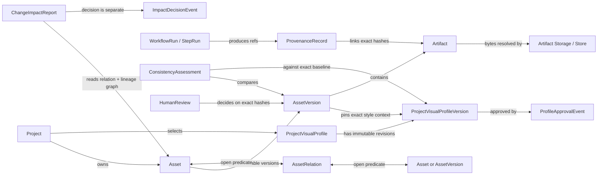
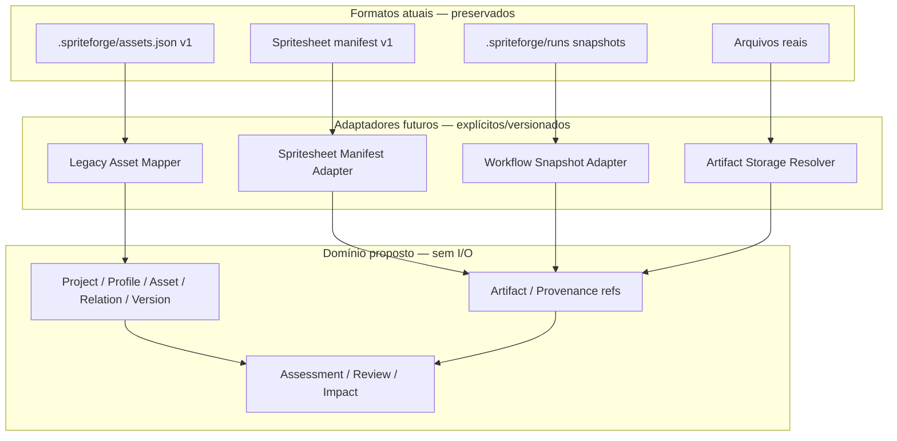

# FASE B — Proposta de evolução dos contratos de domínio

**Tipo:** desenho técnico e análise de compatibilidade
**Implementação:** não autorizada nesta etapa
**Estado:** `PROPOSED` — nada abaixo altera código, store, manifestos ou dados.

Esta proposta parte da [`DOMAIN-CONTRACTS-AUDIT.md`](DOMAIN-CONTRACTS-AUDIT.md) e do protótipo `shared/domain/contracts.mjs`. O objetivo é acrescentar identidade visual, relações, avaliações e análise de impacto sem absorver Workflow Engine, providers ou armazenamento no domínio e sem substituir os contratos especializados existentes.

## 0. Como ler os rótulos

- `EXISTING` — fato constatado no checkout ou contrato documentado; não significa que toda a capacidade tenha sido verificada em runtime.
- `PROPOSED` — desenho recomendado, ainda sujeito a aprovação.
- `REQUIRES_DECISION` — escolha que não deve ser adivinhada por quem implementar.
- `DEFERRED` — deliberadamente fora da implementação de contratos desta fase.

Os documentos-alvo `ASSET-MANAGEMENT.md`, `WORKFLOW-ENGINE.md` e `VISUAL-QA-BENCHMARK.md` são `DOCUMENTED`/`PLANNED`, não contratos runtime já adotados. `shared/domain/contracts.mjs` continua experimental.

## 1. Resumo da recomendação

**`PROPOSED`** — preservar `Project`, `Asset`, `Artifact`, `AssetVersion`, `Provenance` e `ValidationResult` como conceitos centrais, acrescentando records versionados ao lado deles:

1. `ProjectVisualProfile`, snapshots imutáveis `ProjectVisualProfileVersion` e eventos de aprovação;
2. `StylePolicySnapshot` por intenção/execução, separado do perfil;
3. `AssetRelation` com predicados abertos registrados num catálogo versionado;
4. `ConsistencyAssessment` separado de validação estrutural e aprovação humana;
5. `ChangeImpactReport` declarativo, sem geração ou regeneração;
6. adaptadores explícitos entre domínio, arquivos, workflow snapshots e o manifesto de spritesheet.

O perfil versionado é a referência de estilo; `StylePolicySnapshot` diz como uma execução deve usá-lo; Workflow Plan/Adapter registra capacidade reportada; avaliação registra evidência; decisão artística continua humana. Alterar perfil cria uma versão nova e não modifica nem reinterpreta versões antigas dos Assets.

**Resultado esperado:** Codex pode implementar os contratos puros e testes depois da aprovação desta proposta e da única escolha `REQUIRES_DECISION` indicada abaixo. Isso não autoriza conectar subsistemas, alterar Store ou migrar dados.

## 2. Modelo e fronteiras

### 2.1 Diagrama de domínio proposto



`AssetRelation` é uma aresta, não um comando. Seus endpoints podem apontar para Asset lógico ou para versão específica. `AssetVersion.parentVersionIds` continua sendo ancestry entre versões da mesma identidade; `Artifact.parentArtifactIds` continua sendo lineage de arquivos. Relações semânticas não substituem esses campos.

### 2.2 Diagrama de compatibilidade entre camadas



**`EXISTING`** — `.spriteforge/assets.json`, `.spriteforge/runs/` e o manifest do Blender são formatos distintos. O protótipo declara que seu `schemaVersion: 1` não é migration desses formatos.
**`PROPOSED`** — adaptadores validam referências, sem transformar formatos legados em aliases do domínio. O domínio não abre arquivos, não chama providers e não executa workflows.

## 3. Project Visual Profile

### 3.1 Identidade, versões e histórico

**`PROPOSED`** — separar perfil estável de seus snapshots:

- `ProjectVisualProfile` é o cabeçalho do perfil do Project e guarda o ponteiro para a versão aprovada ativa.
- `ProjectVisualProfileVersion` é imutável: revisão, pai, conteúdo, origens e hash. Qualquer edição cria record novo, inclusive quando aguarda aprovação.
- `ProfileApprovalEvent` é append-only. Aprovar, rejeitar ou revogar não reescreve o snapshot nem apaga decisões anteriores.
- `Project.visualProfileId` é opcional. Cada novo `AssetVersion` registra o modo e o perfil exato usados; nunca consulta silenciosamente “a versão atual” depois do início da execução.
- Mudar o perfil ativo pode gerar `ChangeImpactReport`, mas não atualiza versões antigas nem as invalida automaticamente.

### 3.2 Campos e regras

| Record/campo | Obrigatório? | Regra proposta |
|---|---:|---|
| `ProjectVisualProfile.schemaVersion`, `id`, `projectId`, `createdAt`, `updatedAt` | Sim | Versão de schema separada da revisão do perfil; timestamps ISO 8601 com timezone. |
| `activeApprovedVersionId` | Sim, pode ser `null` | `null` sem aprovação válida; caso contrário referencia versão do mesmo perfil e hash coberto por evento humano não revogado. |
| `ProjectVisualProfileVersion.schemaVersion`, `id`, `profileId`, `projectId` | Sim | Pertencem ao perfil e Project indicados. |
| `revision`, `parentVersionId` | Sim | Inteiro positivo; primeira revisão tem pai `null`. V1 usa cadeia linear, sem branches. |
| `createdAt`, `createdBy`, `changeSummary`, `content` | Sim | Snapshot preservado mesmo se rejeitado. `createdBy.kind`: `human`, `agent` ou `system`. |
| `content.artStyle` | Sim | `styleName`, `description`, `substyle` opcional; texto/IDs livres, sem enum global. |
| `content.palette` | Sim | `paletteStatus` `specified`/`unspecified`; `specified` exige `colorSpace` e ≥1 swatch `{id, role, color}`; `unspecified` tem lista vazia. `role` extensível; cor `#RRGGBB`/`#RRGGBBAA`. |
| `content.formLanguage` | Sim | `silhouetteGuidance`, `proportionGuidance`, `anatomyGuidance`; restrições quantitativas têm `measure`, `value`, `unit` e tolerância opcional. |
| `content.surface` | Sim | `materials[]`, `lighting`, `finish`, `detailLevel`; não presume DCC/material específico. |
| `content.cameraAndScale` | Sim | `perspective`, `camera`, `scaleReference`, `viewContinuity[]`; unidades são dados, não dependência de engine. |
| `content.technicalTargets[]` | Sim | Pode ser vazio; cada alvo tem ID aberto, constraints com unidade/prioridade e escopo opcional. Se `appliesToAssetTypeIds` existir, não pode ser vazio; ausente significa alvo geral. Não presume que todo Asset seja sprite 2D. |
| `content.visualReferences[]` | Sim | IDs de Artifact + SHA-256 + papel/descrição. Referência só está aprovada quando evento válido cobre a versão e hash exatos. |
| `traitOrigins[]` | Sim | Origem para cada campo característico preenchido; `traitPath` é JSON Pointer relativo a `content`. |
| `contentSha256` | Sim | Hash do payload canônico `{content, traitOrigins}`; não inclui IDs, timestamps ou aprovação. |
| `ProfileApprovalEvent` | Record separado | `schemaVersion`, `id`, `profileId`, `profileVersionId`, hash, `decision`, `actor`, `decidedAt`, `reason`; `revokesEventId` obrigatório apenas em `revoked`. Append-only; ator humano decide. |

### 3.3 Exemplo JSON ilustrativo

O digest abaixo é fixture estrutural, não um hash calculado para este conteúdo.

```json
{
  "schemaVersion": 1,
  "id": "profile-version-game-01-r4",
  "profileId": "visual-profile-game-01",
  "projectId": "game-01",
  "revision": 4,
  "parentVersionId": "profile-version-game-01-r3",
  "createdAt": "2026-10-25T16:20:00Z",
  "createdBy": { "kind": "human", "id": "local-user" },
  "changeSummary": "Ajustar paleta e escala das vistas; preservar silhueta aprovada.",
  "contentSha256": "aaaaaaaaaaaaaaaaaaaaaaaaaaaaaaaaaaaaaaaaaaaaaaaaaaaaaaaaaaaaaaaa",
  "content": {
    "artStyle": {
      "styleName": "stylized hand-painted",
      "substyle": "warm low-fantasy",
      "description": "Formas legíveis, contornos suaves e textura pintada sem ruído fino."
    },
    "palette": {
      "paletteStatus": "specified",
      "colorSpace": "sRGB",
      "swatches": [
        { "id": "primary", "role": "main cloth", "color": "#486B55" },
        { "id": "accent", "role": "small warm accents", "color": "#C77B45" }
      ],
      "guidance": ["Reservar a cor de acento para áreas pequenas."]
    },
    "formLanguage": {
      "silhouetteGuidance": ["Silhueta reconhecível em tamanho de ícone."],
      "proportionGuidance": [
        { "subject": "humanoid", "measure": "head-height/body-height", "value": 7.5, "tolerance": 0.5, "unit": "head-units" }
      ],
      "anatomyGuidance": ["Mãos e pés estilizados; articulações permanecem legíveis."]
    },
    "surface": {
      "materials": [
        { "id": "cloth", "guidance": "tecido fosco com dobra ampla" },
        { "id": "metal", "guidance": "metal gasto, sem brilho espelhado" }
      ],
      "lighting": { "guidance": "key light ampla, sombras suaves e leitura consistente entre vistas" },
      "finish": "painterly, sem contorno fotográfico",
      "detailLevel": "silhueta primeiro; detalhe fino subordinado à resolução alvo"
    },
    "cameraAndScale": {
      "perspective": { "projection": "orthographic", "guidance": "sem convergência perceptível entre vistas" },
      "camera": { "guidance": "enquadramento fixo; frente, lado e costas alinhados" },
      "scaleReference": { "subject": "humanoid", "value": 1.8, "unit": "m" },
      "viewContinuity": ["mesma escala", "mesma altura de câmera", "mesma iluminação principal"]
    },
    "technicalTargets": [
      {
        "id": "sprite.character.base",
        "appliesToAssetTypeIds": ["character"],
        "constraints": [
          { "id": "frame.width", "operator": "equals", "value": 48, "unit": "px", "priority": "required" },
          { "id": "frame.height", "operator": "equals", "value": 48, "unit": "px", "priority": "required" },
          { "id": "alpha", "operator": "required", "value": true, "priority": "preferred" }
        ]
      },
      {
        "id": "texture.default",
        "constraints": [
          { "id": "texture.max_dimension", "operator": "at_most", "value": 2048, "unit": "px", "priority": "preferred" }
        ]
      }
    ],
    "visualReferences": [
      {
        "artifactId": "artifact-turnaround-01",
        "artifactSha256": "bbbbbbbbbbbbbbbbbbbbbbbbbbbbbbbbbbbbbbbbbbbbbbbbbbbbbbbbbbbbbbbb",
        "role": "approved-turnaround",
        "description": "Referência aprovada de forma e proporção."
      }
    ]
  },
  "traitOrigins": [
    { "traitPath": "/artStyle", "contributions": [{ "kind": "manual", "actorId": "local-user" }] },
    {
      "traitPath": "/palette",
      "contributions": [
        { "kind": "imported_reference", "sourceArtifactId": "artifact-turnaround-01", "sourceArtifactSha256": "bbbbbbbbbbbbbbbbbbbbbbbbbbbbbbbbbbbbbbbbbbbbbbbbbbbbbbbbbbbbbbbb" }
      ]
    },
    { "traitPath": "/formLanguage/silhouetteGuidance", "contributions": [{ "kind": "manual", "actorId": "local-user" }] },
    {
      "traitPath": "/formLanguage/proportionGuidance/0",
      "contributions": [{ "kind": "ai_proposal", "proposalId": "proposal-proportions-42", "sourceArtifactIds": ["artifact-turnaround-01"] }]
    },
    { "traitPath": "/formLanguage/anatomyGuidance", "contributions": [{ "kind": "manual", "actorId": "local-user" }] },
    { "traitPath": "/surface", "contributions": [{ "kind": "manual", "actorId": "local-user" }] },
    { "traitPath": "/cameraAndScale", "contributions": [{ "kind": "manual", "actorId": "local-user" }] },
    { "traitPath": "/technicalTargets/0", "contributions": [{ "kind": "manual", "actorId": "local-user" }] },
    { "traitPath": "/technicalTargets/1", "contributions": [{ "kind": "manual", "actorId": "local-user" }] },
    {
      "traitPath": "/visualReferences/0",
      "contributions": [
        { "kind": "imported_reference", "sourceArtifactId": "artifact-turnaround-01", "sourceArtifactSha256": "bbbbbbbbbbbbbbbbbbbbbbbbbbbbbbbbbbbbbbbbbbbbbbbbbbbbbbbbbbbbbbbb" }
      ]
    }
  ]
}
```

A aprovação é um record separado:

```json
{
  "schemaVersion": 1,
  "id": "profile-approval-04",
  "profileId": "visual-profile-game-01",
  "profileVersionId": "profile-version-game-01-r4",
  "contentSha256": "aaaaaaaaaaaaaaaaaaaaaaaaaaaaaaaaaaaaaaaaaaaaaaaaaaaaaaaaaaaaaaaa",
  "decision": "approved",
  "actor": { "kind": "human", "id": "local-user" },
  "decidedAt": "2026-10-25T16:45:00Z",
  "reason": "Aprovo esta versão como a identidade visual ativa do projeto."
}
```

### 3.4 Origem, aprovação e evolução

- **`PROPOSED`** — `traitPath` é JSON Pointer relativo a `content` e precisa existir. Cada característica não vazia tem uma ou mais contribuições.
- **`PROPOSED`** — `manual` exige `actorId`; `imported_reference` exige `sourceArtifactId` e hash; `ai_proposal` exige `proposalId` e pode referenciar inputs. Origem de IA nunca aprova.
- **`PROPOSED`** — referência aprovada é coberta pela aprovação humana do snapshot que contém seus IDs/hashes. Bytes alterados significam novo hash e nova revisão/aprovação.
- **`PROPOSED`** — revisão aprovada nunca é editada no lugar. Nova mudança cria filho com novo `revision` e `parentVersionId`. `decision` aceita `approved`, `rejected`, `revoked`; revogação referencia aprovação anterior da mesma versão.
- **`PROPOSED`** — só ação explícita do usuário move `activeApprovedVersionId`. Revogar a versão ativa define o ponteiro como `null`; nenhuma versão antiga é reativada silenciosamente.
- **`PROPOSED`** — canonicalização `lia-json-canonical-v1`: ordenar chaves de objetos por sequência de pontos de código Unicode ascendente (comparação numérica, sem locale); preservar ordem de arrays; JSON compacto sem whitespace; strings e números finitos serializados pela semântica ECMAScript `JSON.stringify` (`-0` vira `0`), sem normalização Unicode; rejeitar `undefined`, não finitos, arrays esparsos e surrogate não pareado. SHA-256 dos bytes UTF-8. Payload exatamente `{content, traitOrigins}`; excluir IDs, timestamps, aprovação e hash próprio. Fixtures fixam bytes e digest.
- **`PROPOSED`** — `ActorRef` é `{kind, id}`. No app local single-user, `{kind:"human", id:"local-user"}` identifica a ação nesta instalação, sem afirmar autenticação ou identidade civil. Multiusuário requer contrato próprio.
- **`PROPOSED`** — V1 permite exatamente um `ProjectVisualProfile` global por Project, com versões históricas; perfis scoped por coleção/asset type/bioma e herança ficam `DEFERRED`.
- **`PROPOSED`** — legado sem perfil permanece `null`/`unknown`; não inferir perfil aprovado a partir de prompt, imagem ou histórico.

## 4. Style Lock

### 4.1 Contrato e semântica

**`PROPOSED`** — `StylePolicySnapshot` é um value object de domínio copiado no `WorkflowPlan` aprovado e no `WorkflowRun` imutável. A instância da execução pertence ao plano/run, não ao provider nem a uma nova categoria de Asset. Um `AssetVersion` registra a referência exata usada.

| `mode` | Perfil | Comportamento | Gate de capacidade |
|---|---|---|---|
| `Free` | Opcional; se houver é contexto | Não exige correspondência; registrar que a execução foi livre; não rotular como consistente. | Sem claim de style-lock. Gates gerais continuam valendo. |
| `Guided` | Obrigatório: versão aprovada exata. Sem perfil, escolher `Free` ou criar/aprovar perfil antes. | Orienta a execução; divergências permitidas, expostas como limitações/avaliação. | `partial`/`unknown` não bloqueia por si; limitações visíveis, sem promessa de aderência. |
| `Locked` | Obrigatório: versão aprovada exata | Restringe execução aos traits selecionados. Alterar baseline requer nova versão aprovada. Output ainda exige avaliação/revisão. | Exige claim de suporte para cada trait selecionado. `unknown`, `unsupported` ou `partial` bloqueia. `supported` é claim, não garantia. |

`requestedTraitPaths` indica quais partes do perfil o modo aplica. Mesmo em `Locked`, capability declarada não prova qualidade ou consistência visual.

### 4.2 Snapshot e capability check

Campos obrigatórios: `schemaVersion`, `mode`, `profileRef`, `requestedTraitPaths`. `profileRef` é `null` somente em `Free`; paths vazios em `Free`, não vazios em `Guided`/`Locked`. A ref pinna profile ID, version ID e hash — nunca só o ponteiro ativo.

```json
{
  "schemaVersion": 1,
  "mode": "Locked",
  "profileRef": {
    "profileId": "visual-profile-game-01",
    "profileVersionId": "profile-version-game-01-r4",
    "contentSha256": "aaaaaaaaaaaaaaaaaaaaaaaaaaaaaaaaaaaaaaaaaaaaaaaaaaaaaaaaaaaaaaaa"
  },
  "requestedTraitPaths": ["/artStyle", "/palette", "/formLanguage/silhouetteGuidance", "/cameraAndScale/viewContinuity"]
}
```

A checagem pertence ao plano/run, não ao snapshot nem ao domínio:

```json
{
  "adapterRef": { "id": "adapter-id", "version": "reported-version-or-unknown" },
  "checkedAt": "2026-10-25T17:00:00Z",
  "claims": [
    { "traitPath": "/palette", "status": "supported", "limitations": [] },
    { "traitPath": "/cameraAndScale/viewContinuity", "status": "unknown", "limitations": ["Capability não reportada."] }
  ],
  "decision": "blocked"
}
```

`claims.status`: `supported`, `partial`, `unsupported`, `unknown`. Isso não enumera providers. Workflow registra o adapter/versão reportado; o domínio guarda intenção e perfil.

### 4.3 Mudança do baseline e desvios

- **`PROPOSED`** — mudar estilo-base: criar `ProjectVisualProfileVersion` derivada, registrar origem/resumo, obter aprovação humana e só então mover o ponteiro ativo. Impacto nos Assets é relatado, não aplicado.
- **`PROPOSED`** — `StyleDeviationDecision` aceita/rejeita um desvio pontual pós-output, para uma `AssetVersion` candidata e evidências exatas. Não aprova a versão inteira, não altera profile, avaliação ou capability report. Não contorna preflight bloqueado de `Locked`; desvio conhecido antes da execução exige nova versão de perfil ou novo plano `Guided`.
- **`PROPOSED`** — alterar provider, inputs, traits, referência, perfil ou destino que mude o plano invalida a aprovação daquele plano e exige nova revisão antes do efeito externo.

Shape obrigatório de `StyleDeviationDecision`: `schemaVersion`, `id`, `workflowRunId`, `assetId`, `assetVersionId`, `profileRef`, `affectedTraitPaths`, `evidenceRefs` não vazias, `reason`, `requestedBy`, `requestedAt`, `decisionState`. A versão pertence ao Asset/Run; hashes da evidência correspondem aos artifacts vistos. `decisionState`: `pending`, `approved`, `rejected`. Decisão final também exige `decidedBy`, `decidedAt`, `decisionReason`, por ator humano. Essa exceção não substitui `HumanReview` nem atualiza `Asset.currentVersionId`.

```json
{
  "schemaVersion": 1,
  "id": "style-deviation-hero-run-88",
  "workflowRunId": "123e4567-e89b-42d3-a456-426614174000",
  "assetId": "hero-01",
  "assetVersionId": "hero-variant-v1",
  "profileRef": {
    "profileId": "visual-profile-game-01",
    "profileVersionId": "profile-version-game-01-r4",
    "contentSha256": "aaaaaaaaaaaaaaaaaaaaaaaaaaaaaaaaaaaaaaaaaaaaaaaaaaaaaaaaaaaaaaaa"
  },
  "affectedTraitPaths": ["/palette"],
  "reason": "A variação sazonal usa um acento diferente sem mudar o perfil global.",
  "requestedBy": { "kind": "human", "id": "local-user" },
  "requestedAt": "2026-10-25T18:30:00Z",
  "evidenceRefs": [
    { "artifactId": "hero-variant-atlas-v1", "sha256": "eeeeeeeeeeeeeeeeeeeeeeeeeeeeeeeeeeeeeeeeeeeeeeeeeeeeeeeeeeeeeeee" }
  ],
  "decisionState": "approved",
  "decidedBy": { "kind": "human", "id": "local-user" },
  "decidedAt": "2026-10-25T18:45:00Z",
  "decisionReason": "Aprovo apenas para esta versão/execução."
}
```

**`PROPOSED`** — trait `partial`, `unknown` ou `unsupported` bloqueia `Locked` enquanto listado em `requestedTraitPaths`. Usuário pode removê-lo/reduzir escopo, criar novo snapshot e repetir a checagem; é novo escopo Locked, não exceção silenciosa. Sem subset totalmente suportado, mudar para Guided. Default: sem perfil aprovado, `Free`; com perfil aprovado, UI pode pré-selecionar `Guided`; `Locked` nunca é default implícito.

## 5. Asset Identity & Relationships

### 5.1 Asset e versões

**`EXISTING`** — protótipo já tem `Asset.id`, `projectId`, `assetTypeId`, `currentVersionId`; `AssetVersion` tem `assetId`, `parentVersionIds`, `artifactIds`.

**`PROPOSED`** — Asset é identidade lógica estável; nome/type/subtype podem evoluir sem renomear ID. `AssetVersion` é snapshot imutável candidato, sem status mutável embutido. `HumanReview` registra a decisão; somente `approve` aplicável aos hashes exatos pode mover `Asset.currentVersionId`. `reject`/`iterate` deixam o ponteiro anterior intacto. Candidatas antigas/rejeitadas permanecem preservadas. WorkflowRun não é AssetVersion: pode falhar, produzir outputs parciais ou mais de uma candidata.

```json
{
  "schemaVersion": 1,
  "id": "hero-v3",
  "assetId": "hero-01",
  "createdAt": "2026-10-25T17:05:00Z",
  "parentVersionIds": ["hero-v2"],
  "artifactIds": ["hero-atlas-v3", "hero-manifest-v3"],
  "provenanceIds": ["provenance-run-88"],
  "styleContext": {
    "mode": "Locked",
    "profileRef": {
      "profileId": "visual-profile-game-01",
      "profileVersionId": "profile-version-game-01-r4",
      "contentSha256": "aaaaaaaaaaaaaaaaaaaaaaaaaaaaaaaaaaaaaaaaaaaaaaaaaaaaaaaaaaaaaaaa"
    },
    "requestedTraitPaths": ["/artStyle", "/palette", "/formLanguage/silhouetteGuidance"]
  }
}
```

Campo `styleContext` é proposto; ausente em legado significa `unknown`, não `Free`. `HumanReview` referencia a versão e hashes; não se mantém lista mutável `reviewIds` dentro do snapshot.

### 5.2 Predicados extensíveis

**`PROPOSED`** — `RelationPredicateDefinition` versionado descreve semântica; `AssetRelation` instancia aresta. `predicateRef.id` é string estável namespaced, não enum central. Tipos `rig`, `palette`, `clothing`, `vegetation`, `architecture`, `prop`, `animation` são IDs de `AssetType` extensíveis.

Campos de relação: `schemaVersion`, `id`, `projectId`, `from.assetId`, `to.assetId`, `predicateRef.id/version`, `createdAt`, `createdBy`; `assetVersionId` em endpoint é opcional e deve pertencer ao Asset; `evidenceRefs[]`, `metadata` opcionais; `archivedAt`/`archiveReason` opcionais para archive sem cascade.

Exemplos de predicados de catálogo, não built-ins obrigatórios: `game.character.wears`, `game.character.uses_weapon`, `game.animation.animates`, `game.scene.contains`, `game.scene.contains_architecture`, `game.scene.contains_vegetation`, `game.scene.contains_prop`, `game.asset.variant_of`, `game.asset.derived_from`, `game.asset.uses_rig`, `game.asset.uses_palette`, `game.asset.uses_material`, `game.asset.uses_reference`.

Um personagem e uma criatura podem apontar para o mesmo Asset de rig; ambos podem compartilhar Asset de paleta/material. Uma cena pode conter assets de arquitetura, vegetação e props sem categoria global fixa.

Descriptor ilustrativo de `uses_rig`; changes no endpoint `rig` propagam impacto para o Asset que o usa:

```json
{
  "schemaVersion": 1,
  "id": "game.asset.uses_rig",
  "version": "1",
  "directed": true,
  "symmetric": false,
  "acyclic": false,
  "sourceAssetTypeIds": ["character", "creature"],
  "targetAssetTypeIds": ["rig"],
  "impactPropagation": "from_target_to_source"
}
```

```json
[
  {
    "schemaVersion": 1,
    "id": "relation-hero-coat",
    "projectId": "game-01",
    "from": { "assetId": "hero-01" },
    "predicateRef": { "id": "game.character.wears", "version": "1" },
    "to": { "assetId": "coat-01" },
    "createdAt": "2026-10-25T17:10:00Z",
    "createdBy": { "kind": "human", "id": "local-user" },
    "evidenceRefs": []
  },
  {
    "schemaVersion": 1,
    "id": "relation-forest-hut",
    "projectId": "game-01",
    "from": { "assetId": "forest-scene-01" },
    "predicateRef": { "id": "game.scene.contains_architecture", "version": "1" },
    "to": { "assetId": "hut-01" },
    "createdAt": "2026-10-25T17:11:00Z",
    "createdBy": { "kind": "human", "id": "local-user" },
    "evidenceRefs": []
  },
  {
    "schemaVersion": 1,
    "id": "relation-hero-rig",
    "projectId": "game-01",
    "from": { "assetId": "hero-01", "assetVersionId": "hero-v3" },
    "predicateRef": { "id": "game.asset.uses_rig", "version": "1" },
    "to": { "assetId": "shared-humanoid-rig-01" },
    "createdAt": "2026-10-25T17:12:00Z",
    "createdBy": { "kind": "human", "id": "local-user" },
    "evidenceRefs": []
  }
]
```

Relação de variante entre identidades diferentes:

```json
{
  "schemaVersion": 1,
  "id": "relation-sword-variant",
  "projectId": "game-01",
  "from": { "assetId": "sword-ornate-01" },
  "predicateRef": { "id": "game.asset.variant_of", "version": "1" },
  "to": { "assetId": "sword-base-01" },
  "createdAt": "2026-10-25T17:13:00Z",
  "createdBy": { "kind": "human", "id": "local-user" },
  "evidenceRefs": []
}
```

### 5.3 Regras de integridade do grafo

`RelationPredicateDefinition` inclui `version`, `directed`, `symmetric`, `acyclic`, `sourceAssetTypeIds`, `targetAssetTypeIds`, `impactPropagation` (`none`, `from_source_to_target`, `from_target_to_source`, `both`). `symmetric:true` exige `directed:false`; `acyclic` aplica somente ao predicado. Lista vazia de endpoint types significa “sem restrição declarada”, não validação universal. A relação ativa pina a versão do descritor.

- Relações novas só ficam ativas se endpoints existirem no mesmo Project, forem compatíveis e a definição estiver resolvida.
- `AssetVersion.parentVersionIds` e `Artifact.parentArtifactIds` sempre acíclicos. Outros ciclos são proibidos apenas quando o descriptor daquele predicado diz `acyclic:true`.
- Predicado desconhecido pode ser preservado como `unclassified` na leitura/importação, mas não participa do impacto nem autoriza comportamento. Endpoint legado inválido é diagnosticado/quarentenado, nunca apagado silenciosamente.
- V1 não suporta relações cross-project; referência externa é Artifact/Provenance explícito. Cross-project fica `DEFERRED`.
- Exclusão não é cascade: Asset relacionado não apaga endpoints, versões, Artifacts nem arquivos. Preferir archive; unlink/backup exige Change Impact e escolha explícita.
- Implementação de hard delete e prazo de retention ficam `DEFERRED`; v1 modela archive e preserva relações.

## 6. Consistency Analysis e revisão humana

### 6.1 Separar tipos de evidência

**`EXISTING`** — `ValidationResult` registra validator e artifact/hash; validator de PNG/manifest verifica estrutura, não qualidade visual.

**`PROPOSED`** — acrescentar `ConsistencyAssessment`, sem renomear/expandir `ValidationResult` como se fosse análise de estilo. Catálogo aberto de dimensões iniciais:

| `assessmentKind` | Exemplos de dimension IDs | Evidência esperada |
|---|---|---|
| `visual` | `visual.style`, `visual.palette`, `visual.silhouette`, `visual.proportions`, `visual.materials`, `visual.view_continuity` | Perfil/referências e hashes; captura autorizada; método manual/heurístico e limitações declarados. |
| `technical` | `technical.scale`, `technical.rig_skeleton`, `technical.texture_resolution`, `technical.camera`, `technical.export_compatibility` | Medição declarada por validator/tool, versão/target, artifact real, unidade e método do check. |

IDs são strings de `AssessmentDimensionCatalog`, não enum fechado. Evaluator declara somente o que mediu; `unknown` não é `pass`.

### 6.2 Contrato e regra de resultado

`ConsistencyAssessment` requer `schemaVersion`, `id`, `projectId`, `assessmentKind`, `subjectRefs` com IDs/hashes, `baselineRef`, `evaluatorRef` com versão, `evaluationState`, `limitations`. Quando há dimensões, `dimensionCatalogRef {id, version}` é obrigatório para fixar a semântica dos IDs. `dimensions` é obrigatório após `not_run`; `evaluatedAt` é obrigatório se houve execução. Cada dimensão tem `dimensionId`, `status`, `findings[]`; finding tem resumo/evidências. `severity`, `expected`, `observed`, `confidence` são opcionais; confidence exige método declarado.

Estados: `not_run`, `running`, `completed`, `inconclusive`, `blocked`, `failed`. Status de dimensão: `pass`, `issue`, `unknown`, `not_applicable`. `HumanReview.decision`: `approve`, `reject`, `iterate`.

1. Subject/evidência referencia Artifact e SHA-256 exatos; Store confirma bytes.
2. Avaliação visual declara `profileVersionId` ou baseline `none` com razão explícita; técnica declara versão de target técnico ou `unknown`.
3. `completed` exige evaluator/version, horário, dimensões medidas e limitações. Sem evaluator, `not_run`/`blocked`, nunca score.
4. `pass` somente se dimensões requeridas são `pass` ou `not_applicable`; `issue`/`unknown` impede conclusão positiva. Sem média que esconda falha.
5. Avaliação `pass` não aprova pelo usuário. `HumanReview` fixa artifact/profile hashes, reviewer, contexto/escala, checklist, decisão, razão e data. Mudança de bytes/perfil torna revisão inaplicável ao novo snapshot.
6. Métrica exige unidade, método e versão. Validar PNG não infere qualidade visual nem existe evaluator visual implementado nesta proposta.

Avaliação visual manual inconclusiva (ilustrativa):

```json
{
  "schemaVersion": 1,
  "id": "assessment-visual-hero-v3",
  "projectId": "game-01",
  "assessmentKind": "visual",
  "dimensionCatalogRef": { "id": "core-assessment-dimensions", "version": "1" },
  "subjectRefs": [
    {
      "assetId": "hero-01",
      "assetVersionId": "hero-v3",
      "artifactRefs": [{ "artifactId": "hero-atlas-v3", "sha256": "cccccccccccccccccccccccccccccccccccccccccccccccccccccccccccccccc" }]
    }
  ],
  "baselineRef": {
    "kind": "project_visual_profile",
    "profileId": "visual-profile-game-01",
    "profileVersionId": "profile-version-game-01-r4",
    "contentSha256": "aaaaaaaaaaaaaaaaaaaaaaaaaaaaaaaaaaaaaaaaaaaaaaaaaaaaaaaaaaaaaaaa"
  },
  "evaluatorRef": { "id": "manual-review-protocol", "version": "1", "kind": "human" },
  "evaluationState": "inconclusive",
  "dimensions": [
    {
      "dimensionId": "visual.palette",
      "status": "unknown",
      "findings": [{ "summary": "Não foi possível confirmar as cores em escala nativa.", "evidenceRefs": [] }]
    },
    {
      "dimensionId": "visual.silhouette",
      "status": "issue",
      "findings": [
        { "summary": "A silhueta do frame lateral diverge da referência aprovada.", "evidenceRefs": [{ "artifactId": "review-capture-01", "sha256": "ffffffffffffffffffffffffffffffffffffffffffffffffffffffffffffffff" }] }
      ]
    },
    { "dimensionId": "visual.view_continuity", "status": "pass", "findings": [] }
  ],
  "limitations": ["Nenhuma comparação automatizada foi executada; revisão manual parcial."],
  "evaluatedAt": "2026-10-25T18:00:00Z"
}
```

Resultado técnico estrutural ilustrativo — um `pass` cobre somente a dimensão registrada:

```json
{
  "schemaVersion": 1,
  "id": "assessment-technical-hero-v3",
  "projectId": "game-01",
  "assessmentKind": "technical",
  "dimensionCatalogRef": { "id": "core-assessment-dimensions", "version": "1" },
  "subjectRefs": [
    {
      "assetId": "hero-01",
      "assetVersionId": "hero-v3",
      "artifactRefs": [{ "artifactId": "hero-manifest-v3", "sha256": "bbbbbbbbbbbbbbbbbbbbbbbbbbbbbbbbbbbbbbbbbbbbbbbbbbbbbbbbbbbbbbbb" }]
    }
  ],
  "baselineRef": {
    "kind": "technical_target",
    "profileId": "visual-profile-game-01",
    "profileVersionId": "profile-version-game-01-r4",
    "contentSha256": "aaaaaaaaaaaaaaaaaaaaaaaaaaaaaaaaaaaaaaaaaaaaaaaaaaaaaaaaaaaaaaaa",
    "targetId": "sprite.character.base"
  },
  "evaluatorRef": { "id": "illustrative-manifest-validator", "version": "example-1", "kind": "automated" },
  "evaluationState": "completed",
  "dimensions": [
    {
      "dimensionId": "technical.export_compatibility",
      "status": "pass",
      "findings": [
        {
          "summary": "O manifesto cumpre a grade v1 e referencia PNG RGBA8 com dimensões declaradas.",
          "evidenceRefs": [
            { "artifactId": "hero-manifest-v3", "sha256": "bbbbbbbbbbbbbbbbbbbbbbbbbbbbbbbbbbbbbbbbbbbbbbbbbbbbbbbbbbbbbbbb" },
            { "artifactId": "hero-atlas-v3", "sha256": "cccccccccccccccccccccccccccccccccccccccccccccccccccccccccccccccc" }
          ]
        }
      ]
    }
  ],
  "limitations": ["Não avaliou rig/skeleton, câmera no jogo, transparência efetiva nem qualidade visual."],
  "evaluatedAt": "2026-10-25T18:05:00Z"
}
```

`HumanReview` é record explícito preso aos hashes vistos; exemplo de decisão `iterate`:

```json
{
  "schemaVersion": 1,
  "id": "human-review-hero-v3-01",
  "projectId": "game-01",
  "assessmentIds": ["assessment-visual-hero-v3", "assessment-technical-hero-v3"],
  "subjectRefs": [
    {
      "assetId": "hero-01",
      "assetVersionId": "hero-v3",
      "artifactRefs": [{ "artifactId": "hero-atlas-v3", "sha256": "cccccccccccccccccccccccccccccccccccccccccccccccccccccccccccccccc" }]
    }
  ],
  "profileRef": {
    "profileId": "visual-profile-game-01",
    "profileVersionId": "profile-version-game-01-r4",
    "contentSha256": "aaaaaaaaaaaaaaaaaaaaaaaaaaaaaaaaaaaaaaaaaaaaaaaaaaaaaaaaaaaaaaaa"
  },
  "reviewer": { "kind": "human", "id": "local-user" },
  "reviewedAt": "2026-10-25T18:20:00Z",
  "decision": "iterate",
  "rationale": "A silhueta lateral ainda precisa de ajuste antes da entrega.",
  "checklist": [
    { "dimensionId": "visual.silhouette", "status": "issue", "comment": "A vista lateral ficou estreita." },
    { "dimensionId": "visual.palette", "status": "pass", "comment": "Legível em escala nativa." }
  ],
  "reviewContext": { "displayScale": "1x", "targetContext": "inventário do jogo" },
  "evidenceRefs": [{ "artifactId": "review-capture-01", "sha256": "ffffffffffffffffffffffffffffffffffffffffffffffffffffffffffffffff" }],
  "limitations": ["Revisão feita no atlas; não inspecionou deformação do rig."]
}
```

**`PROPOSED`** — HumanReview requer reviewer humano, horário, decisão, razão, contexto, checklist e limitações; captures são opcionais, mas quando armazenadas são Artifact refs autorizadas com hash. Assessment ou deviation approval não substituem esta decisão nem atualizam `currentVersionId`.

## 7. Change Impact Analysis

### 7.1 Propósito e comportamento

**`PROPOSED`** — `ChangeImpactReport` calcula o que pode exigir revalidação/revisão após mudança. Não executa workflow, não muda ponteiros, não altera aprovação, não apaga Artifacts e não inicia/regenera Assets. Percorre apenas relações/lineage com descritores e versões conhecidos; predicado desconhecido limita resultado a `unknown`/não atravessado.

### 7.2 Campos, estados e decisões

- `trigger`: record alterado e refs anterior/nova (profile version/hash, AssetVersion/hash ou relação).
- `affected[]`: entry ID, Asset/version/Artifact refs, `impactLevel` (`low`, `medium`, `high`, `unknown`), `reviewNeed` (`none_indicated`, `recommended`, `required`, `unknown`), razões e caminho causal.
- `analyzerRef`, `createdAt`, `limitations[]` obrigatórios.
- `analysisState`: `computed`, `inconclusive`, `stale`. Stale se grafo, trigger, perfil ou refs mudarem; recomputar cria report novo.
- `decisionState` é projeção derivada: `awaiting_user_decision`, `partially_decided`, `decided`. Entry projeta `pending`, `review`, `defer` ou `dismiss` do último evento válido.
- `ImpactDecisionEvent` é record append-only separado com `schemaVersion`, `id`, `reportId`, `entryId`, `decision`, ator humano, data e razão. `review` sinaliza revisão, não produção; `dismiss` não apaga evidência. Evento não altera snapshot do report.

```json
{
  "schemaVersion": 1,
  "id": "impact-profile-r4-to-r5",
  "projectId": "game-01",
  "trigger": {
    "recordType": "ProjectVisualProfileVersion",
    "fromRef": { "id": "profile-version-game-01-r4", "contentSha256": "aaaaaaaaaaaaaaaaaaaaaaaaaaaaaaaaaaaaaaaaaaaaaaaaaaaaaaaaaaaaaaaa" },
    "toRef": { "id": "profile-version-game-01-r5", "contentSha256": "dddddddddddddddddddddddddddddddddddddddddddddddddddddddddddddddd" }
  },
  "analyzerRef": { "id": "relation-lineage-impact", "version": "1" },
  "analysisState": "computed",
  "decisionState": "awaiting_user_decision",
  "createdAt": "2026-10-25T18:10:00Z",
  "affected": [
    {
      "id": "impact-hero-v3",
      "assetRef": { "assetId": "hero-01", "assetVersionId": "hero-v3" },
      "impactLevel": "high",
      "reviewNeed": "required",
      "reasons": [
        {
          "dimensionIds": ["visual.palette", "visual.silhouette"],
          "relationPath": [{ "relationId": "hero-uses-style-board", "predicateId": "game.asset.uses_reference", "predicateVersion": "1" }],
          "summary": "Versão criada com revisão anterior do perfil e usa a referência afetada."
        }
      ],
      "decisionState": "pending"
    }
  ],
  "limitations": ["O analyzer percorreu predicados registrados; não avaliou pixels nem conteúdo semântico."]
}
```

Evento de decisão independente:

```json
{
  "schemaVersion": 1,
  "id": "impact-decision-hero-v3-01",
  "reportId": "impact-profile-r4-to-r5",
  "entryId": "impact-hero-v3",
  "decision": "review",
  "actor": { "kind": "human", "id": "local-user" },
  "decidedAt": "2026-10-25T18:15:00Z",
  "reason": "Revisar manualmente a silhueta antes de nova entrega."
}
```

**`PROPOSED`** — mudança de perfil aprovada afeta versões/execuções futuras por padrão; Assets relacionados entram no relatório, escolha de revisar é do usuário. Novo output é outra `WorkflowPlan` sujeita aos gates existentes, nunca efeito automático do report.

## 8. Compatibilidade explícita

### 8.1 Mapeamento de formatos atuais

| Origem atual | Destino proposto | Preservação / decisão |
|---|---|---|
| `shared/domain/contracts.mjs`, `DOMAIN_SCHEMA_VERSION=1` | Base experimental mantida; novos records recebem validators e schemaVersion próprios. | Schema de record, revisão do perfil, evaluator e workflow schema são independentes. |
| `Project` (`id`, `rootPolicy`, timestamps, `engine`, `targets`) | Mantém identidade/config; adiciona `visualProfileId` opcional. | `rootPolicy` permanece store/policy, não identidade visual. |
| `.spriteforge/assets.json` envelope v1 | Fica no lugar; `LegacyAssetMapper` fornece DTO/domain view read-only primeiro. | Não migrar, escrever, renomear ou apagar nesta proposta. Arquivo não tem Project record persistido. |
| Asset legado `id`, `type`, `itemKind`, `name`, `brief` | ID preservado; type só mapeia IDs conhecidos `character`/`item`; `itemKind` subtype; name/brief mantidos. | Tipo desconhecido não vira `item` ou `character`; `projectId` não deriva de path/nome. |
| `prompt`, `workflowId`, `animations`, `target` | Permanecem intenção/parâmetros no contexto de workflow/proveniência. | Prompt não prova aprovação nem origem manual de trait. Secrets/redaction seguem política própria. |
| `startStageIndex`, `entryPointId`, `existingInputs`, `stageStatus`, `completed` | Permanecem legacy/handoff ou são traduzidos somente com evidência por Workflow Snapshot Adapter. | `completed` não vira AssetVersion aprovada; não inventar predecessor concluído. |
| `outputPath`, outputs e paths de referência | Artifact Storage Resolver confirma raiz, existência, tamanho e hash antes de criar Artifact/ref. | Validator puro não abre filesystem; path ausente/externo fica bloqueado/quarentenado, não inventado. |
| `AssetVersion` experimental | Continua snapshot com `artifactIds`; acrescenta `styleContext` opcional para novas versões. | Legado sem evidência fica unknown; não usar perfil atual retroativamente nem inferir grafo pelo filename/status. |
| `Artifact` e Artifact Storage | Artifact guarda metadata; Store/Resolver confirma bytes, URI autorizada, hash, tamanho, path/symlink e integridade. | Validator puro confere apenas shape/ref sintática. Hash divergente bloqueia uso. |
| `Provenance` e `WorkflowRun` | Provenance referencia Artifact IDs+hashes e transformation com workflow/run/step, adapter/provider/model version reportados e redigidos. | Licença/consent são records próprios; WorkflowRun continua pertencendo ao Workflow Engine. |
| `electron/spritesheet-manifest.cjs`, `scripts/blender_spritesheet.py`, manifest v1 | PNG e JSON são Artifacts separados; JSON segue `validateSpritesheetManifest`. | Não mudar schemaVersion 1, grid, frames, pivôs, `assetType:character|item` nesta proposta. Tipo sem mapping conhecido fica BLOCKED. |
| workflow contracts, Blender plan, runner, `.spriteforge/runs/` v2 | WorkflowDefinition/Plan/Run/StepRun seguem independentes; output aponta para run/step quando mapper resolve vínculo. | Preservar snapshots/runner. Run não é AssetVersion; não inferir DAG geral de lista ordenada. |
| Adapter/provider | Recebe refs/StylePolicySnapshot via plano e retorna capability/output refs. | ID/versão opacos; não altera ProjectVisualProfile. Adicionar provider não faz parte desta proposta. |

### 8.2 Exemplos de Artifact e Provenance

PNG e manifest JSON são dois Artifacts independentes; records ilustrativos, não arquivos gravados:

```json
[
  {
    "schemaVersion": 1,
    "id": "hero-atlas-v3",
    "uri": "game/assets/characters/hero-01/spritesheet.png",
    "mediaType": "image/png",
    "format": "png",
    "role": "final",
    "sizeBytes": 24576,
    "sha256": "cccccccccccccccccccccccccccccccccccccccccccccccccccccccccccccccc",
    "parentArtifactIds": []
  },
  {
    "schemaVersion": 1,
    "id": "hero-manifest-v3",
    "uri": "game/assets/characters/hero-01/spritesheet.json",
    "mediaType": "application/json",
    "format": "json",
    "role": "metadata",
    "sizeBytes": 8192,
    "sha256": "bbbbbbbbbbbbbbbbbbbbbbbbbbbbbbbbbbbbbbbbbbbbbbbbbbbbbbbbbbbbbbbb",
    "parentArtifactIds": []
  }
]
```

```json
{
  "schemaVersion": 1,
  "id": "provenance-run-88",
  "recordedAt": "2026-10-25T17:30:00Z",
  "sources": [
    {
      "kind": "workspace_import",
      "artifactRef": { "artifactId": "hero-model-source", "sha256": "9999999999999999999999999999999999999999999999999999999999999999" },
      "rightsRecordId": "rights-hero-model-01"
    }
  ],
  "transformations": [
    {
      "workflowRef": {
        "workflowId": "render-spritesheet-from-existing-3d",
        "planSchemaVersion": 2,
        "runSchemaVersion": 2,
        "runId": "123e4567-e89b-42d3-a456-426614174000",
        "stepId": "render-and-pack"
      },
      "adapterRef": { "id": "blender-spritesheet", "version": "reported-or-unknown" },
      "inputArtifactRefs": [
        { "artifactId": "hero-model-source", "sha256": "9999999999999999999999999999999999999999999999999999999999999999" }
      ],
      "outputArtifactRefs": [
        { "artifactId": "hero-atlas-v3", "sha256": "cccccccccccccccccccccccccccccccccccccccccccccccccccccccccccccccc" },
        { "artifactId": "hero-manifest-v3", "sha256": "bbbbbbbbbbbbbbbbbbbbbbbbbbbbbbbbbbbbbbbbbbbbbbbbbbbbbbbbbbbbbbbb" }
      ],
      "executedAt": "2026-10-25T17:20:00Z",
      "parametersDigest": "8888888888888888888888888888888888888888888888888888888888888888"
    }
  ],
  "inputArtifactIds": ["hero-model-source"],
  "outputArtifactIds": ["hero-atlas-v3", "hero-manifest-v3"]
}
```

Secrets não entram em `parameters`/logs; direitos/licenças não são inferidos por provider/repositório.

### 8.3 O que continua independente

- **Domínio — `PROPOSED`:** contracts puros sem paths absolutos, chamadas DCC, nomes de provider ou execução.
- **Orchestrator — `PLANNED`:** interpreta intenção e planeja; agente externo é opcional, não requisito de operação da Forge. Não executa efeitos por conta própria.
- **Workflow Engine — `EXISTING`/`PLANNED`:** executa o plano aprovado, gerencia ordem, autorização, capabilities, checkpoints e retries; não é absorvido pelo domínio.
- **Tools/Providers — `EXISTING`/`PLANNED`:** produzem outputs e reportam capacidades/limitações; não aprovam estilo nem substituem revisão humana.
- **Spritesheet manifest — `EXISTING`:** contrato de output especializado e validator próprio; não é schema universal de Asset.
- **Artifact Storage — `PROPOSED`:** camada de I/O que resolve URI e comprova bytes/hash/raízes; domain validators só verificam estrutura/referência sintática.
- **Provider/Adapter Hub — `DEFERRED` para integração:** informa capability report, efeitos e versões ao plano; não cria identidade de projeto nem declara aprovação visual.
- **UI/HumanReview — `DEFERRED` para implementação:** UI apresenta perfil, impacto e limitações; decisão humana explícita. Abrir a tela não é avaliação.

## 9. Validação, schema e compatibilidade

### 9.1 Fronteiras

| Camada | Deve validar | Não deve afirmar |
|---|---|---|
| Domain validator puro | Forma JSON, required/optional, IDs/versões/timestamps/estados, cores/unidades/ranges e refs sintáticas. | Que ID existe no Store, path é seguro, bytes batem, provider suporta lock ou imagem é coerente. |
| Asset Store/Repository | Unicidade/ownership, transações, ciclos, referências, URI/root/symlink/size/hash real. | Qualidade visual ou licença sem evidência. |
| Workflow Plan/Runner | Compatibilidade de input/output, adapter/capability report, snapshot, autorização, output real e vínculo run/step. | Capability como garantia ou job concluído sem confirmação. |
| Structural validators | Propriedades do formato declarado PNG/manifest/mesh/rig/export, com versão/limitações. | Adequação artística, consistência geral ou aprovação humana. |
| Evaluator/Review futuro | Dimensões medidas, baseline/hash/evaluator/limitações; decisão humana separada. | Garantia universal, score único ou PASS de arte por validação estrutural. |

### 9.2 Versionamento recomendado

- `schemaVersion` é por tipo de record; o `1` do protótipo não versiona automaticamente o Store. Novas entidades começam em 1 após aprovação.
- `revision` monotônica mede mudança de conteúdo do perfil, não de schema.
- Pin `profileVersionId` + hash em StylePolicySnapshot, AssetVersion, Assessment, HumanReview e ChangeImpact quando aplicável.
- Cada codec/migration é função identificável `source schema → DTO → target schema`; não acoplar leitor v1 ao validator v2 e não descartar unknown fields.
- **`PROPOSED`** — criar futuramente `.spriteforge/project.json` como sidecar Project schema v1; UUID criado uma vez e persistido, nunca derivado de path/nome/slug. Perfil pode usar sidecar versionado no mesmo namespace após decisão de Store.
- **`REQUIRES_DECISION`** — aprovar `.spriteforge/project.json` como local futuro do Project ID antes de B3. Esta proposta não cria o arquivo nem altera `.spriteforge/assets.json`.
- **`DEFERRED`** — migration escrita/dual-write, mover `.spriteforge/`, substituir JSON por DB, mudar manifest v1 ou schema de histórico de run.

### 9.3 Campos desconhecidos

- Novos contracts rejeitam unknown keys no núcleo e aceitam extensões em `extensions` namespaced/versioned; detecta typo sem fechar a taxonomia.
- Mappers legados preservam payload/unknown keys num envelope de importação; não descartam nem reinterpretam sem mapping.
- Não endurecer validators experimentais in-place. O novo schema é estrito no núcleo; mapper legado preserva o que já foi gravado sem rejeição silenciosa.

## 10. Plano incremental de implementação futura

Plano, não autorização de execução:

| Fase | Escopo futuro | Gate de saída |
|---|---|---|
| B0 — decisões | Revisar/aceitar defaults `PROPOSED`; aprovar sidecar `.spriteforge/project.json` antes de B3. | Nenhuma decisão fundamental deixada para inferência. |
| B1 — domínio puro | Validators/records de profile/version/approval, StylePolicySnapshot, relation catalog/AssetRelation, Assessment, HumanReview, Impact; sem Electron/React/filesystem/provider. | Unit tests; extensão de catálogos; sem I/O. |
| B2 — compatibilidade read-only | Fixtures para assets v1, manifest v1, run snapshot v2; DTO e relatório de losses/unknown refs. | Round-trip e fixtures negativas; nenhum arquivo real reescrito. |
| B3 — Store/IDs, autorização separada | Persistir Project/Profile/relations/approvals com transação, integridade e backup/rollback. | Dry-run, before/after, hashes e restauração testada. |
| B4 — binding de workflow | Copiar refs/style snapshot ao Plan/Run; mapear output real a Artifact/Provenance/StepRun. | Teste mostra profile hash, run/step, artifacts; falha/partial não promove versão. |
| B5 — decisão humana | UI registra profile approval, review e impact decisions sem ação oculta ou geração automática. | Decisão presa a hashes; alteração invalida aplicabilidade. |
| B6 — evaluators | Avaliação técnica/visual e benchmark em fase separada. | E2E por evaluator e revisão humana dentro do escopo declarado. |

## 11. Testes obrigatórios futuros

1. Perfil: required/optional, cores/unidades/ranges, origins por trait, ref ausente, approval/hash correto, rejection/revocation, revisão preserva pai, IA nunca autoaprova.
2. Canonicalização: ordem de chaves não altera digest; ordem de arrays altera; Unicode/números/escapes/invalid values; mudança em trait altera hash; digest divergente bloqueia promoção.
3. Style Lock: Free sem perfil; Guided/Locked exigem versão aprovada; Locked partial/unknown/unsupported bloqueia; usuário não rebaixa plano silenciosamente; `supported` não equivale a pass.
4. Catálogos: AssetType/predicado/dimensão desconhecidos preservados; endpoint compatibility e pin de versão; predicado unknown não propaga impacto.
5. Grafo: endpoint inexistente, cross-project, owner/version incompatível, self-edge/duplicata; ciclos parent/artifact; predicado acyclic; sem cascade; quarantine preserva inválidos legados.
6. Assessment: visual/technical separados; evaluator/version/hash/limitações; pass bloqueado por issue/unknown obrigatório; nenhuma média mascara dimensão.
7. HumanReview: hashes/contexto/reviewer/checklist/limitações; alteração de bytes/profile invalida decisão; assessment automatizado não aprova.
8. Impact: triggers e caminhos, só predicado versionado; desconhecido marca limitação/unknown; evento por entry append-only; report stale; confirmar que geração/regeneração/deleção não é chamada.
9. Compatibilidade: fixtures character/item, prompts/references/entry points/stages pending/completed/skipped/outputs, extras; manifest v1 válido/inválido; run v2 parcial/blocked/resumed; sem inferir perfil/aprovação ou reescrever.
10. Fronteiras: Domain não importa Electron/React/filesystem/network/runner; Storage verifica paths/symlinks/bytes/hash fora do Domain; logs sem secrets.
11. Integração/E2E posterior apenas para adapters disponíveis; smoke de validator, Store, Blender adapter e avaliação humana relatados separadamente.

## 12. Riscos e decisões pendentes

| Tema | Estado | Recomendação |
|---|---|---|
| Perfil global/scoped | `PROPOSED` / `DEFERRED` | V1 exatamente um perfil global por Project, com histórico; perfis scoped/herança ficam depois. |
| Identidade do aprovador | `PROPOSED` | `ActorRef {kind:"human", id:"local-user"}` no app single-user identifica ação local, não autentica pessoa; multiusuário exige novo contrato. |
| Hash do perfil | `PROPOSED` | `lia-json-canonical-v1` acima, com fixtures de bytes/digest. |
| Locked parcial | `PROPOSED` | Bloquear traits unknown/partial/unsupported; reduzir escopo explicitamente e replanejar ou usar Guided. Claim supported não é garantia. |
| Perfil ausente legado | `PROPOSED` | Preservar null/unknown; não transformar prompt/referência em estilo aprovado nem inferir Free retroativamente. |
| Relações/cross-project | `PROPOSED` / `DEFERRED` | Predicados namespaced/versionados; V1 same-project; desconhecido não atravessado; cross-project depois. |
| Exclusão/retention | `PROPOSED` / `DEFERRED` | Sem cascade, archive; hard delete/retention fora do v1 e exigiria fluxo de backup/confirm. |
| Project ID/local persistente | `REQUIRES_DECISION` | Aprovar sidecar futuro `.spriteforge/project.json`, UUID persistido uma vez, não derivado do path; nada escrito agora. |
| Unknown fields | `PROPOSED` | Novo núcleo strict com `extensions`; mapper legado preserva unknowns, sem tightening in-place. |
| Evaluator visual/score | `DEFERRED` | Não implementar/alegar evaluator visual; definir baseline, métricas, protocolo e datasets licenciados depois. |
| Migration/write-back/store/manifest | `DEFERRED` | Sem autorização; plano separado com backup verificável, rollback e aprovação. |
| Providers/downloads/tool adapters novos | `DEFERRED` | Fora da proposta; não adicionar nem inferir provider por causa de Style Lock. |

### Riscos principais

- Resolver perfil pelo ponteiro `current` num Asset antigo altera significado histórico; sempre pin versão/hash, legado unknown.
- Capability auto-reportada não prova resultado; `Locked` exige preflight e ainda pode divergir visualmente.
- Enum rígido de AssetTypes/predicados bloqueia taxonomia futura; usar IDs abertos + registry versionado.
- Grafo/arquivos externos podem ter dependências não conhecidas; reportar limitação/unknown, nunca “sem impacto” sem evidência.
- Workflow `completed` não aprova AssetVersion; output parcial/falha não promove Asset.
- Sem ActorRef humano/hash exato, não alegar aprovação auditável.
- Paths, `type`, `startStageIndex`, `stageStatus` e manifest sem mapper podem perder semântica; fixtures obrigatórias antes de migration.
- Não copiar secrets em Profile/Provenance/logs sem redaction/consent; rights/licenças não são inferidos pelo provider.

## 13. Decision Register consolidado

| Decisão | Estado | Formulação proposta |
|---|---|---|
| Isolamento do Domain | `EXISTING` | Manter validators puros de filesystem/UI/provider; Store confirma existência/hash/referências. |
| AssetType extensível | `EXISTING` / `PROPOSED` | Sem enum global; descriptor/adapters determinam suporte, não mera existência do ID. |
| Perfil global versionado | `PROPOSED` / `DEFERRED` | Um ProjectVisualProfile por Project em V1, com versões imutáveis; scoped depois. |
| Aprovação de perfil | `PROPOSED` | Evento append-only humano preso a profile version + hash; aprovação válida atualiza ponteiro. |
| Origins | `PROPOSED` | Manual, imported reference ou AI proposal por trait; IA nunca aprova; referência exige ID/hash. |
| Style modes | `PROPOSED` | Free/Guided/Locked da tabela; Guided/Locked pinam perfil; Locked bloqueia trait sem suporte completo. |
| Relations | `PROPOSED` / `DEFERRED` | Predicate aberto, registry versionado, same-project; unknown não atravessado; cross-project depois. |
| Assessment | `PROPOSED` | Visual/técnico separados, sem score universal, evaluator/versão/hash/limitações; HumanReview separado. |
| Change impact | `PROPOSED` | Report declarativo, decisão por entry; nunca aciona geração, regeneração ou exclusão. |
| Compatibilidade | `EXISTING` / `PROPOSED` / `DEFERRED` | Preservar assets v1, manifest v1 e run v2; começar read-only sem migration/write-back. |
| Project record persistente | `REQUIRES_DECISION` | Aprovar `.spriteforge/project.json` futuro; UUID estável não derivado de path antes de ligar `Asset.projectId`. |
| Canonicalização | `PROPOSED` | `lia-json-canonical-v1` e fixtures de digest exatamente como especificado. |
| Visual evaluators | `DEFERRED` | Não implementar/alegar nesta fase. |
| Store/manifest/provider changes | `DEFERRED` | Nenhuma alteração ou integração autorizada nesta proposta. |

## 14. Impactos de identidade/consistência compartilhada entre Lia Studio e Lia Forge (2026-11-11)

**Estado:** `PROPOSED` para o desenho e `REQUIRES_DECISION` para os pontos marcados. **Nada nesta seção implementa, aprova ou altera** a especificação de Domain Contracts, que continua `DRAFT_FOR_HUMAN_REVIEW — NOT AUTHORIZED FOR IMPLEMENTATION`; nenhum campo, enum, predicado ou record novo é proposto aqui. A seção apenas **indica impactos** de uma exigência arquitetural registrada em [`PRODUCT-ARCHITECTURE.md`](PRODUCT-ARCHITECTURE.md) (seção "Consistência nos dois produtos") e decorrente da pesquisa dos itens 13 a 16 de [`EXTERNAL-REPOSITORY-RESEARCH.md`](EXTERNAL-REPOSITORY-RESEARCH.md).

### 14.1 O que já tem forma proposta e não precisa ser inventado

| Necessidade de integração | Onde já está desenhada | Rótulo |
|---|---|---|
| Identidade visual do projeto, versionada e aprovada por humano | §3 (`ProjectVisualProfile` / `ProjectVisualProfileVersion`), §3.4 (origem, aprovação e evolução) e spec §3.8/§6 | `PROPOSED` |
| Origem de cada trait (`manual`, `imported_reference` com `artifactRef`/`sha256`/`reviewRef`/`rightsRef`, `ai_proposal` com `provenanceRef`) | §3.2 e spec §3.8 (`TraitOrigin`) | `PROPOSED` |
| Referências com função/papel ligadas a assets e versões | §5.2 (`lia.rel.uses_reference`) e spec §7.1 | `PROPOSED` |
| Relações entre partes (cabelo, rig, motion, contenção, derivação, variante) | §5.2 e §5.3 (`uses_hair`, `uses_rig`, `uses_motion`, `animates`, `contains`, `derived_from`, `variant_of`) | `PROPOSED` |
| Detecção de desvio e impacto, com separação entre evidência técnica e julgamento | §6 (`ConsistencyAssessment`) e §7 (`ChangeImpactReport`/`ImpactDecisionEvent`) | `PROPOSED` |
| Desvio aprovado com justificativa registrada | spec §3.12 (`StyleDeviationDecision`) | `PROPOSED` |
| Style Lock e modo de operação por trait | §4 (`Free`/`Guided`/`Locked`) | `PROPOSED` |

**Conclusão parcial:** a *forma* de um contrato de identidade e consistência já existe nos documentos. O que a integração entre dois produtos expõe não é falta de campos, e sim **escopo, propriedade e precedência**.

### 14.2 Impactos que exigem decisão humana antes de qualquer implementação

| # | Impacto | Por que a integração expõe | Rótulo |
|---|---|---|---|
| I-1 | **Perfil scoped/projeção por produto ou por destino.** V1 prevê exatamente um perfil global por `Project`, com perfis scoped e herança adiados (§12, linha "Perfil global/scoped"; §13, "Perfil global versionado"). Um contrato compartilhado com projeções exige decidir se `scope` ganha outros `kind` além de `"project"` (spec §3.8 mantém `extensions` para isso, sem desenhá-los). | O Studio produz identidade de jogo; a Forge produz identidade de produção; Lia Desktop e outros destinos exigem projeção da mesma identidade sem fragmentar o sistema de assets. | `REQUIRES_DECISION` |
| I-2 | **Relações cross-project.** V1 é same-project e cross-project fica para depois (§12, "Relações/cross-project"; §13, "Relations"); `AssetRelationship` porta um único `projectRef` (spec §3.9, §11 item 11). Identidade compartilhada entre dois produtos **é** um caso entre projetos distintos. | Sem isso, um asset da Forge não pode ser ligado formalmente ao personagem canônico do Studio — apenas copiado textualmente, que é exatamente a divergência que se quer evitar. | `REQUIRES_DECISION` |
| I-3 | **Precedência entre projeções.** Não existe regra de "quem vence" quando duas fontes afirmam o mesmo trait com valores diferentes. Imutabilidade append-only e CAS no ponteiro (§4.5 da spec) resolvem concorrência de escrita, **não** conflito semântico. | Duas implementações que discordam são o risco central da exigência arquitetural. | `REQUIRES_DECISION` |
| I-4 | **Propriedade do núcleo do contrato.** Se houver núcleo compartilhado, é preciso definir dono, versão, política de compatibilidade e um documento de fronteira com gates para trocar a dependência. | Precedente externo concreto: no ArtCraft, o contrato puro `craft-ai-core` foi promovido a `storytold/craft-libs` enquanto o workspace downstream manteve **cópia local** com adições pendentes de revisão upstream, exigindo `docs/CORE-SYNC.md` para definir fronteira e gates (item 15 da pesquisa). | `REQUIRES_DECISION` |
| I-5 | **Meio de armazenamento e descoberta.** Arquivo no workspace, banco, serviço do ecossistema ou descoberta por `%APPDATA%\Lia\lia.json` / `HKCU\Software\Lia` (proposta do guia, sem schema comum versionado — [`lia-ecosystem-integration.md`](lia-ecosystem-integration.md), limites item 1). | A forma do contrato não deve presumir o meio; mas o meio determina viabilidade de projeções e de funcionamento offline. | `REQUIRES_DECISION` / `DEFERRED` nesta fase |
| I-6 | **Funcionamento sem o Studio.** O perfil precisa continuar opcional e local, com traits `unknown` válidos e sem preenchimento por suposição (§12, "Perfil ausente legado"; princípio 4 da arquitetura-alvo, local-first, e requisito confirmado 9). | A Forge não pode ganhar dependência de outro produto; e precisa atender destinos sem projeto de jogo. | `PROPOSED` (regra já existente, a preservar) |

### 14.3 Impactos das novas capacidades pesquisadas sobre os contratos

As capacidades apontadas pelas quatro fontes **não têm representação contratual hoje** e nenhuma é acrescentada por esta seção; cada uma exigiria decisão prévia de escopo (perguntas 16 a 20 de [`DECISIONS-AND-OPEN-QUESTIONS.md`](DECISIONS-AND-OPEN-QUESTIONS.md)).

| Capacidade candidata | Impacto contratual se vier a existir | Rótulo |
|---|---|---|
| Vídeo como produção (backend `hyperframes`) | Mídia temporal não é representada: precisaria de formato/validador de `Artifact`, gate de QA por categoria e contrato de composição. **Nenhum campo é proposto aqui.** | `DEFERRED` |
| Gaussian splats (`.spz`) | Formato novo de `Artifact` com validador próprio; formatos são capacidades, não dependências (proposta §9.2/§9.4). | `DEFERRED` |
| Áudio e SFX | Categoria de asset nova (taxonomia extensível já prevista) com formatos, validador de duração/loop e relações com o asset dono. | `DEFERRED` |
| Nó de *staging* de cena (câmera/pose/posicionamento/máscaras antes de gerar) | Entra como nós e contratos de I/O de `WorkflowDefinition`/`WorkflowPlan`, não como record de domínio novo; reusa a rota `Manequim → 2D` já documentada. | `PROPOSED` como forma, `DEFERRED` como implementação |
| Checklist de pureza determinística (sem relógio, sem random não semeado, sem rede durante o render, saída fixa, duração finita) | Não é contrato de domínio: é **critério de evidência** para promover `VERIFIED` em render, aplicável ao renderer Blender existente. | `PROPOSED` como critério de QA |

### 14.4 O que esta seção não faz

1. Não implementa, não aprova e não altera a especificação nem o protótipo `shared/domain/contracts.mjs`.
2. Não cria campos, enums, predicados, records nem shapes novos.
3. Não escolhe alternativa de contrato compartilhado (A/B/C), dono, precedência nem meio de armazenamento.
4. Não transforma recomendação em decisão aprovada, nem altera a precedência documental (ADR-001 > proposta consolidada > especificação > auditorias/pesquisas).
5. Não promove nenhum estado: sem execução, nada vira `EXISTING` ou `VERIFIED`.

## Conclusão

A evolução mais econômica é adicionar perfis visuais versionados, relações, assessments e impacto como contracts de domínio puros; manter Workflow Engine, providers, Artifact Storage e manifest de spritesheet independentes; conectá-los depois apenas por adaptadores testados. Isso preserva histórico, não fixa taxonomia em enum e não transforma snapshots de execução em versões de Asset.

A única escolha `REQUIRES_DECISION` de persistência é aprovar `.spriteforge/project.json` antes de B3 e em autorização separada para mudar o Store. Os demais defaults estão explicitamente `PROPOSED` (um perfil global em V1, `local-user` sem autenticação, hash canônico especificado, Locked bloqueando traits sem suporte completo, relações same-project e sem cascade). Nenhum default foi implementado ou aprovado por esta proposta. Nenhum código, teste, Store, arquivo de dados, manifest ou provider foi alterado nesta fase.
