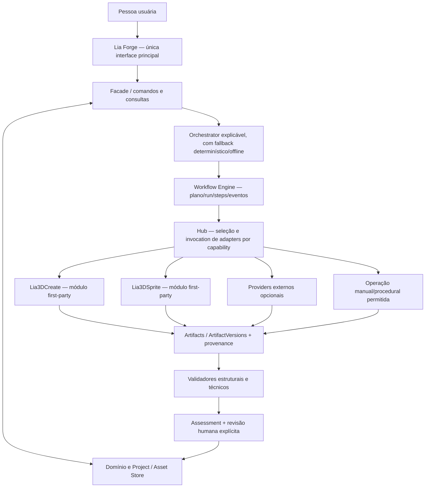

# Lia Forge — proposta técnica consolidada de arquitetura e evolução

**Snapshot de referência:** 2026-10-25 (UTC) 
**Data efetiva desta revisão documental:** 2026-10-25 (UTC; cross-reference e especificação pré-implementação) 
**Reconciliação com a especificação de Domain Contracts:** 2026-11-09 (UTC; notas pontuais em §5.2 e §15.4, ampliadas após a revisão integral da especificação com notas em §2.2, §4.3, §5.3, §9.4, §10.1 e §15.2 — nenhuma decisão aprovada foi reaberta, nenhuma decisão nova foi aprovada e os registros de data acima não foram re-datados) 
**Expansão 2D/2.5D e destinos de utilização:** 2026-11-10 (UTC; registro documental de escopo de produto, rota em camadas e dois providers externos candidatos — §1, §2.3, §4.3, §8.4, §9.4, §12.3, §15.2, §15.3 e §16. Nenhuma decisão aberta foi aprovada, nenhum contrato de domínio foi criado e nenhuma integração foi realizada) 
**Data da aprovação humana da arquitetura:** não registrada separadamente; não inferida do snapshot 
**Data da aprovação humana da especificação de contracts:** pendente 
**Especificação Domain Contracts:** [DOMAIN-CONTRACTS-IMPLEMENTATION-SPEC.md](DOMAIN-CONTRACTS-IMPLEMENTATION-SPEC.md) (`DRAFT_FOR_HUMAN_REVIEW`; implementação não autorizada) 
**Branch:** `arena/649f88bd-3dspritesheet` (`active`) 
**HEAD observado:** `13dc4c7d2fde28f9324fd929482948ba34a87abf` 
**Tipo:** proposta de produto, arquitetura, contratos, compatibilidade e migração 
**Estado:** decisões arquiteturais `APPROVED`; implementação/migração `NOT_AUTHORIZED`.

> Este documento incorpora a revisão final do usuário. Lia Forge é o único produto e a interface principal; `Lia3DCreate` e `Lia3DSprite` são módulos first-party distintos. A aprovação fecha as decisões de arquitetura listadas abaixo, mas **não autoriza implementação**: a próxima etapa será preparar um pacote de implementação delimitado para contratos puros/testes e submetê-lo à revisão independente da Arena.
>
> **Escopo desta revisão:** documentação apenas. Não há autorização para alterar código/contratos executáveis, executar testes, instalar/baixar ferramentas, abrir Blender/serviços/providers, enviar dados, aceitar licenças, mover/migrar arquivos ou repositórios, alterar branch/histórico, fazer commit ou push. O workspace e seus arquivos não rastreados devem ser preservados.

## Histórico da decisão

| Registro | Estado e efeito |
|---|---|
| Proposta consolidada inicial (este documento antes da revisão final) | `PROPOSED`; apresentou recomendações e questões abertas. Seu conteúdo histórico continua refletido nas auditorias, mas as decisões abaixo têm precedência. |
| Revisão final do usuário | `APPROVED_ARCHITECTURE`; aprova/refina as decisões 1–10 da Seção 1 e as regras normativas das Seções 5–13. |
| Autorização para implementar/migrar | `NOT_AUTHORIZED`; esta revisão documental não é aprovação de código, testes, integração, providers, migração ou operação Git. |

## 1. Resumo executivo

### Decisões arquiteturais aprovadas

1. **Produto e módulos — aprovado:** Lia Forge é o único produto/interface principal. `Lia3DCreate` cria/prepara personagens e peças; `Lia3DSprite` cuida de animações, câmeras, renderização e spritesheets. Não haverá dashboards/launchers de produto duplicados. Painel Blender só pode ser interface técnica auxiliar quando uma operação exigir interação direta com o Blender.
2. **Runtimes — aprovado:** manter limites de processo/linguagem quando tecnicamente necessários (Forge Electron/React, Blender/Python, WebGL). Um runtime separado não cria um produto separado. Repositórios, histórias e originais continuam preservados para rollback.
3. **Contracts — aprovado:** `Artifact` é o conteúdo físico imutável identificado por hash; `ArtifactVersion` é uma revisão de uma entrega lógica que agrupa um ou mais Artifacts; `AssetVersion` é a revisão imutável da identidade lógica de um Asset, associando ArtifactVersions, provenance e contexto. Aprovação é sempre humana e separada de execução.
4. **Persistência — aprovado:** preservar `.spriteforge/` sem alterações nesta etapa; não criar `.spriteforge/project.json`, não escolher banco de dados e não migrar/reescrever Store agora.
5. **Perfil visual — aprovado:** um `ProjectVisualProfile` global por Project no schema inicial, com forma evolutiva para futuros profiles por tipo/coleção/Asset. Não implementar scope específico nem herança nesta etapa.
6. **Primeira homologação — aprovada:** modelo 3D existente → configuração de câmera/animação → render → spritesheet PNG + manifesto → validação e revisão. Não exige `Lia3DCreate`. É uma primeira fatia técnica, sem mudar a prioridade de produto: personagens humanoides estilizados.
7. **Renderer — aprovado sem default:** comparar Blender e WebGL/SpriteForge usando o mesmo input e critérios objetivos; não escolher renderer padrão antes dos resultados.
8. **Plataforma — aprovado como alvo, não como claim:** Windows é o primeiro alvo de homologação, incluindo a configuração AMD RX 580 8 GB. Isso não declara suporte. CPU, AMD e Vulkan exigem evidências próprias por capability/versão/ambiente.
9. **Direitos — aprovado como política:** avaliar separadamente direitos de uso comercial dos outputs e direitos de código, modelos, pesos, dependências, datasets e assets. Licença do wrapper não libera os demais componentes.
10. **Execução e proveniência — aprovado como princípio:** capabilities/providers/backends são separados; execução é por etapa, provider-independent e consentida. Hashes, versions, origem, licença, backend, parâmetros e vínculos input/output ficam registrados; `unknown` não vira compatibilidade nem autorização.

### Escopo de produto registrado nesta expansão (decisão de produto do usuário; 2026-11-10 UTC)

**Decisão de produto registrada:** Lia Forge é uma **fábrica geral de assets**. Seus projetos e resultados podem ser utilizados em jogos, personagens desktop, avatares, experiências interativas e outros destinos. **Não existe — nem deve existir — arquitetura separada para personagens de jogos e personagens da Lia.**

A mesma infraestrutura de projeto, identidade visual, geração, edição, validação, proveniência e exportação atende:

- personagens 2D;
- personagens 2.5D;
- PSD em camadas (partes com pixels próprios e máscaras editáveis);
- Live2D e formatos compatíveis, **quando houver provider adequado**;
- personagens 3D;
- VRM, GLB, FBX e outros formatos suportados;
- cabelos, roupas, acessórios, expressões e partes intercambiáveis;
- rigging, animação, spritesheets e renderização.

**Formatos são capacidades e formatos de saída, nunca dependência obrigatória de um único software.** Nenhum formato, runtime, editor, skill ou DCC vira pré-requisito do produto: a ausência de um provider bloqueia aquela rota específica, não a Forge, e cada etapa admite alternativa (outra ferramenta, trabalho manual ou implementação própria).

Dois destinos de utilização são registrados como primeira classe — **Game Asset** e **Lia Desktop Asset** (detalhamento e regras em §4.3). São consumidores dos assets, não módulos de geração separados, e não limitam a Forge a esses dois usos.

O que este registro **não** faz: não escolhe separador de camadas, editor/rig, runtime 2.5D, formato de intercâmbio nem destino Live2D (permanecem abertos em §15.2); não aprova instalação, execução, integração ou aceite de direitos de nenhum provider externo; não cria nem altera contratos de domínio — a especificação continua `DRAFT_FOR_HUMAN_REVIEW`, com seus 12 itens pendentes; e não reabre as decisões 1–10 acima, apenas explicita o escopo de produto que elas já atendem.

### O que esta proposta não declara

- Não declara `Lia3DCreate`, `Lia3DSprite`, Hub genérico, scheduler DAG, validadores novos ou avaliação visual como implementados; aprovar arquitetura não é aprovar código.
- Não seleciona renderer padrão, provider, modelo/pesos, backend de geração, banco de dados, plugin API ou formato de persistência.
- A primeira plataforma de homologação é Windows (incluindo a máquina RX 580 8 GB), mas não há claim de suporte. CPU, AMD/Vulkan, NVIDIA/CUDA, Colab e cloud/API só podem ser anunciados com evidência por capability, adapter, versão e ambiente.
- Não corrige HairDeck, Motion2MixamoRig, scripts, permissões ou licenças; converte achados estáticos em requisitos e gates futuros.
- Decisões arquiteturais aprovadas estão identificadas como tal. Renderer, providers, modelos, clearance/licenças concretas, persistência/ID do Project e demais itens abertos estão na Seção 15; nenhum default pode ser inferido.
- Não declara `image-to-psd` nem `doll-studio` integrados, instalados, executados, testados ou aprovados: são **providers externos experimentais candidatos** da rota 2.5D em camadas (§8.4), com origem/commit pinados em §2.3 e direitos pendentes em §12.3.
- Não declara compatibilidade verificada de PSD/PSB, `.doll`, HTML autocontido, Live2D ou de qualquer formato 2D/2.5D com software de terceiros; formato é capacidade/declaração de saída, não contrato semântico (§9.4).
- Não converte a **autorização de uso geral declarada pelo usuário** sobre o `image-to-psd` em licença formal Apache/MIT inexistente, nem o Apache-2.0 de componentes de terceiros (LivLiv Player adaptado e MediaPipe) em licença do código original do Doll Studio; a declaração `MIT` em `electron/package.json` cobre apenas o subpacote Electron.
- Não cria integração com Lia Desktop, módulo de geração por destino, árvore de projeto por destino nem duplicação de identidade/origem quando o mesmo asset é publicado para vários destinos (§4.3).
- Não declara qualidade de rigging profissional, preenchimento de áreas ocultas como conteúdo do original, nem suporte de Windows/macOS pela existência de instaladores não assinados.

## 2. Snapshot, fontes e estado do checkout

### 2.1 Checkout local e preservação Git

A tabela distingue a criação da proposta, a revisão anterior e o estado após a especificação atual:

| Momento | Branch / `HEAD` | Estado rastreado e worktree |
|---|---|---|
| Criação da proposta inicial | `arena/649f88bd-3dspritesheet` / `13dc4c7d2fde28f9324fd929482948ba34a87abf` (`Initial commit`, `2026-10-25T19:24:03-03:00`) | Só `README.md` está rastreado no `HEAD`; o README já estava modificado e havia 112 paths não rastreados, zero staged. |
| Antes desta revisão final | Mesma branch e mesmo `HEAD`; status da branch `active` | `README.md` modificado; 113 paths não rastreados (`git status --porcelain=v1 -uall`); zero staged. `docs/`, `shared/`, `electron/`, `src/`, `scripts/`, `tests/` e os demais arquivos não rastreados são conteúdo do workspace, não do commit. |
| Depois desta revisão documental | `arena/649f88bd-3dspritesheet` / `13dc4c7d2fde28f9324fd929482948ba34a87abf`; sem mudança de branch/`HEAD`. | `README.md` segue modificado como antes; 114 paths não rastreados; zero staged; só `README.md` aparece como diff rastreado. A proposta existente foi atualizada in-place; o ADR é o único path novo e explica o aumento de 113 para 114. Os demais paths preexistentes não foram editados. |
| Depois desta revisão da especificação (2026-10-25 UTC) | Mesma branch e mesmo `HEAD`; sem staging. | `README.md` segue modificado como antes; 115 paths não rastreados; zero staged; só `README.md` aparece como diff rastreado. A especificação Domain Contracts é o único path adicional; proposta/ADR já eram paths não rastreados e tiveram apenas alterações documentais. Nenhum outro arquivo preexistente foi editado. |
| Depois da expansão 2D/2.5D (adendo 2026-11-10 UTC) | Mesma branch e mesmo `HEAD`; sem staging, sem commit, sem push, sem alteração de remoto. | `README.md` raiz (rastreado) segue modificado exatamente como antes e não foi tocado; **115 paths não rastreados** (`git status --porcelain=v1 -uall`), sem nenhum arquivo novo criado nesta etapa; zero staged. Seis documentos não rastreados foram editados in-place: `docs/EXTERNAL-REPOSITORY-RESEARCH.md`, `docs/ASSET-PIPELINES.md`, `docs/TOOL-PROVIDER-HUB.md`, `docs/SKILLS-KNOWLEDGE-ENGINE.md`, `docs/README.md` e esta proposta. `docs/DOMAIN-CONTRACTS-IMPLEMENTATION-SPEC.md` (SHA-256 `ca493fb5…ebf70a82`) e `docs/ADR-001-LIA-FORGE-DECISIONS.md` (SHA-256 `2e3cf2a1…30eed995`) foram conferidos antes e depois, **inalterados**. |
| Depois da reconciliação da especificação (publicação Git) | `arena/649f88bd-3dspritesheet`; commit `b8403fbb6f678261480cd6013a015d6557a01de1` (pai `f274b015706f3cf2305678d6ee78d5ca4dc311b4`, a ponta remota de então), publicado em fast-forward, sem force push e sem merge em `main` | O `HEAD` local permanece `13dc4c7d2fde28f9324fd929482948ba34a87abf` e o worktree não foi tocado: `README.md` raiz segue modificado como antes e os 115 paths não rastreados continuam no disco. O commit contém **um único arquivo** (`docs/DOMAIN-CONTRACTS-IMPLEMENTATION-SPEC.md`, +1.934 linhas), montado por índice Git temporário sobre a árvore remota. Nenhuma decisão humana foi aprovada: a especificação continua `DRAFT_FOR_HUMAN_REVIEW — NOT AUTHORIZED FOR IMPLEMENTATION`, com os 12 itens de §11 `OPEN`. |
| Depois da publicação do conjunto documental de suporte | Mesma branch; commit documental subsequente ao anterior (SHA no histórico Git e no relatório da tarefa), também em fast-forward, sem force push e sem merge em `main` | Publicados os documentos necessários para que a especificação, esta proposta e o ADR-001 sejam navegáveis no remoto sem referências quebradas (fechamento transitivo dos links relativos). Nenhum código, teste, configuração ou `README.md` raiz foi incluído; os seis documentos que já existiam no remoto com conteúdo divergente do workspace (`agent-workflow.md`, `comfyui.md`, `humanoid-workflow-research.md`, `lia-ecosystem-integration.md`, `mcp.md`, `usage-workflows.md`) **não** foram sobrescritos. |

Não atribuir SHA de `HEAD` aos documentos ou contratos não rastreados nem tratar o commit como representação completa do workspace. O diff preexistente do `README.md` não foi editado. O diretório `local-renderer-test/` é um trabalho separado: foi preservado, não reaberto, inspecionado ou executado. Nenhum teste ou comando do projeto foi executado nesta revisão.

### 2.2 Datas e precedência documental

As fontes locais relevantes são:

- [`MODULE-CONSOLIDATION-AUDIT-3D.md`](MODULE-CONSOLIDATION-AUDIT-3D.md) e [`CHARACTER-HAIR-MOTION-BACKENDS-AUDIT-3D.md`](CHARACTER-HAIR-MOTION-BACKENDS-AUDIT-3D.md): inventários estáticos de módulos, formatos, HairDeck, movimento, segurança e limitações.
- [`DOMAIN-CONTRACTS-AUDIT.md`](DOMAIN-CONTRACTS-AUDIT.md) e [`DOMAIN-CONTRACTS-EVOLUTION-PROPOSAL.md`](DOMAIN-CONTRACTS-EVOLUTION-PROPOSAL.md): estado experimental dos contratos e desenho de perfis/relacionamentos/avaliação/impacto.
- [`PRODUCT-ARCHITECTURE.md`](PRODUCT-ARCHITECTURE.md), [`ASSET-PIPELINES.md`](ASSET-PIPELINES.md), [`WORKFLOW-ENGINE.md`](WORKFLOW-ENGINE.md), [`INTELLIGENT-ORCHESTRATOR.md`](INTELLIGENT-ORCHESTRATOR.md), [`TOOL-PROVIDER-HUB.md`](TOOL-PROVIDER-HUB.md), [`ASSET-MANAGEMENT.md`](ASSET-MANAGEMENT.md) e [`VISUAL-QA-BENCHMARK.md`](VISUAL-QA-BENCHMARK.md): visão e arquitetura-alvo, em geral `PLANNED`.
- [`IMPLEMENTATION-AUDIT.md`](IMPLEMENTATION-AUDIT.md), [`PHASE-0-REPORT.md`](PHASE-0-REPORT.md), [`MASTER-ROADMAP.md`](MASTER-ROADMAP.md), [`DECISIONS-AND-OPEN-QUESTIONS.md`](DECISIONS-AND-OPEN-QUESTIONS.md), [`asset-task.schema.json`](asset-task.schema.json), README local, contratos e testes.
- [`DOMAIN-CONTRACTS-IMPLEMENTATION-SPEC.md`](DOMAIN-CONTRACTS-IMPLEMENTATION-SPEC.md): proposta técnica pré-implementação dos contratos; pendente de aprovação humana e sem autorização de código.

Há uma discrepância temporal importante: `docs/README.md`, `IMPLEMENTATION-AUDIT.md` e `PHASE-0-REPORT.md` declaram snapshots de **2026-11-06**; `DOMAIN-CONTRACTS-AUDIT.md` declara **2026-11-07**; relatórios externos também mencionam alguns snapshots de novembro. Essas datas são posteriores à data confiável deste documento (**2026-10-25**). Seus relatos de testes/build e seus timestamps são preservados como conteúdo documental, mas **não são usados aqui como evidência de uma execução já ocorrida nesta data**. O código e os testes presentes foram lidos estaticamente; nada foi executado ou validado nesta etapa.

**Base de datação do adendo 2D/2.5D:** a data de **2026-11-10 (UTC)** atribuída à expansão registrada em §1, §2.3, §4.3, §8.4, §9.4, §12.3, §15.2–§15.4 e §16 deriva da **evidência upstream observada** — criação e commits dos repositórios externos em 2026-11-09/2026-11-10 (`image-to-psd` criado 2026-11-10T01:30:13Z; `doll-studio` criado 2026-11-09T23:47:49Z, release `v0.1.0` em 2026-11-10T02:26:55Z) — e segue a cronologia de novembro já registrada nos documentos deste workspace. Ela **não reinterpreta** o snapshot original de 2026-10-25, não cria data de aprovação humana e não promove nenhuma decisão: aprovação humana continua não registrada/pendente.

A recomendação antiga do relatório modular de manter 3D Create e 3D Sprite como duas aplicações executáveis independentes é **substituída somente quanto à experiência/produto** pela decisão do usuário registrada no cabeçalho. Preservam-se os limites de runtime, a possibilidade de execução isolada para desenvolvimento/rollback e os projetos originais; não se preservam interfaces duplicadas como destino de produto.

### 2.3 Referências externas fixadas nos relatórios

Os relatórios anteriores citam os snapshots abaixo. Eles são referências de leitura, não clones/worktrees locais, aprovações de licença ou evidência de execução nossa:

| Fonte | Referência registrada | Limite |
|---|---|---|
| Forge | branch local e `HEAD` acima | Há muitos arquivos de trabalho não rastreados; o commit não representa o estado completo do checkout. |
| 3D Create | branch publicada `arena/01a0d27a-3d-create`, `027e9dfc6f96565a0da2dfe5498f60f5d148dca2`; auditoria complementar também leu `9e4bc91f7115abb5137682e5814c170dd2f670ba` | O segundo SHA é associado no relatório a data futura (`2026-11-08`); deve ser confirmado antes de qualquer decisão temporal ou integração. Não há cópia local nem visibilidade de alterações não commitadas/ignoradas. |
| 3D Sprite / SpriteForge Web | branch publicada `arena/01a098db-3d-sprite`, `a69e6cec01ac69c40faeeb82857528be526bb9eb` | Árvore publicada examinada estaticamente; não há cópia local nem visibilidade de alterações locais não publicadas. |
| HairDeck | `cb20f7073419a33c9ab88f22f686fcb9060a99f0` | Relatório associa esse snapshot a novembro; data posterior a este corte. Riscos são hipóteses estáticas a confirmar, não falhas reproduzidas. |
| Charakuru | v1.1.0, `8eb22f6c6700dcc310896336596682594928024c` | Fonte usada somente para ideias gerais de workflow. Não copiar/integrar código, Skills, prompts, assets, ZIP ou arquivo. |
| Motion2MixamoRig | v0.1.8, `f05a718188026b06e7ee64b47bab077970444b19` | Release declarada experimental; documentação/release consultadas não provam build ou compatibilidade Windows/AMD. |
| image-to-psd (adendo 2026-11-10) | [link-ding/image-to-psd](https://github.com/link-ding/image-to-psd), branch `main`, commit `e386bf3a92ef1359379ee582309cb55e85db0e9c` (2026-11-10T01:32:11Z); commit anterior `acc5a053fc99b80fbba710897379d177ad019c6e`; sem tag/release | Leitura de metadados/árvore/arquivos públicos via API. Nada clonado, baixado, instalado ou executado. Sem `LICENSE` (API `license: null`): apenas autorização de uso geral **declarada pelo usuário**. 2 commits, sem testes; PSDs de exemplo têm direitos próprios. |
| Doll Studio (adendo 2026-11-10) | [link-ding/doll-studio](https://github.com/link-ding/doll-studio), branch `main`, commit `127968436dca6d564b6075de94259679e4f17c43` (2026-11-10T02:28:59Z); commits `eddd41779ddf`, `13af521f222f`, `5f335b628518`; release/tag `v0.1.0` (2026-11-10T02:26:55Z) | Leitura de metadados/árvore/arquivos públicos via API; instaladores (~159–172 MB, não assinados) **não** baixados. Código original sem licença identificada; Apache-2.0 só para LivLiv Player adaptado e MediaPipe (`THIRD_PARTY_NOTICES.md`); `MIT` só no manifesto do subpacote Electron. 4 commits, sem suíte de testes observada. |

Nenhum repositório externo foi clonado nesta etapa; não se conhece o estado completo de arquivos ignorados ou não commitados dos mantenedores. Antes de reaproveitamento deve haver novo inventário autorizado de snapshots/arquivos e revisão de direitos por material. O adendo de 2026-11-10 (image-to-psd e Doll Studio) seguiu a mesma regra: somente leitura de informação pública, sem clone/download/instalação/execução/cópia, e os commits acima são a referência fixa de origem e versão para qualquer uso futuro.

### 2.4 Vocabulário de maturidade

Usar os estados sempre com escopo e evidência explícitos:

- `IMPLEMENTED`: código/capacidade nomeada aparece no snapshot; não significa que rodou.
- `VERIFIED`: comportamento estreito testado para inputs, versão e ambiente identificados.
- `PARTIALLY_IMPLEMENTED`: existe uma parte concreta, faltam etapas/contratos/gates relevantes.
- `DOCUMENTED`: há descrição, sem executor comprovado.
- `PLANNED`: objetivo ainda sem runtime correspondente.
- `EXPERIMENTAL`: protótipo ou rota delimitada, sem promessa de produção.
- `BLOCKED`: depende de decisão, direitos, ambiente, autorização ou adapter ausente.
- `NOT_VERIFIED` / `unknown`: não há prova suficiente; não converter em `pass` ou compatibilidade presumida.
- `APPROVED_ARCHITECTURE`: decisão de arquitetura confirmada pelo usuário; não implica código, testes, integração ou migração autorizados.
- `PROPOSED`: recomendação ainda não aprovada; só permanece vigente onde explicitamente classificada assim.

Smoke/unit de fixture, parsing de manifesto, build de renderer, catálogo de provider e mensagem de README não se promovem a E2E, qualidade artística ou suporte de plataforma.

## 3. Inventário funcional consolidado antes de decidir reaproveitamento

A matriz resume o que está no material auditado e o que pode vir a ser reutilizado; ela não declara que as funcionalidades funcionam em ambiente-alvo.

| Origem / recurso | Evidência e capacidade observada | Estado neste planejamento | Disposição proposta |
|---|---|---|---|
| **Lia Forge — Studio Electron/React** | `src/App.jsx`, `electron/main.cjs`, preload e estilos. Há workspace, briefs, referências, rotas/estágios, handoff, atividades, aplicações externas e guias visuais de arte/rig/atlas. As prévias comentadas como guia não são viewers nem outputs. | Código presente; experiência/empacotamento alvo ainda não verificados nesta etapa. | Preservar como **única interface/produto**; evoluir por módulos internos e facade, sem atribuir qualidade de arte aos guias da UI. |
| **Forge — registro manual/workspace** | `.spriteforge/assets.json`; registro de arquivos reais por etapa; roots configuráveis; seleção de inputs/outputs; `.spriteforge/runs/` para snapshots. Persistências/helper paths aparecem em Electron, Vite e MCP. | `PARTIALLY_IMPLEMENTED`; não é version graph nem migração geral. | Preservar paths/records e leitores atuais; criar interface de Store e mapeadores read-only antes de alterar schema. |
| **Forge — ComfyUI** | `scripts/comfyui-client.mjs`, templates de workflow e adapter para diagnóstico e geração explícita de PNG de conceito com checkpoint já instalado/escolhido. | `PARTIALLY_IMPLEMENTED`; não gera modelo 3D, rig, movimento ou spritesheet. Nenhuma chamada real foi feita nesta etapa. | Preservar como capability específica de conceito; não promovê-la a image-to-3D nem exigir ComfyUI. Consentimento de rede/upload separado. |
| **Forge — Blender renderer** | `electron/blender-adapter.cjs`, `scripts/blender_spritesheet.py`, plano de um estágio. Usa modelo existente; personagens usam ações/amostras e itens usam turntable; emite PNG + JSON específico. | Código e smoke citados em documentação; Blender real/visual no target não verificados aqui. | Preservar como implementação/candidato observado de adapter `Lia3DSprite`; não é escolha de renderer padrão e será comparado com WebGL/SpriteForge no E2E. |
| **Forge — runner/store** | `workflow-contracts.cjs`, `workflow-runner.cjs`, `workflow-run-store.cjs`, `resume-workflow.cjs`; validações, autorizações, revisão, hashes, outputs e snapshot local. | `PARTIALLY_IMPLEMENTED`: execução serial pela ordem da lista; retomada exposta limitada ao workflow Blender de um estágio. Não é scheduler DAG geral. | Evoluir incrementalmente; manter estados/compatibilidade; separar Run de AssetVersion e nunca marcar predecessor fora do escopo como concluído. |
| **Forge — contrato de domínio experimental** | `shared/domain/contracts.mjs` valida JSON puro para `Project`, `Asset`, `Artifact`, `AssetVersion`, `Provenance`, `ValidationResult` e catálogo extensível de tipos. Não lê arquivo nem confirma hash/ownership no Store. | `EXPERIMENTAL`; existe código/teste, sem integração demonstrada. | Manter como protótipo; fortalecer versionamento/semântica após aprovação e criar codecs separados para cada formato legado. Não endurecer ou mudar os validators v1 in-place. |
| **3D Create / Bloom Agent** | Snapshot remoto de add-on Blender/Python, painel, `tools_registry`, handlers, Asset Bank, jobs/backups e DevKit. Operações lidas incluem cena/referências, corpo-base (fallback geométrico explicitamente placeholder), proporções, rig/autoweights, shader, UV/bake, peças, idle e exports GLB/FBX/VRM/BLEND com `.lia.json`. | Subconjuntos de código presentes; depende de inputs/topologia, Blender e possíveis providers; qualidade/Windows não verificados. | Fazer inventário arquivo a arquivo. Adaptar capabilities úteis por contrato e processo isolado; não importar o agente ou executar Python arbitrário como extensão implícita da Forge. Preservar painel somente se necessário ao trabalho técnico. |
| **3D Create — launcher/instalador/sync** | Auditoria relata pull/atualização, instalação/remoção de add-ons/ZIP, busca recursiva em pastas do usuário e rotina `sync` capaz de stage/commit/push; extração de ZIP sem containment suficiente. | `RISK`; nada foi executado. | Não migrar nem executar por padrão. Tratar cada efeito como ação separada, revisada, escopada e autorizada. Não levar credenciais, plugins ou dados de usuário sem gate. |
| **HairDeck no 3D Create** | Notebook Colab, handler `kind="hairdeck"` e import inicial de GLB no snapshot citado; a coleta descrita não seleciona seed visualmente, pode importar proxy de cabeça, parentar objeto não equivale a skinning/spring bones e há suspeita estática de incompatibilidade de diretório. | `PARTIALLY_IMPLEMENTED` no snapshot citado; não reproduzido; snapshot upstream citado é posterior ao corte. | Tratar como provider opcional para uma capability específica de cabelo, sujeito aos requisitos independentes da Seção 10. Não contar como cabelo com rig/física integrado. |
| **Motion2MixamoRig empacotado no 3D Create** | ZIP e manifesto aparecem no relatório, mas não foi encontrado fluxo que o chame automaticamente pelo agente. Tem pipeline documentado de pose/captura, retarget e GLB. | `EXPERIMENTAL`/`NOT_VERIFIED`; não instalado/executado. | Manter como provider externo opcional e capability de movimento separada; exigir direitos de cada modelo/peso e target real. |
| **3D Sprite / SpriteForge WebGL2** | HTML/ES modules, Three.js vendorizado, `core.js`/`app.js`, servidor estático Python e launchers. Lógica observada inclui pose/direções, framing, layout, pivôs, Aseprite JSON, GIF, trim/packing, sombra, presets e export PNG/JSON/ZIP. Entradas incluem modelos GLB/GLTF/FBX/OBJ/STL/PLY segundo o snapshot; `.blend` requer conversão. | Código no snapshot publicado; browser/WebGL/GPU e aparência não foram validados nesta etapa. Não foi identificado CLI/headless API comprovado no relatório. | Fazer o inventário de código/licença e extrair/adaptar somente o core e a view necessários a `Lia3DSprite`. Não manter um segundo dashboard/launcher como interface de produto; a view pertence à Forge. |
| **Recursos ocultos/não documentados** | DevKits, testes, asset banks, `jobs/`, backups, `.blend`, ZIPs de plugins, amostras, settings, `localStorage`/IndexedDB, templates, sidecars e launchers são mencionados nos relatórios. | Inventário de árvore publicada, não de worktrees locais completos; alguns direitos são desconhecidos. | Antes de selecionar/reaproveitar qualquer recurso: manifestar arquivos, hash, origem, dono, licença, comportamento de instalação, destino e dependências. Quarentena de conteúdo com origem/direitos `unknown`; não descartar por não estar documentado. |
| **Hub genérico, planner, QA visual e version graph** | Presentes nos docs-alvo como contrato/roadmap. | `PLANNED`; documentação não constitui runtime. | Construir somente após contratos e fronteiras aprovados, por fatias e evidências separadas. |

**Regra de seleção de código:** cada recurso inventariado recebe uma disposição explícita — `preserve-source`, `adapt-behind-adapter`, `extract-core`, `reimplement-independently`, `defer`, `exclude/quarantine` — com motivação, fonte/commit, hash, licença, dependências, testes e rollback. “Funciona em demo”, presença de arquivo ou extensão compartilhada não basta para `reuse`.

## 4. Produto e fronteiras de módulos

### 4.1 Diagrama lógico aprovado

A UI não chama provider/serviço diretamente. O Hub não é um produto nem um pipeline; é uma fronteira técnica. Módulos Lia não são providers externos. O Orchestrator sugere; a pessoa escolhe; grants específicos autorizam efeitos; o Workflow Engine executa; validação e aprovação continuam separadas.

### 4.2 Responsabilidades

| Parte | Responsabilidade arquitetural aprovada | Fronteira / estado atual |
|---|---|---|
| **Lia Forge** | Projetos, assets, navegação, rota/ponto de entrada, apresentação de planos, consentimento, atividade, revisão, histórico e exportação. | Interface única; preservar UI atual e separar gradualmente monólitos/facade. |
| **`Lia3DCreate`** | Criação/preparação de personagens e peças: modelo/corpo, cabelo/roupa, materiais, montagem, rig, validações e exportação. | Módulo interno. Pode usar Blender/add-on/worker Python separado. Não é o launcher Bloom nem seu agente como dependência de produto. |
| **`Lia3DSprite`** | Animações/clips, câmeras/direções, setup de render, renderização, packing e outputs/manifestos de spritesheet. | Módulo interno. Pode ter mais de um renderer adapter. O canvas WebGL, se escolhido, fica numa view da Forge, não num dashboard separado. |
| **Painel técnico Blender** | Interface técnica auxiliar somente quando uma operação exigir interação direta com o Blender. | Não é requisito de produto nem painel genérico para substituir a Forge; sua necessidade operacional permanece por demonstrar. |
| **Orchestrator** | Traduz intenção/restrições em opções de capability e planos com bloqueios e custos/dados explícitos. | Deve funcionar por formulários/regras locais sem LLM/agente; não executa efeitos. `PLANNED`. |
| **Workflow Engine** | Valida e executa plano/run/steps, gates, eventos, checkpoints, recuperação e reconciliação. | Runner atual serial é base parcial; DAG geral e scheduling ainda não existem. |
| **Hub / registries** | Encontrar adapters capazes de satisfazer uma capability; comparar licença, origem, backend, runtime, hardware, dados, custos, maturidade e preferências. | Sem catálogo genérico atual. Nenhum provider é obrigatório. |
| **Provider externo** | Serviço/modelo/runtime de terceiros com nome e origem próprios, capabilities, terms, versões e limitações. | Preservar nome original; não renomear HairDeck, Motion2MixamoRig, ComfyUI etc. para módulo Lia. |
| **Adapter** | Implementação concreta do contrato Lia para chamar um tool/provider ou worker, conferir outputs e informar efeitos/reconciliação. | Não é o provider, capability ou workflow. Executar em processo/permissões mínimas sempre que necessário. |
| **Backend** | Ambiente de execução efetivo por etapa: manual, local CPU, local acelerado, CUDA, Vulkan quando comprovado, Colab, cloud/API ou outro registered. | Não se infere pelo nome do provider, placa detectada ou extensão do modelo. |
| **Destinos de consumo** (jogos, Lia Desktop, avatares, experiências interativas) | Receber assets exportados e impor requisitos próprios de formato/compatibilidade por destino (Game Asset, Lia Desktop Asset e outros). | Não são módulos, providers, adapters nem geradores; não criam identidade, schema, store, rota ou arquitetura separados (§4.3). |

A extração/reuso deve manter a autoria/origem e o runtime necessário. Não unificar Python/Blender, Node/Electron e WebGL só para formar um único processo. A experiência continua uma, mas operações podem atravessar processos isolados e contratos explícitos.

### 4.3 Destinos de utilização e escopo geral de asset

Consequência direta da decisão de produto registrada em §1: a Forge produz assets; **destinos consomem assets**. Dois destinos são nomeados como primeira classe, sem fechar a lista.

| Destino | O que consome | Requisitos típicos de compatibilidade | O que **não** é |
|---|---|---|---|
| **Game Asset** | personagens, roupas, cabelos, acessórios, animações, spritesheets, tilesets, materiais e outros assets destinados a jogos | engine/versão e formato de importação, atlas/pivôs/FPS, escala/unidades/eixos, resolução e paleta, limites de memória/desempenho, empacotamento e direitos por título | Módulo de geração separado; árvore de projeto própria; schema/store/rota/UI exclusivos |
| **Lia Desktop Asset** | personagem principal da Lia, roupas alternativas, cabelos, expressões, acessórios e animações para uso no desktop | transparência/recorte, resolução e tamanho de janela, idle/loop contínuo, FPS e desempenho em desktop, formatos aceitos pelo app, empacotamento/assinatura e direitos de marca/uso da Lia | Módulo de geração separado; contrato de domínio próprio; integração já existente — **nenhuma integração com Lia Desktop foi criada nesta revisão** |
| **Outros destinos (lista aberta)** | avatares, experiências interativas, vídeo/streaming, impressão, materiais de comunidade e outros consumidores | requisitos declarados por destino quando existir consumidor real e evidência de formato | Limite do produto; a enumeração não é exaustiva nem fechada |

Regras normativas:

1. **Nenhuma distinção estrutural entre destinos.** Game Asset e Lia Desktop Asset utilizam o mesmo sistema de assets, contratos, formatos, pipelines e mecanismos de versionamento. Não há tipo de Asset, projeto, store, rota, UI ou módulo de geração separado por destino, nem arquitetura distinta para “personagens de jogos” e “personagens da Lia”.
2. **Destino é requisito de consumo/compatibilidade**, expresso como target/declaração de exportação (formato, resolução, transparência, FPS/loop, empacotamento, plataforma, uso pretendido e direitos). O target descreve o que o consumidor exige; não redefine identidade, origem nem proveniência do asset.
3. **Um mesmo asset pode ser publicado para vários destinos** sem duplicar identidade ou origem: cada exportação é uma nova entrega/versão ligada ao mesmo Asset, com linhagem por parents, proveniência e hashes próprios — nunca um Asset novo nem uma cópia desconectada da origem.
4. **Compatibilidade por destino exige evidência.** Afirmar que um asset “serve” a um destino requer validação estrutural no formato alvo e, quando aplicável, teste real no consumidor; extensão, nome de formato ou leitura bem-sucedida em um parser não provam aceite (§9.4).
5. **Nenhum destino cria dependência de software.** Formatos de engine, PSD/PSB, `.doll`, Live2D/formatos compatíveis, VRM/GLB/FBX e HTML autocontido são capacidades e opções de saída. A ausência de provider adequado para um destino bloqueia aquela exportação específica, não o produto, e não torna nenhum aplicativo obrigatório.
6. **Publicar/exportar é ação explícita**, com consentimento por efeito, direitos avaliados por componente e uso pretendido (interno, comercial, modificação, publicação, distribuição) e registro de destino, bytes e hash. Esta seção não autoriza integração com Lia Desktop, engine, loja ou serviço.

**Reconciliação com o pacote de contracts:** as regras 1–6 são representadas na especificação sem novo record de topo — destino é declarado na entrega (`ArtifactVersion.extensions`, shape **proposto e pendente**) e a compatibilidade é evidenciada por `ValidationResult.targetRef` (especificação §8.1, recomendação R24). `Project.targets`/`engine`, citados em §5.2 desta proposta, **não** fazem parte do primeiro pacote: divergência registrada na matriz de compatibilidade (especificação §13.4) e decisão pendente (§11, item 12 daquela). Destino de consumo não se confunde com destino físico de persistência. Nenhuma integração com Lia Desktop, engine, loja ou serviço foi realizada, testada ou homologada por esta proposta ou pela especificação.

## 5. Modelo de contratos de domínio

### 5.1 Princípios comuns

**Restrição de arquitetura aprovada para implementação futura:** cada tipo tem `schemaVersion` próprio, ID estável e sem dependência de Electron/React/filesystem/network/provider. Versão de schema, revisão de conteúdo, versão de workflow e versão de modelo são dimensões distintas. IDs não derivam apenas de path, nome ou slug. O shape de cada record, mecanismo de ID/persistência e compatibilidade concreta permanecem detalhes de implementação a deliberar separadamente.

- Núcleo de campos conhecidos é estrito e tipado; extensões são aceitas em `extensions` namespaced e com versão declarada.
- Mapeadores de dados antigos preservam o payload original/unknowns e emitem diagnósticos. Não descartar chaves nem “corrigir” sem semântica conhecida.
- Validators de domínio verificam forma e referências sintáticas. O Store/Repository verifica ownership, existência, bytes/hash, path, symlink, unicidade e transação.
- SHA-256 do arquivo mede bytes específicos. Hash do perfil mede payload canônico e precisa de fixtures; um nome de arquivo ou um hash meramente sintático não prova que o Store leu aqueles bytes.
- `unknown`, `not_run`, `partial` e `blocked` são estados legítimos; não usar campos opcionais ausentes para inferir compatibilidade, aprovação ou sucesso.
- `Provenance`, permissões, licenses/terms e consentimentos são records vinculados, não texto livre nem um booleano único.

### 5.2 Contratos pedidos e fronteira sugerida

A tabela é uma proposta de semântica mínima, não um JSON Schema aprovado nem formato runtime. `RecordRef` pode incluir `{ id, schemaVersion }`; referências a conteúdo imutável incluem também hash do conteúdo/arquivo.

| Contrato | Semântica e campos mínimos propostos | Invariantes/gates |
|---|---|---|
| **`Project`** | ID persistente; schema; timestamps; targets/engine opcionais; policy/root ref administrada pelo Store; `visualProfileId` opcional. | Raiz e caminhos não são resolvidos pelo validator puro; não armazenar secrets. O ID não pode ser derivado de caminho. Sidecar futuro requer escolha explícita na Seção 15.2. |
| **`Asset`** | Identidade lógica estável; `projectId`; `assetTypeId` extensível; subtype, nome, brief/tags; `currentVersionId` aponta para a versão aprovada corrente ou fica nulo. | Tipo não implica capability/route. O ponteiro deve apontar a `AssetVersion` do mesmo Asset e só muda em transação explícita após HumanReview `approve` sobre a versão/hash exatos. Candidatas, rejeitadas e falhas não movem o ponteiro. |
| **`Artifact`** | Um arquivo físico exato e imutável: ID/content hash, URI lógica, media type/formato declarado, role, tamanho, SHA-256 e metadata/extension tipada. | Mudança de bytes cria outro Artifact; refs podem ser compartilhadas. Não confundir extensão/MIME com semântica, rights ou compatibilidade. Resolver bytes fica fora do Domain; originais nunca são sobrescritos. |
| **`ArtifactVersion`** | Revisão imutável de um slot de entrega lógico (ex.: `character.model`, `sprite.atlas`), com slot/revision, pai(s), ArtifactRefs exatos e digest do conjunto. Pode reunir arquivo principal, manifesto e sidecars necessários. | Não é arquivo nem Asset inteiro: agrupa um ou mais Artifacts imutáveis. PNG + manifesto semanticamente vinculados podem formar uma entrega; relação semântica precisa estar explícita. Revisões incompletas ou de execução falha continuam registráveis, nunca substituem a anterior. |
| **`AssetVersion`** | Snapshot imutável de uma revisão coerente do Asset; `parentAssetVersionIds` do mesmo Asset; `artifactVersionIds`; `provenanceIds`; contexto de estilo pinado (modo + perfil/version/hash) quando conhecido; ator, hora e resumo. | Não guarda status de review mutável. `candidate` é aguardando revisão; aprovação/rejeição são eventos HumanReview; incompletude é resultado de validação/entrega; falha é estado de WorkflowRun com outputs parciais preservados quando existem. Nenhum desses casos apaga/reescreve versões. Ausência de contexto legado é `unknown`, não `Free`. |
| **`Provenance`** | Fontes e transformações com ArtifactRefs/hash; workflow/run/step; módulo/capability; adapter/provider/tool/model/weights + source/version/commit quando conhecidos; parâmetros redigidos; backend/ambiente; input/output; rights/consents vinculados. | Registrar também lacunas/unknowns. Não guardar credentials, tokens, código secreto ou prompts privados sem grant. Licença do wrapper não determina licença de model/weights/output. |
| **`ValidationResult`** | ID/schema; subject Artifact/ArtifactVersion + hash exato; validator e versão; target/contract ref; horário/ambiente; checks tipados (`checkId`, status, finding, expected/observed/unidade/evidência); limitações. | Status controlado (p.ex. `passed`, `failed`, `warning`, `blocked`, `not_run`, `unknown`, `not_applicable`). Só atesta checks indicados para o hash/version visto; nunca aprovação visual ou legal genérica. |
| **`WorkflowRun`** | ID; Project/Asset; WorkflowDefinition/Plan e versões; entry/subgraph; inputs/artifacts/hash; profile/style snapshot; steps/events; estado; ambiente, grants e refs de executions. | Execução separada do AssetVersion. Saídas parciais/falhas ficam preservadas. `completed` de workflow não aprova Asset nem predecessor fora do escopo. |
| **`ProviderExecution`** | Uma invocação por step: capability, adapter ref/version, provider ref original ou `manual`, backend efetivamente reportado; input/output hashes; parâmetros redigidos; estado, timestamps, job remoto, bytes enviados/baixados, custo, destino/região conhecidos ou `unknown`, consent refs e reconciliação. | Nunca serializar secret; registrar `needs_reconciliation` se o efeito remoto pode ter ocorrido sem resposta. Uma declaração de capability não equivale a resultado. |
| **`ProjectVisualProfile`** + versão/eventos | Identidade visual completa do Project; ponteiro de versão aprovada; versões imutáveis com conteúdo, pai, hash, origins por trait, referências visuais aprovadas e eventos append-only de aprovação/rejeição/revogação. | Edição sempre cria versão; IA pode propor, nunca aprova; perfil ativo só muda por ato explícito do usuário. Não reinterpreta AssetVersions antigas. |
| **`AssetRelationship`** | Aresta com endpoint Asset ou AssetVersion; Project; predicado namespaced + versão registrada; evidências/provenance; actor/time; archive opcional. | Representa relações semânticas entre identidades/versões; ancestry/derivação de bytes continuam em `AssetVersion`/`Artifact`. Predicate unknown é preservado, não executa propagação nem decisão automática. |
| **`HairAsset`** | Extensão tipada de Asset: representação (cards/mesh/curves/etc.), ArtifactVersion de geometria, materiais/cores/UVs, proxies, referência de cabeça/rig, skinning/weights, springs/colliders, eixos/unidades, gerador/seed/provenance. | Cada propriedade pode estar `present`, `absent`, `unknown` ou não aplicável. Um GLB de cards não implica rig, pesos ou springs. |
| **`RiggedCharacter`** | AssetVersion de personagem, model/artifact refs, assinatura/versão do skeleton, hierarquia/bind pose, eixos/unidades/escala, skinning/weights, materiais/texturas, Actions/Slots/clips, constraints e extensões de spring/VRM declaradas. | Validar importer/exporter e round-trip. Só extensão `.glb` não prova armature, skin, actions, coordenadas, materiais ou deformação correta. |
| **`MotionClip`** | Clip com fonte (keyframe/import/capture/retarget), ArtifactVersion, rig fonte/alvo, timebase/FPS/frame range, canais/root motion, mapping, transforms, cleanup/validation refs e provenance. | Pose estática não se torna sequência de movimento; vídeo/imagem de pessoa é dado sensível e não é retido/enviado sem consentimento específico. |
| **`SpriteSheetOutput`** | Resultado semântico que referencia ArtifactVersion da imagem e ArtifactVersion do manifesto; source character/rig/clip hashes; layout; linhas/colunas e seu significado; frame size, ordem, FPS/duração, pivots, origem/eixos, câmeras/direções, target. | PNG e JSON são Artifacts distintos. `rows=actions` não equivale a `rows=directions`; preservar original e declarar conversão. |

**Nota de reconciliação (2026-11-09; documental, sem reabrir decisões aprovadas nem criar decisões novas).** Em relação à revisão de reconciliação da especificação de Domain Contracts ([`DOMAIN-CONTRACTS-IMPLEMENTATION-SPEC.md`](DOMAIN-CONTRACTS-IMPLEMENTATION-SPEC.md) §13), registram-se os mapeamentos abaixo. Todos os nomes/shapes citados são **propostas** da especificação, pendentes de aprovação humana:

- `Asset.currentVersionId` e `Project.visualProfileId` (nomes semânticos desta proposta e do ADR-001): a especificação propõe como nomes concretos `Asset.currentVersionRef`, `Project.visualProfileRef` e `ProjectVisualProfile.currentApprovedVersionRef`, na forma `RecordRef<T>` tipada. A semântica aprovada não muda.
- "URI lógica" e `role` no `Artifact`: no pacote de contracts, a URI lógica é um localizador administrado pelo Store futuro, resolvido pelo `Artifact.id`/hash (não é campo do contract — localização pode mudar sem que os bytes mudem); `role` é propriedade da participação em uma entrega (`ArtifactVersionMember.roleId`), pois os mesmos bytes podem ter roles diferentes em entregas diferentes.
- "Digest do conjunto" no `ArtifactVersion`: a especificação propõe o campo `membersDigest` (payload canônico do conjunto de membros); a escolha de canonicalização permanece aberta.
- `ProjectVisualProfile` + versão/eventos: a especificação recomenda `ProjectVisualProfileVersion` como record independente de topo, com o aggregate mantendo `versionRefs` e o ponteiro aprovado; os "eventos append-only de aprovação/rejeição/revogação" desta proposta correspondem a `HumanReview` append-only, com o valor `revoke` recomendado para revogação.
- `Provenance` com "workflow/run/step; módulo/capability": o primeiro pacote contém apenas `Provenance`, que referencia os contratos futuros (`WorkflowRun`, `StepRun`, `ProviderExecution`, capability) por `executionContext` (`Reported<OpaqueRef>`), sem implementá-los e sem perder rastreabilidade.
- `StylePolicySnapshot`: corresponde ao campo `AssetVersion.styleContext` da especificação (modo + refs de profile/versão + digest + trait paths).
- Níveis (`low/medium/high/unknown`) e necessidade de revisão do §7.2: incorporados na especificação como `severity`/`reviewNeed` obrigatórios nos findings de `ChangeImpactReport`; `stale` é projeção derivada (reports são imutáveis). O vocabulário de decisão (`review/defer/dismiss/pending`) mapeia para o enum de `ImpactDecisionEvent` (`request_review/defer/keep/ausência de evento`).
- Contratos especializados (`HairAsset`, `RiggedCharacter`, `MotionClip`, `SpriteSheetOutput`): no primeiro pacote são cobertos por slots/extensions/relationships/`styleContext`, sem records top-level próprios; permanecem como evolução futura descrita por esta proposta. O mapeamento requisito a requisito está demonstrado na especificação (§8.3 daquela).
- Dimensões de `ConsistencyAssessment` (§5.3 desta proposta: `pass/issue/unknown/not_applicable`): a especificação propõe como enum canônico do pacote `match/deviation/unknown/not_applicable`, com mapeamento `pass`→`match` e `issue`→`deviation` (§3.11 daquela). As "limitações obrigatórias" pedidas aqui passam a ter campo declarado (`ConsistencyAssessment.limitations`), com regras de quando deve ser não vazio.
- `HumanReview` (§5.3 desta proposta: "checklist/contexto/escala"): corresponde aos campos propostos `reviewBasis` (`checklist`/`scale`/`context` como `Reported<>`, com registry externo ao pacote) e `limitations` da especificação (§3.10). A definição de "decisões concorrentes" passou a cobrir duplicatas de `approve` para o mesmo sujeito/digest.
- Estado por propriedade de contratos especializados (exemplo de cabelo no §5.3 desta proposta): o dono do estado é `AssetVersion` (imutável, versionada, incluída no digest de revisão) — não `Asset` (registro mutável de identidade) nem `ArtifactVersion` (uma entrega de um slot). O vocabulário proposto é `present|absent|unknown|not_applicable`; o valor `partial`, usado no exemplo desta proposta, **não** faz parte dele e permanece como divergência registrada e pendente (especificação §5.2, §8.3, recomendação R18).
- `Provenance.environment`: a especificação substituiu o campo nomeado a partir de uma ferramenta específica por `environment.toolVersions` (`{toolId, version, role}` namespaced), independente de ferramenta — coerente com §8.1 desta proposta (backend não se infere pelo nome do provider) e com as Decisões 1 e 5 do ADR-001 (especificação §3.6, §8.2, recomendação R21).
- Destinos de consumo (§4.3 desta proposta): a especificação os representa como declaração na entrega (`ArtifactVersion.extensions`) mais evidência de compatibilidade em `ValidationResult.targetRef`, sem tipo de domínio, identidade ou origem separados por destino; `Project.targets`/`engine` continuam fora do primeiro pacote e a distinção entre *destino de consumo* e *destino físico de persistência* fica explícita (especificação §8.1).
- Rotas 2D/2.5D (§4.3, §8.4, §9.4 desta proposta): a especificação declara que formatos como PSD em camadas, rig 2.5D/runtime, Live2D e atlas 2D são representáveis pelo mesmo mecanismo (registry versionado + `formatId` + `extensions`) e mapeia a rastreabilidade do fluxo 2.5D (fontes, máscaras, reconstruções como conteúdo gerado, ajustes manuais, rig, animações, versões, proveniência), mas **não** propõe IDs de slot/role/formato 2D/2.5D neste pacote — permanecem decisão pendente (especificação §8.2 e §11, item 5). Nenhum formato, provider candidato ou documento de pesquisa é promovido a capacidade suportada.
- Campos desta proposta sem correspondência na especificação: `Project.targets`/`engine`, `Asset.subtype`/`brief`, o "resumo" de `AssetVersion` e o nome `finding` em checks de `ValidationResult` (a especificação usa `message`). Todas essas divergências estão registradas na matriz de compatibilidade da especificação (§13.4); nenhuma foi resolvida por default.

### 5.3 Ciclo de vida, linhagem e avaliações adicionais

**Decisão de arquitetura aprovada:** `Asset` é identidade estável; `AssetVersion` é snapshot coerente e imutável dessa identidade; `ArtifactVersion` é uma revisão imutável de um slot/entrega que agrupa `Artifact` refs; `Artifact` é um arquivo físico imutável identificado por seus bytes/hash. Essa distinção preserva o significado atual de `validateArtifact()` sem alegar que o protótipo já contém version graph. A proposta histórica usava `AssetRelation`; o nome arquitetural aprovado aqui é `AssetRelationship`, com codec nominal caso exista legado, sem reescrever os records legados.

Cada nova tentativa/iteração produz novos records e ligações; não atualiza os bytes ou conteúdo de uma versão anterior. `AssetVersion.parentAssetVersionIds` descreve a linhagem de revisão do mesmo Asset; `ArtifactVersion.parentArtifactVersionIds` descreve a linhagem do slot/entrega. Relações entre Assets diferentes usam `AssetRelationship`, não substituem a linhagem. Um hash idêntico pode ser referenciado por mais de uma versão sem duplicar nem alterar o Artifact.

Ciclo de vida normativo:

1. Uma execução cria uma ou mais Artifact/ArtifactVersion refs e uma `AssetVersion` candidata imutável, mesmo se só parte dos slots estiver pronta. Se nada foi produzido, preserva-se o `WorkflowRun` falho e seus eventos; não se fabrica uma versão sem conteúdo.
2. Uma candidata incompleta é preservada com outputs disponíveis, resultados `partial/failed/blocked/unknown` e faltas explícitas. Ela não se torna aprovada por terminar a execução.
3. A pessoa pode aprovar ou rejeitar a candidata por `HumanReview` referindo os IDs e hashes exatos; rejeição não apaga a versão. Iteração após rejeição cria nova `AssetVersion` ligada à anterior. Reaprovação depende de novo review da versão exata.
4. Só uma transação explícita do Store, após `HumanReview=approve` válido e aplicável, pode mover `Asset.currentVersionId`. Review de bytes/profile diferentes, output parcial, falha de workflow ou simples status `completed` não move o ponteiro. A versão corrente anterior continua preservada e rastreável.
5. `AssetVersion` continua imutável: o ciclo e decisões são derivados de eventos/reviews/validations/run refs, não de editar status por cima de uma versão já criada. Política exata de concorrência/branch/merge de versões é item de implementação futura, não default nesta arquitetura.

**Exemplos concretos de encadeamento (ilustrativos, não fixtures nem schema):**

- **Personagem:** `Asset(character)` possui `AssetVersion v1` com `ArtifactVersion(slot=character.model, v1)`, que agrupa Artifact do `hero.glb` e sidecar `.lia.json` exato quando existir. Provenance registra origem/importer/hash. Só depois de `HumanReview(approve)` para esses hashes `Asset.currentVersionId` aponta para `v1`; uma revisão `v2` cria novos ArtifactVersions, `parentAssetVersionIds=[v1]`, e permanece candidata até nova aprovação.
- **Cabelo:** `Asset(hair)` tem sua própria `AssetVersion` e `ArtifactVersion(slot=hair.geometry)` com GLB/mesh/hash e sidecars originais. `HairAsset` registra estados independentes, por exemplo geometria `present`, UV `partial`, rig attachment `unknown`, skinning `absent`, springs `unknown`; nenhum estado infere outro. `AssetRelationship(uses_hair)` liga hair e versão de personagem com evidência, sem fundir suas identidades. **Divergência registrada, não resolvida por default:** no pacote de contracts o dono desse estado por propriedade é a `AssetVersion` (não `Asset` nem `ArtifactVersion`) e o vocabulário proposto é `present|absent|unknown|not_applicable` — o valor `partial` usado neste exemplo **não** faz parte dele e permanece como divergência explícita (especificação §5.2, §8.3 e recomendação R18; decisão pendente em §11, item 12 daquela).
- **Animação:** `Asset(motion.clip)` guarda `AssetVersion` que referencia `ArtifactVersion(slot=motion.clip)` e Artifact(s) do clip/NPZ/GLB com timebase/FPS, frame range e source/target rig hashes conhecidos. `AssetRelationship(animates)` liga o clip à `AssetVersion` de personagem compatível; a relação não prova visualmente que o retarget está correto.
- **Spritesheet:** `Asset(sprite.output)` possui `AssetVersion` com `ArtifactVersion(slot=sprite.atlas)` que agrupa dois Artifacts distintos — `hero-idle.png` e `hero-idle.manifest.json` — e o record `SpriteSheetOutput` liga ambos ao hash exato do modelo/rig/clip/câmera. PNG e manifesto permanecem originais; o validator confere dimensões, grid, frame order, pivots/origem e semântica declarada. Uma falha/rejeição preserva ambos sem movê-los para `currentVersionId`.

Acrescentar entidades independentes:

- **`ConsistencyAssessment`**: comparação visual/técnica entre subjects exatos, baseline de perfil/target, evaluator/protocolo e dimensões; estados `not_run/running/completed/inconclusive/blocked/failed`; dimensões `pass/issue/unknown/not_applicable`; limitações obrigatórias. `ValidationResult` continua sendo check estrutural/técnico de artefato, não score de estilo. **Reconciliação:** a especificação propõe `match/deviation/unknown/not_applicable` como enum canônico do pacote (mapeamento `pass`→`match`, `issue`→`deviation`) e declara as "limitações obrigatórias" como campo `limitations`, obrigatório e não vazio nos casos em que o alcance da avaliação fica reduzido (§3.11 daquela, §13.4). Avaliação de consistência visual, validação técnica e aprovação humana são **três atos distintos**, com records distintos; nenhum substitui ou dispensa os outros (especificação §9.3, invariante 13).
- **`HumanReview`**: decisão `approve/reject/iterate`, ator humano, data, razão, checklist/contexto/escala e refs/hash exatos observados. Mudança de bytes ou profile version invalida aplicabilidade; nenhum evaluator aprova arte em nome da pessoa. **Reconciliação:** "checklist/contexto/escala" corresponde aos campos propostos `reviewBasis` (`checklist`/`scale`/`context` como `Reported<>`, com registry externo ao pacote) e `limitations`; "decisões concorrentes" passou a cobrir duplicatas de `approve` para o mesmo sujeito/digest, com diagnóstico `review_conflict` (especificação §3.10).
- **`StyleDeviationDecision`**: exceção intencional e localizada para uma AssetVersion/Run, com evidências e traits afetados; não altera perfil global, capability ou revisão geral. Não contorna preflight bloqueado de `Locked`.
- **`ChangeImpactReport` + `ImpactDecisionEvent`**: análise declarativa e eventos append-only de decisão do usuário. Mudanças do grafo tornam report `stale`; recomputar cria report novo.
- **`RightsRecord` / `ConsentRecord`**: licença/termos e grant de efeito distintos, vinculados a código/modelo/weights/input/output e hashes. Consentimento nunca é uma propriedade implícita do provider.

### 5.4 Canonicalização e versionamento

- Schema de cada record inicia em uma versão própria; `DOMAIN_SCHEMA_VERSION = 1` do protótipo não versiona automaticamente Store, manifestos, run, provider ou perfil.
- `AssetTypeId`, predicados de relação, dimensões de assessment, capability IDs e roles são strings namespaced de registries versionados, não enum global fechado.
- Para hash do profile, a recomendação anterior `lia-json-canonical-v1` pode ser adotada após aprovação: ordenar chaves de objeto, preservar ordem de arrays, JSON compacto, números finitos e bytes UTF-8; documentar fixtures de bytes/digest e rejeitar valores não JSON/cíclicos. SHA-256 de Artifact continua sendo hash dos bytes originais.
- Não atualizar validators atuais in-place para descartar campos ou reescrever dados. Codec identifica `source schema → DTO → target schema`, emite relatório de unknown/loss e separa leitura de escrita.
- O Domain não importa `fs`, Electron, React, Blender, rede, launcher ou adapter. Store verifica consistência física; Workflow executa; Hub resolve capacidade; avaliação/review julga evidência.

## 6. Perfil visual do projeto e Style Lock

### 6.1 Conteúdo de identidade visual

`ProjectVisualProfile` deve representar a identidade visual **completa** do projeto e ser reutilizável entre categorias sem forçar uma única rota:

- nome/descrição de estilo e subestilo;
- paleta, espaço de cor, swatches/roles e regras de uso;
- linguagem de forma, silhueta, proporções/anatomia e tolerâncias quantitativas com unidade;
- materiais/superfícies, acabamento, iluminação e nível de detalhe;
- câmera, perspectiva, escala de referência, vistas/direções e continuidade entre vistas;
- targets técnicos aplicáveis a asset types específicos, com prioridade/unidade e sem presumir que todo asset é sprite;
- referências visuais com Artifact ID + hash exato, papel e descrição;
- `traitOrigins` para cada campo: `manual`, `imported_reference` ou `ai_proposal`, com origem/hash/input. Referências importadas precisam de aprovação para serem tratadas como baseline; sugestões de IA só usam como referência de estilo aprovada aquilo que a pessoa autorizou/aprovou, e continuam sendo propostas até revisão humana.

Profile e revisão são independentes: versão imutável contém conteúdo e provenance; evento humano append-only aprova/rejeita/revoga hash específico. Uma sugestão de IA não aprova nem torna a referência licenciada.

**Decisão aprovada:** v1 tem um único `ProjectVisualProfile` global por Project. A estrutura do schema deve permitir evolução futura para escopos por tipo/coleção/Asset, mas tais escopos não entram em v1 e não há herança entre profiles. Project legado sem profile permanece `null/unknown`; não inferir identidade aprovada a partir de prompt ou nome.

### 6.2 Semântica de `Free`, `Guided`, `Locked`

`StylePolicySnapshot` é um snapshot do plano/run e da AssetVersion, pinando `mode`, `profileId`, `profileVersionId`, hash do conteúdo e trait paths selecionados. Não é propriedade do provider nem um switch que reescreve outputs existentes.

| Modo | Requisito e efeito | Regra de capability/revisão |
|---|---|---|
| **`Free`** | Perfil opcional como contexto; execução é explicitamente livre. | Não promete aderência. Gates gerais, licença, dados, custos e revisão seguem valendo. Ausência legada não vira `Free` automaticamente. |
| **`Guided`** | Exige versão aprovada exata do profile; orienta, mas permite diferenças. | `partial`/`unknown` é limitação visível; output ainda precisa de avaliação/revisão quando aplicável. |
| **`Locked`** | Exige versão aprovada exata e conjunto explícito de trait paths. | Para cada trait selecionado, preflight requer claim `supported` com versão, scope e evidência compatíveis com capability/adapter/renderer/backend e input. `partial`, `unknown`, `unsupported`, incompatível ou stale bloqueia esse plano. Claim não prova qualidade: validar, avaliar e revisar o output. |

Mudar um `Locked` intencionalmente significa criar uma nova versão do profile, registrar origens/resumo, obter nova aprovação humana e, se escolhida, torná-la ativa para runs futuros. Não modifica versões antigas. Um Style Deviation pode aceitar uma exceção pontual pós-output com hash/evidência; não passa por cima do bloqueio de preflight nem aprova o Asset inteiro. Sem profile aprovado, `Free` só vale quando escolhido explicitamente; não é inferido da ausência de profile. Com profile aprovado a UI pode sugerir `Guided`, mas a seleção é explícita; `Locked` nunca é implícito.

## 7. Relações, lineage e impacto de mudanças

### 7.1 Representar identidade, originais, versões e dependências

- `Asset` é identidade estável; mudar nome/type/subtype não cria nova identidade por si só.
- `AssetVersion.parentAssetVersionIds` registra ancestry entre versões da **mesma** identidade.
- `ArtifactVersion.parentArtifactVersionIds` e Provenance registram lineage de entregas/transformações; `Artifact` representa bytes imutáveis e não é sobrescrito.
- `AssetRelationship` representa vínculo entre Assets/AssetVersions: `derived_from`, `variant_of`, `uses_rig`, `uses_hair`, `wears`, `uses_material`, `uses_palette`, `animates`, `contains`, `uses_reference`, `depends_on` e semelhantes. Esses IDs são exemplos de catálogo, não enums obrigatórios.
- Predicado tem definição/versionamento, orientação, endpoint types, regra de ciclo e direção de propagação de impacto. V1 recomendado: relações dentro do mesmo Project; cross-project fica adiado.
- Uma relação desconhecida pode ser preservada na importação com diagnóstico, mas não é atravessada pelo analisador. Endpoint inválido é quarentenado/relatado, nunca eliminado em silêncio. Archive não é cascade delete.

Exemplos de relações pretendidas: roupa/cabelo/personagem; rig compartilhado por mais de uma criatura; animação ligada ao skeleton compatível; cena contendo assets de arquitetura, vegetação e props; variação derivada de uma identidade; artefato referindo-se à versão original. `character/item` não é uma taxonomia universal.

### 7.2 Change Impact é somente informativo

`ChangeImpactReport` recebe trigger exato (profile/AssetVersion/ArtifactVersion/hash/relação anterior e nova), analyzer/version, data, limitações e uma lista de impactos com caminho causal, nível (`low/medium/high/unknown`) e necessidade de revisão (`none_indicated/recommended/required/unknown`). Decisões do usuário são eventos separados (`review`, `defer`, `dismiss`, `pending`) com ator/data/motivo.

O relatório:

- não altera `Asset.currentVersionId`, profile, Artifact, review, workflow ou arquivo;
- não executa, agenda ou oferece regeneração automática; “revisar” significa inspecionar, não produzir output;
- marca `stale` se trigger, profile, relation graph ou refs mudarem; cria análise nova em vez de editar a anterior;
- declara limites: relação ausente/desconhecida, grafo parcial ou avaliação sem pixels não permite dizer “sem impacto”.

## 8. Capabilities, Providers, Backends e Workflow Engine

### 8.1 Vocabulário e seleção

| Conceito | Significado | Não significa |
|---|---|---|
| **Módulo** | Código Lia first-party com responsabilidade de produto (`Lia3DCreate`, `Lia3DSprite`). | Provider, launcher separado ou promessa de que todo recurso está pronto. |
| **Capability** | Operação tipada e declarativa, com inputs/outputs, requisitos, efeitos, limites e evidência. | Tool instalada, resultado garantido ou etapa completa. |
| **Tool** | Programa/runtime/DCC acessível, como Blender ou editor externo. | Workflow ou provider que produz qualquer tipo de output. |
| **Provider** | Modelo/serviço/runtime que atende uma ou mais capabilities; local ou remoto. | Adapter pronto, licença do modelo resolvida ou execução autorizada. Nome/origem externa permanecem. |
| **Adapter** | Implementação Lia de discovery, compatibilidade, invocation, output validation, cancellation/reconciliation e proveniência. | Sinônimo de provider ou confiança automática num plugin. |
| **Backend** | Ambiente efetivamente usado **por etapa**: manual, CPU, GPU/backend específico, Colab, cloud/API ou outro registro versionado. | Compatibilidade deduzida do nome da GPU, provider ou formato. |
| **Workflow** | Recipe/graph independente, conectando capabilities por contracts. | Agente ou sequência obrigatória para todo asset. |
| **Agent/Skill** | Cliente opcional / orientação versionada. | Executor obrigatório, permissão ou fonte confiável por padrão. |

Orchestrator solicita `capabilityId` e critérios; Hub compara pares capability–adapter–provider–backend com versões, OS/runtime, hardware, formatos/semântica, rights, network/data, custo, instalação e preferências. A resposta inclui `supported/partial/unsupported/unknown` com evidência/fonte/data/limitações. A escolha final e o início são ações separadas da pessoa. O Hub não escolhe por popularidade nem chama serviços durante discovery sem política consentida.

Maturity é avaliada por capability × adapter × provider/model × backend × OS/runtime/hardware/versão, não com um selo universal do módulo. “Disponível”, “instalado”, “licenciado”, “compatível”, “chamado” e “verificado” são estados distintos.

**Capability claims são registros versionados e escopados, não booleans.** Cada claim deve identificar `claimId`/`claimVersion`, capability e versão do contrato; adapter/provider/model/pesos/backend e suas versões/commits conhecidos; OS/runtime/hardware/driver/versão testados; tipos, hashes/condições de input e outputs/casos efetivamente cobertos; estado (`supported`, `partial`, `unsupported`, `unknown`), limites e data; refs de evidência (run, checks, hashes, logs/resultados redigidos, source/fixture) e autor/reviewer. Um claim só se aplica ao escopo exato testado; sem versão, scope, validade ou evidência suficiente, fica `unknown`. Claims não se herdam entre GPUs, SOs, providers, versões, capabilities nem trait paths.

Para `Style Lock`, `supported` precisa cobrir o trait path selecionado e a capability/renderer/version/backend que fará a operação, com evidência atual e aplicável ao input. `partial`, `unknown`, `unsupported`, scope incompatível ou evidência stale bloqueia o plano `Locked`; nem mesmo claim `supported` garante qualidade ou aprovação do output. Validate/assessment e review continuam etapas independentes.

### 8.2 Execução por etapa e backends

| Rota/backend | Planejamento e gate requerido | Estado/limite que não pode ser ocultado |
|---|---|---|
| **Windows local** | Primeiro alvo de homologação; registrar Windows, versão do Blender/runtime/driver/adapter e incluir a configuração AMD RX 580 8 GB no ambiente-alvo. Homologar efetivamente antes de qualquer claim. | Alvo de teste não é suporte declarado. Configuração NSIS ou fixtures de path não comprovam runtime/installer; CPU/AMD/Vulkan têm evidência própria. |
| **CPU local** | Adapter declara suporte/limite de memória/tempo por capability; evidência reproduzível no CPU-alvo. | Não tratar fallback em código ou “CPU mode” documental como rota viável/rápida em qualquer Windows. |
| **NVIDIA/CUDA** | Pin de driver, CUDA/runtime, modelo/pesos, VRAM/recursos e OS; prova por capability. | Ter NVIDIA/CUDA instalada não garante compatibilidade do modelo ou qualidade. |
| **AMD / Vulkan / RX 580 8 GB** | Só anunciar após evidência específica de RX 580, Windows, driver, Vulkan/runtime, provider e output; Vulkan é outro backend/rota se não integrado ao provider. | Hoje é `unknown/NOT_VERIFIED`; não presumir ROCm, Vulkan ou que ComfyUI use Vulkan. Não converter VRAM em prova. |
| **Colab** | Etapa remota opt-in: informar inputs/bytes enviados, destino, notebook/commit, runtime, downloads, licença de pesos, job e outputs baixados; autorizações de upload/download/custos/termos separadas. | Não é fallback automático nem grátis/sempre disponível. Timeout não autoriza novo submit. |
| **Cloud/API** | Provider, região/destino, retenção, termos, dados, billing/limite, upload/download, credenciais e mudança de escopo visíveis; consentimento expresso por efeito. | Custo/retention desconhecidos devem ficar explícitos e bloquear/perguntar conforme política aprovada. |
| **Manual** | Paths permitidos, input/output real, hash, origem e validação; usuário escolhe arquivo sem cópia/movimento implícito. | É uma rota de primeira classe, não “falha” por não usar agent/provider. |
| **Procedural/local** | Capability específica e sandbox/limites para código; parâmetros/seed/runtime versionados; autorização antes de executar script. | Não expor `exec`/shell arbitrário de skill/provider como contrato genérico. |

Backend é escolhido e registrado por step; o mesmo Workflow pode combinar execução manual, ferramenta local e serviço remoto, se a pessoa autorizar. Inputs intermediários já existentes podem iniciar um subgrafo depois de passarem o validator/rights/contract correto.

### 8.3 Plano, execução, retomada e consentimento

Separar `WorkflowDefinition` (recipe versionada), `WorkflowPlan` (subgrafo e bindings concretos), `WorkflowRun` (execução) e `StepRun`/`ProviderExecution` (invocação/evidência). O Orchestrator constrói alternativas; o usuário edita/autoriza/inicia; o Engine valida input hash, contrato, capabilities e permissões imediatamente antes de cada efeito.

- O executor atual é serial e parcial; planejar um DAG geral não o implementa. Introduzir primeiro core puro de validação/topologia e adapters isolados; integrar scheduler depois, com resource claims/locks, limites, cancelamento e recuperação testados.
- Estados devem separar `blocked`, `failed`, `partial`, `cancelled`, `needs_reconciliation`, `awaiting_review` e `completed`. Progresso numérico só de evento real. Run `completed` não promove automaticamente `AssetVersion` aprovada.
- Retry só é automático quando capability/adapter garantem idempotência/deduplicação. Submit remoto/compra/upload sem resposta vira `needs_reconciliation`, não retry cego.
- Reuso/retomada exige fingerprints/hashes, versions, contrato e arquivo real ainda compatíveis. Alteração de um input invalida apenas seus descendentes dependentes. Predecessores fora do escopo são `out_of_scope`/`reused`, nunca `completed` nesta Run sem evidência.
- Consentimento é por efeito/escopo: action, inputs/hashes, classe de dados, provider/destino/região, downloads/instalação, custo/limite/unknown, overwrite, tempo e outputs. Mudança de parâmetro, caminho, provider ou destino invalida o grant anterior.
- Logs não incluem credenciais; cancelamento local não afirma que job remoto parou. Registrar ID externo, dados enviados/baixados e estado de reconciliação.

### 8.4 Rota 2.5D em camadas — capabilities candidatas e providers externos em avaliação

Rota registrada nesta expansão (operação/preservação em [`ASSET-PIPELINES.md`](ASSET-PIPELINES.md); candidatos e manifestos ilustrativos em [`TOOL-PROVIDER-HUB.md`](TOOL-PROVIDER-HUB.md); origem, versão e direitos em [`EXTERNAL-REPOSITORY-RESEARCH.md`](EXTERNAL-REPOSITORY-RESEARCH.md) itens 10–11):

**Imagem 2D → separação de partes → reconstrução de áreas ocultas → PSD em camadas e máscaras → revisão de partes → rig 2.5D → animação → exportação.**

| Etapa | Capability candidata (rótulo ilustrativo, não contrato aprovado) | Provider experimental registrado | Alternativas previstas |
|---|---|---|---|
| Separar partes | `image2d.split-parts` | image-to-psd @ `e386bf3a92ef` (skill de agente + script Python) | outro separador de camadas; separação manual assistida; implementação própria |
| Reconstruir áreas ocultas | `image2d.reconstruct-occluded` | image-to-psd (declara preenchimento por inferência usando ferramenta de geração de imagem) | pintura manual; provider de inpainting escolhido/consentido; manter `partial` registrado |
| Exportar PSD em camadas | `psd.export-layered` | image-to-psd (`scripts/layered_assets.py`, modos `psd-png`/`psd`, `--report`) | exportador próprio; outro formato de camadas; partes PNG + manifesto sem PSD |
| Ler e revisar camadas | `psd.read`, `layers.cleanup` | doll-studio @ `127968436d` (`src/psd.js`, `src/cleanup.js`, editor web) | editor 2D do usuário; validador/checklist próprio da Forge |
| Rig e deformação 2.5D | `rig2d.auto-rig`, `rig2d.deform` | doll-studio (`src/autorig.js`, `src/roles.js`, `src/rig.js`, `src/renderer.js`) | editor/rig próprio; outro runtime 2.5D; rig manual |
| Animação e captura facial | `anim.idle`, `anim.lip-sync`, `anim.hair-physics`, `tracking.face` | doll-studio (`src/idle.js`, `src/voice.js`, `src/tracking.js` + MediaPipe Face Landmarker) | clips/keyframes próprios; outro runtime; spritesheet pela rota 3D→2D existente |
| Exportação | `model.doll.export`, `export.html-selfcontained` e formatos intercambiáveis quando suportados | doll-studio (`.doll` v1 e página HTML autocontida) | exportação própria; frames/spritesheet; Live2D/formatos compatíveis **apenas** com provider adequado e licenciado |

Regras da rota:

1. **Providers independentes e substituíveis.** image-to-psd e doll-studio ocupam etapas diferentes e **não formam dependência indivisível** — ainda que o README do doll-studio declare forte dependência do image-to-psd, a Forge define cada etapa por contrato de input/output, não por par de ferramentas. Nenhum dos dois é obrigatório.
2. **Nenhum claim de capability.** `supported`/`partial`/`unsupported`/`unknown` só existe com claim versionado e evidência da combinação exata (§8.1). Nesta revisão tudo permanece `unknown`/`NOT_VERIFIED`: nada foi instalado, executado, medido ou comparado.
3. **Direitos fail-closed (§12.3).** image-to-psd não tem arquivo de licença — há apenas autorização de uso geral **declarada pelo usuário**; doll-studio tem código original **sem licença identificada** (Apache-2.0 cobre apenas componentes de terceiros; `MIT` aparece só no manifesto do subpacote Electron). Cópia, integração, redistribuição e fork permanecem bloqueados até esclarecimento/autorização do titular; estudo conceitual e avaliação técnica são permitidos nesta fase.
4. **Efeitos por consentimento e escopo.** Instalação de skill e dependências Python (`pillow`/`numpy`/`psd-tools`, `cairosvg` opcional); download de vendor (~17 MB do npm e de `storage.googleapis.com`); envio de arte/prompt a provider de geração de imagem; acesso a câmera e microfone; execução de app Electron com instaladores **não assinados**; e escrita em configuração de agentes externos (`~/.claude/settings.json`, `~/.codex/config.toml`). Nenhum é efeito padrão; todos exigem destino, bytes, custo conhecido/desconhecido e reversão visíveis antes da autorização.
5. **Conteúdo reconstruído é conteúdo gerado.** Pixels inferidos em áreas ocultas são registrados na proveniência como reconstruídos/gerados, com tool/model/parâmetros quando conhecidos, e apresentados como tais na revisão humana — nunca como pixels do original.
6. **Sem promessa de qualidade.** O próprio upstream declara não garantir one-click nem qualidade de rigging de produção; a Forge não declara rigging profissional, compatibilidade de formato nem suporte de plataforma a partir desta documentação.
7. **Implementação própria independente é rota prevista.** Havendo impedimento de direitos, técnico ou de manutenção, a Forge pode desenvolver separador de camadas, editor/rig ou runtime 2.5D próprios, **sem copiar código, prompts, exemplos ou assets** dos repositórios sem autorização apropriada.
8. **Backend registrado por etapa.** Local por script, local com servidor HTTP, desktop Electron e remoto para geração de imagem são backends distintos; nenhum se infere do nome do provider, da extensão do arquivo ou da presença de instalador.

## 9. Compatibilidade e preservação de formatos

### 9.1 Mapeadores legados — read-only e preservação integral

**Decisão aprovada:** `.spriteforge/` permanece intacto nesta etapa; não criar `.spriteforge/project.json`, não escolher/alterar armazenamento e não migrar conteúdo. Mapeadores futuros começam read-only e por formato/versão: nunca reescrevem, renomeiam ou movem fontes; preservam bytes, paths, hashes, sidecars, outputs e campos desconhecidos; não inferem semântica pela extensão/nome; incompatibilidade ou perda possível produz diagnóstico, não substituição. Qualquer futura escrita exige autorização e plano separado.

| Formato atual | Semântica observada | Regra de compatibilidade aprovada |
|---|---|---|
| **`.spriteforge/assets.json` v1** | Records de personagem/item com `type`, brief/prompt/referências, `outputPath`, entry/stage, `existingInputs`, status/outputs; não há identidade Project genérica equivalente em todo record. | Manter no lugar e sem escrita nesta fase. DTO read-only preserva `type`, campos desconhecidos, IDs/paths/estados e alerta quando `projectId`/mapping não existe. Não derivar Project ID de nome/path. |
| **`.spriteforge/runs/*.json` schema v2** | Snapshot próprio de WorkflowRun/steps, eventos, checks e outputs do runner atual. | Adaptador versionado preserva snapshot e estados; não transforma `completed` em AssetVersion/review aprovada. Não inferir DAG geral de lista serial. |
| **`asset-task.schema.json` v2.0** | Handoff atual limitado à rota `3d_to_2d` e tipos `character/item`, com `startStageIndex`/`existingInputs`. | Tratar como contrato de handoff legado distinto; adaptar com versão sem ampliar enums nem alterar arquivo nesta proposta. |
| **`.lia.json` do 3D Create** | Sidecar de modelo com `schemaVersion: "bloom-lia-1"`, formato/rig/ações/peças conforme snapshot citado. | Preservar bytes e nome como Artifact original. Interpretar apenas com mapper específico dessa versão; se campos/versão não casarem, importar como opaque/unknown e pedir revisão. Não substituir pelo manifesto Forge. |
| **metadata `metadata.json` do SpriteForge** | Layout de direções/frame IDs, pivot normalizado, render/shadow etc.; snapshot observado não declara schemaVersion no builder. | Preservar como fonte; mapper identifica producer/version e sinaliza unknowns. Não inferir schema só pelo nome do arquivo. |
| **Manifesto spritesheet Forge v1** | `schemaVersion:1`, `assetType:character|item`, origem top-left, anchor por tipo, grid, ações por linha e frames row-major (renderer usa 8 colunas), pivots/duração/sourceFrame. | Preservar validator e callers v1. Criar tradução explícita para `SpriteSheetOutput`; schema específico não é universal nem deve ser apagado. |
| **Arquivos auxiliares/saídas SpriteForge** | Aseprite JSON, GIF(s), ZIP, folhas compactadas, shadow/trim podem coexistir com PNG/metadata. | Registrar cada arquivo e hash como Artifact; uma ArtifactVersion pode agrupar a entrega; não presumir que só PNG representa todo o resultado. |

### 9.2 Formatos 3D e motion não são contratos semânticos

- **GLB/GLTF:** container de intercâmbio, não evidência suficiente de rig, hierarquia, skin weights, Actions/Slots, FPS, root motion, UVs, textura, material, eixos, unidades, escala, spring bones ou collider. Validar cada propriedade necessária para o consumidor e testar import/export round-trip.
- **VRM:** preservar versão (0.x vs 1.0), extensões, licença, humanoid, materiais e estruturas de spring exatamente como importadas. Não renomear ou converter por inferência.
- **BLEND:** fonte/editável de runtime Blender; guardar dependências/paths/versões declarados e não prometer abertura pelo renderer WebGL.
- **NPZ:** possível estrutura intermediária de pose/esqueleto/movimento, não mesh ou asset animado autossuficiente; associar schema, rig, timebase e provenance.
- **FBX/OBJ/STL/PLY:** suporte depende do importer e de campos efetivamente presentes; alguns são estáticos e podem não conter rig, animação ou materiais externos.
- **PNG + JSON de spritesheet:** ambos são Artifacts reais; semântica de linhas/colunas, alpha, pivot, FPS/duração, source frame, coordenadas e source hash precisam ser fixadas pelo `SpriteSheetOutput`.

A conversão é uma transformação nova, com ArtifactVersion/output e provenance próprios. Originais e sidecars continuam acessíveis; incompatibilidade ou perda de informação gera relatório, não correção automática.

### 9.3 Primeira fatia E2E de homologação (decisão aprovada; execução não autorizada)

A primeira fatia técnica é **modelo 3D existente do usuário → setup explícito de câmera/animação → render → spritesheet PNG + manifesto → validação estrutural → avaliação visual → aprovação humana**. Ela deve aceitar um modelo preexistente e **não depende de geração via `Lia3DCreate`** nem de provider/modelo generativo. Prioridade de produto para humanoides estilizados permanece; isso não obriga que a primeira fixture técnica seja produzida pelo módulo de criação.

Para comparar renderers, executar Blender e WebGL/SpriteForge sobre o **mesmo input exato**, identificado por hash, e registrar qualquer diferença de configuração necessária para representar o mesmo setup de câmera/animação/layout. Usar a mesma rubrica para ambos, cobrindo: (a) paridade de input/scene/câmera/ação; (b) correção estrutural e semântica do atlas/manifesto; (c) enquadramento, pivots, ordem/alinhamento de frames, clipping, transparência/cor e artefatos visuais; (d) reprodutibilidade e proveniência; (e) tempo/recursos/erros observados no ambiente. Qualidade visual e desempenho são reportados separadamente; não criar score agregado, pesos ou limiares sem decisão explícita. Não há renderer padrão até avaliação dos resultados. Se uma das rotas não estiver disponível no ambiente autorizado, registrar `blocked/not_run` com motivo; não converter isso em suporte ou preferência.

Para cada tentativa — inclusive incompleta/falha — preservar e registrar, quando aplicável:

- bytes originais e SHA-256 do modelo e de qualquer clip/textura sidecar usados; nada de overwrite/cópia implícita;
- `AssetVersion`, `ArtifactVersion` e Artifact refs de input, PNG e manifesto; o PNG e o manifesto são arquivos distintos e agrupam uma entrega quando semanticamente vinculados;
- renderer/adapter/backend, versão e origem/commit, Blender/browser/engine, sistema operacional, hardware/driver/runtime, parâmetros/configuração/câmera/animação, hashes e provenance; valores não obtidos permanecem `unknown`;
- PNG + manifesto declarando de modo inequívoco dimensões, frame/grid, ordem, pivots/origem, FPS/duração, câmera/direções/ação e vínculo ao hash da fonte. A semântica deve ser validada contra os pixels/frames e o target declarado, não apenas contra JSON sintaticamente válido.

Separar três evidências, sem promovê-las uma à outra: (1) **validação estrutural/semântica** do PNG, atlas, manifesto e relação entre eles; (2) **qualidade visual** avaliada por dimensões/protocolo e evidência, sem score inventado; (3) **aprovação humana** explícita sobre hashes exatos. Apenas a última pode, por transação, mudar `Asset.currentVersionId`. Status de renderer/capability exige claim versionado e evidência dessa combinação; sucesso estrutural não comprova qualidade nem direitos.

Critério de aceite futuro desta fatia: dois resultados comparáveis ou bloqueios documentados para cada rota; input hashes iguais; configuração e provenance suficientes para reproduzir a comparação; manifesto semanticamente consistente; originais/sidecars intactos; falhas/outputs parciais preservados; revisão visual e aprovação humana registradas separadamente; nenhuma conclusão sobre suporte geral, licença comercial ou renderer padrão fora do escopo observado.

### 9.4 Formatos 2D/2.5D não são contratos semânticos

- **PSD/PSB:** container de camadas, não evidência de separação correta de partes. Nomes/ordem/offsets de camada, alpha, máscaras independentes, profundidade de bits (8/16), compressão (raw/RLE/ZIP/ZIP com predição), grupos, blend modes e smart objects variam por produtor. Extensão `.psd` não prova que as partes estão semanticamente corretas, que áreas ocultas foram reconstruídas nem que o software-alvo aceita o arquivo. **Ler com sucesso em um parser não é aceite do consumidor:** declarar software/formato verificado exige import real observado na combinação testada.
- **Partes PNG + manifesto de camadas:** conjunto de PNGs com mesmo tamanho/posição do canvas, ordem de trás para frente e nomes de parte é uma entrega com contrato próprio. Camada ausente pode significar parte vazia **ou** omissão do produtor; a semântica deve ser declarada, não inferida.
- **`.doll` v1:** formato proprietário de um runtime específico — JSON UTF-8 com texturas embutidas como data URLs PNG, coordenadas em pixels do canvas PSD original (origem no topo-esquerda, y para baixo), `parts` em ordem de desenho com `role`/`side`/`viseme`/`src`/`mesh{pos,uv,idx}`, `rig` (esfera da cabeça, pivô do pescoço, fator de giro, olhos, boca, corpo), `physics` como pêndulos amortecidos (`k`/`c`/`gain`/`amp`) e parâmetros de runtime não armazenados no arquivo. Compatibilidade declarada: recusar `version` maior do que o player suporta e manter campos novos ignoráveis por players antigos. **Não é formato de intercâmbio neutro**, não é contrato semântico da Forge e não implica Live2D, deformação correta nem qualidade de rigging.
- **Live2D e formatos compatíveis:** só entram como saída quando houver provider adequado e direitos resolvidos. Sem provider, a rota permanece `BLOCKED`; não converter por inferência nem prometer compatibilidade.
- **HTML autocontido / página de player:** artefato de entrega e reprodução com dependências embutidas. Registrar hash, o que foi embutido e se há script/rede; não tratar como asset neutro nem como prova de runtime validado.
- **Máscara × alpha:** máscara grayscale de cobertura e alpha de pixels são informações distintas (a máscara marca o que pertence à camada; o alpha preserva bordas e materiais semitransparentes). Confundir as duas produz validação falsa; os checks devem medir cada uma separadamente e conferir a composição efetiva.
- **Conteúdo reconstruído:** pixels gerados para completar áreas ocultas são conteúdo derivado/gerado com proveniência própria. Não podem ser registrados como parte do original, e os direitos da imagem de entrada não os cobrem automaticamente.

A conversão entre qualquer desses formatos é transformação nova, com ArtifactVersion/output e provenance próprios. Originais — imagem de entrada, PSD e máscaras, partes reconstruídas, ajustes manuais, configuração de rig e arquivo final — continuam acessíveis; incompatibilidade ou perda de informação gera relatório, nunca correção automática.

**Reconciliação com o pacote de contracts:** estes formatos são representáveis pelo mesmo mecanismo — `Artifact.formatId`/`mediaType` declarados, registry versionado de slots/roles e `extensions` namespaced — sem dependência obrigatória de software específico (especificação §8.2). **Limite explícito:** os IDs de slot, role e `formatId` para os fluxos 2D e 2.5D (imagem 2D fonte, PSD em camadas, máscaras por camada, rig 2.5D/runtime, atlas 2D, expressões/visemes) **não estão propostos no primeiro pacote**; sua definição é decisão pendente (especificação §11, item 5). Até lá, um produtor que use slot/formato não registrado tem seus valores preservados com diagnóstico, `assemblyState="unknown"` e `completeness.state="unknown"` — nunca convertidos em conhecidos. Formato ou provider candidato não é capacidade implementada.

## 10. Requisitos do módulo de cabelo e validação HairDeck

### 10.1 Contrato e semântica de HairAsset

`HairAsset` registra separadamente geometria/cabelo, materiais/cores, UVs, associação ao personagem e estado de rig/física. Não há um único `hairReady`/`rigged` booleano que colapse níveis diferentes: geometria, material, UV, associação/head proxy, rig attachment, skinning/weights, springs/colliders e validation/review têm estados próprios — por exemplo `present`, `absent`, `partial`, `unknown`, `not_applicable`, `not_run` ou `failed` — com evidence refs e hashes quando conhecidos. A ausência/desconhecido de um campo não deve ser convertida em falha ou sucesso inferido.

**Reconciliação com o pacote de contracts:** `HairAsset` não é record de topo no primeiro pacote. O estado por propriedade vive em `AssetVersion.extensions` (extensão namespaced `lia.hair.state.v1`, shape **proposto e pendente**), porque `AssetVersion` é o snapshot imutável e versionado da identidade — `Asset` é registro mutável de identidade e `ArtifactVersion` é uma entrega de um slot (especificação §5.2 e §8.3, recomendação R22). O mapeamento requisito a requisito desta seção está demonstrado na especificação §8.3; o vocabulário proposto lá é `present|absent|unknown|not_applicable` e o valor `partial` permanece divergência registrada (R18), não default.

Deve identificar explicitamente:

- representação/gerador/versão/commit/seed/weights e os direitos conhecidos;
- ArtifactVersion de geometria e sidecars/metadados originais;
- presença de head proxy, escala/transform, sistema de coordenadas e unidades;
- material, textura/vertex color, atributos por vértice, UV sets/atlas e intenções de overlap;
- ligação ao skeleton, bone de attach, skinning/vertex groups/pesos, chains/springs/colliders e versão/extensão (ou estados `absent/unknown`);
- validações e revisão visual vinculadas a hashes.

O GLB padrão HairDeck, conforme o snapshot estático citado, pode conter proxy de cabeça/`COLOR_0` e UVs locais por carta; as chains visuais não equivalem a bones. O export VRM/spring é uma rota diferente do GLB de cabelo. Não afirmar que o simples import/parent de um GLB cria spring bones, skinning ou attachment ao rig.

### 10.2 Validador independente de provider

Projetar um validator read-only/diagnóstico, aplicável a imports de qualquer provider, que registre versão/ferramenta, método, unidade, tolerâncias, evidências e limitações para:

- faces degeneradas/quase zero, vértices/faces exatamente duplicados e componentes;
- interseções geométricas, faces internas **suspeitas**, caps e cartões sobrepostos, sem classificar toda sobreposição/oclusão como defeito;
- normais/winding e orientação por componente;
- UV bounds, sobreposições, islands/atlas e diferenças entre UVs por carta vs atlas compartilhado;
- material indices, texturas, vertex colors/attributes, alpha e dependências externas;
- skinning, distribuição/normalização dos pesos, hierarchy/bind transforms e attachment;
- springs/chains/colliders e compatibilidade de extensão/VRM declarada;
- proxy de cabeça, output escolhido, seed/variante e transform/importer.

Cada finding deve apontar para componente/carta/face e hash de origem, com severidade/confiança e revisão humana. Overlap/face oculta pode ser intencional (cards, caps, seam, material, cor), portanto o validator não deve apagar faces ou fazer merge/decimate/flip normais globalmente. Correção automática só pode ser proposta para caso comprovadamente seguro, em nova cópia, com comparação before/after, igualdade de atributos relevantes, relatório e rollback; o original nunca é alterado. Na dúvida, relatório e escolha manual.

### 10.3 Achados estáticos convertidos em requisitos

A auditoria anterior descreve uma **suspeita** de incompatibilidade entre o diretório de saída por imagem do HairDeck e o diretório esperado pelo export VRM do notebook; coleta potencialmente ampla de outputs antigos; seleção não visual de seed; possível importação de proxy de cabeça; falta de validação geométrica/atributos e ausência de transferência de spring bones do GLB ao rig. Não foram reproduzidos nem corrigidos aqui e dependem de confirmar snapshot/commit, especialmente porque alguns timestamps externos são futuros.

Requisitos antes de qualquer integração futura:

1. Isolar outputs por job/hash e não coletar arquivos de execuções anteriores; validar o manifesto e o caminho real de cada arquivo antes de o associar a um Run.
2. Exibir e permitir escolha explícita da variante/seed e política para head proxy; nenhum primeiro GLB encontrado vira escolha implícita.
3. Separar `HairAsset` estático, cabelo skinned, springs e avatar/VRM; cada nível tem validator próprio, import/export e evidência.
4. Comparar geometria, UVs, material/cores, rig, eixos/unidades e versão/hash antes/depois; preservar intermediários originais.
5. Exigir revisão visual (wireframe/UV/escala/frente-lado-costas) e fixtures de falso positivo/negativo antes de qualquer correção automática.
6. Pin de commit e pesos/licenças; upload/download/Colab/nuvem requer consentimentos independentes. Nenhuma dependência ou provider é requerido pelo módulo.

## 11. Captura de movimento, retarget e Charakuru

### 11.1 Motion é uma família de capabilities separadas

Não tratar “animação” como um único provider monolítico. Registrar, conforme disponibilidade, capabilities distintas:

`motion.pose_estimation` → `motion.capture` → `motion.retarget` → `motion.cleanup` → `motion.validate` → `motion.export`.

A entrada pode ser vídeo/imagem, skeleton/NPZ, animação já existente ou edição manual. Uma foto repetida em frames pode representar uma pose estática; não é motion temporal. Retarget precisa de source/target rig signatures, mapping, frame rate, root motion e transform, e cleanup/validação precisam de seus próprios outputs e revisão.

`Motion2MixamoRig` permanece provider experimental opcional, não módulo first-party nem chamada implícita do runner. A documentação citada informa CPU no Windows, mas release v0.1.8 e teste upstream não comprovam build/compatibilidade no Windows-alvo; CPU requer validação no hardware/tempo real antes de ser anunciado. Não presumir AMD/Vulkan/ROCm para esta rota.

A licença Apache do wrapper **não** libera GVHMR, SMPL-X, MANO/HaMeR, YOLO, checkpoints, weights ou dados. O uso comercial da rota é `BLOCKED` enquanto houver dependência sem licença/autorização compatível. Inventário e autorização/substituição devem ocorrer por componente, antes de download/instalação/executação.

### 11.2 Charakuru não é dependência ou fonte de código

Charakuru serve exclusivamente como referência de ideias gerais de workflow — checkpoints humanos, comparação explícita de variantes, continuidade e revisão — para eventual implementação independente. Não criar adapter, copiar/integrar código, Skills, prompts, assets, ZIP, corpo base ou arquivos. O termo source-available/custom e as permissões do kit não são substituídos pela licença do repositório ou pelo fato de o workflow ser interessante.

## 12. Segurança, proveniência, direitos e dados

### 12.1 Gates transversais

- **Execução de código Blender:** `run_blender_python` executa Python dentro do Blender; bloqueio regex não é sandbox. Não expor como capability genérica chamada por texto, Skill ou agent. Futuro adapter requer processo/permissões/allowlist/threat model explícitos.
- **ZIP/add-on/plugin:** validar manifest ID e paths canônicos/containment, symlinks, tamanho/quantidade, checksum, origem/licença; staging e aprovação antes de instalar/substituir. O achado de traversal em instalador é blocker de reuso até mitigação verificável.
- **Colab/ngrok/bridge:** exigir autenticação, limits, origem/destino visíveis, timeout/expiração, isolamento por job, MIME/nome seguros, CORS restrito e reconciliação. Um túnel público não é um transporte local confiável por default.
- **HTTP/endpoints:** evitar SSRF/redirect para destino não aprovado; host/region allowlists e limites de bytes/tempo; status/diagnóstico também devem obedecer à política de rede configurada. A auditoria descreve configurações amplas no Vite/dev server e endpoints de workspace; mantê-los fora de produção e rever Origin/CSRF/SSRF/preview host numa etapa de threat model, sem alterar as permissões aqui.
- **Credentials:** armazenar no host/credential store futuro; nunca em Project, Artifact, WorkflowPlan, ProviderExecution, logs, renderer, export ou payload sem redaction. Rotação/revogação explícitas.
- **Filesystem:** roots explícitas, `realpath`, containment, symlink/path traversal, file-size quotas, escrita atômica e limpeza só de temporários da própria Forge. Input externo é read-only até autorização.
- **Efeitos:** Workflow Engine registra autorização antes de instalação, download, upload, cobrança, execução de código, overwrite/deleção e export. Escopo alterado invalida grant.
- **Telemetry:** Forge local-first/offline, telemetria desligada por padrão; política de provider é separada e apresentada antes de transmitir dados.

### 12.2 Proveniência de ponta a ponta

Para cada transformação, registrar origem/autor/URL, commit/tag/version, checksum de código/modelo/weights, license/terms e estado de direitos; capability/adapter/provider original; parâmetros redigidos/seed; software/importer/exporter/Blender/runtime; OS/CPU/GPU/driver/backend reportados; eixos/unidades/FPS/transforms; inputs e outputs exatos com hashes; permission/consent; uploads/downloads/destinos; custo real ou `unknown`; validators, findings, limitations e review humana. Se a fonte/rights não puderem ser determinada, `unknown/REVIEW_REQUIRED`; não declarar uso comercial permitido.

**Rights clearance é por componente e por uso, nunca herdado do wrapper.** Manter decisões separadas para código, wrapper, dependências/runtime, modelos, pesos/checkpoints, datasets, assets/referências/inputs e outputs gerados; registrar titulares/termos/evidência e se o uso pretendido é interno, comercial, modificação, armazenamento, publicação ou distribuição. Uma licença de output ou autorização comercial de um componente não cobre os demais. `unknown`/incompatível bloqueia o uso correspondente até avaliação; esta proposta não aceita licença nem faz conclusão jurídica.

### 12.3 Gates de direitos identificados

- A licença MIT indicada para código Forge não incorpora marca/assets da Lia nem licencia outros repositórios.
- 3D Create: relatório encontrou declaração GPL no manifesto do add-on, mas não licença raiz suficiente para inferir direitos de todo o repo; assets, `plugins/*.zip`, samples e dados requerem inventário próprio.
- 3D Sprite: relatórios não identificaram licença raiz/notices suficientes para todo o app; alguns vendorizados declaram MIT, mas samples/dependências restantes precisam de provenance/notices completos.
- HairDeck: licença do código do wrapper não substitui licenças/termos de SAM 3, DINOv3, BiRefNet, datasets, weights ou assets.
- Motion2MixamoRig: Apache do wrapper não substitui GVHMR, SMPL-X, MANO/HaMeR, YOLO/checkpoints e terms de modelos.
- Charakuru: source-available/custom; nenhuma cópia, integração ou redistribuição nesta proposta.
- **image-to-psd (`link-ding/image-to-psd` @ `e386bf3a92ef`):** o repositório **não tem arquivo `LICENSE`** e a API do GitHub retorna `license: null` — direitos reservados por padrão. O usuário informou que **o criador autorizou o uso geral do projeto**; isso fica registrado como **autorização declarada pelo usuário**, sem URL, documento, SPDX ou texto de licença, e **não pode ser apresentado como licença formal Apache/MIT inexistente**. Camadas separadas e ainda `unknown`: termos do provider de geração de imagem usado nas referências de partes, direitos dos PSDs/PNGs de `examples/` e direitos sobre os pixels reconstruídos/gerados. Cópia de código, prompts, referências, exemplos ou assets para uma implementação independente exige autorização apropriada; sem ela, a implementação própria deve ser escrita do zero.
- **Doll Studio (`link-ding/doll-studio` @ `127968436d`, release `v0.1.0`):** **código original com licença não identificada** (API `license: null`, sem `LICENSE` na raiz). `THIRD_PARTY_NOTICES.md` identifica **Apache-2.0 apenas** para o código adaptado do LivLiv Player (`src/idle.js`, `src/voice.js`, `src/tracking.js`) e para o MediaPipe (`@mediapipe/tasks-vision` 1.1.1 + modelo `face_landmarker.task` do Google, obtidos por script); o texto Apache-2.0 está em `licenses/Apache-2.0.txt`, e nome/logos/personagens LivLiv são explicitamente excluídos. `electron/package.json` declara `license: MIT` **apenas para o subpacote Electron `dollpet`**, o que não licencia o `src/` web, o formato `.doll`, os assets de `backgrounds/` nem o repositório inteiro. **Não classificar o repositório como Apache-2.0.** Registro: integração, cópia, redistribuição e fork do código original **aguardam esclarecimento ou autorização do titular**; estudo conceitual e avaliação técnica **são permitidos nesta fase**; um adapter independente futuro é possível se técnica e juridicamente viável, sem copiar código/assets. Direitos adicionais pendentes: imagens de `backgrounds/*.png`, termos do modelo Face Landmarker e outputs gerados.

Sem revisão de direitos por arquivo/componente/uso e notices apropriados, não copiar, empacotar, distribuir ou fazer promessa de licença unificada. Isto é um gate técnico de planejamento, não parecer jurídico.

## 13. Migração incremental, preservação e rollback

### Princípio

**Nenhuma migração é necessária para aprovar a arquitetura.** Primeiro estabilizar interfaces e mapeadores; manter os projetos e sidecars originais. O caminho de consolidação é primeiro de produto (uma experiência Forge) e de integração por adapter; mudança física de repositórios/dados é uma decisão posterior separada.

### Fases propostas e gates

| Fase | Trabalho futuro (não autorizado agora) | Gate de saída |
|---|---|---|
| **P0 — Baseline confiável** | Reconciliar commits, branches, worktrees, untracked/ignored relevantes, paths, owners, hashes e direitos; confirmar datas anômalas. Manter os originais imutáveis. | Inventário reproduzível dos arquivos que podem ser considerados; nada de snapshot incompleto tratado como código integral. |
| **P1 — Contratos e decisões residuais** | Registrar decisões arquiteturais já aprovadas; fechar somente detalhes ainda abertos (Project ID/persistência, canonicalização, predicates, grants, concorrência, etc.) em pacote delimitado, sem reabrir escolhas aprovadas sem nova revisão. | ADR/contract registry versionado, explicitamente aprovado em cada detalhe necessário, sem ambiguidades ou defaults inferidos por quem codifica. |
| **P2 — Domain puro** | Validators puros para records, Profile/StylePolicy, relationships, provenance, validation/assessment/review, impact e specialized records. | Unit tests/fixtures; sem imports Electron/React/fs/network/providers; desconhecidos e limitações preservados. |
| **P3 — Legacy read-only** | DTOs/adapters separados para `.spriteforge/assets.json`, runs v2, `.lia.json`, metadata SpriteForge e manifest Forge v1. | Round-trip/read-only fixtures e relatório de diffs/unknowns; source hashes/bytes inalterados; sem promover run a approval. |
| **P4 — Store/persistência** | Escolha futura de sidecar/backend; transação/atomicity, Project IDs, backup e migration dry-run. | Antes/depois, hashes, conflitos explícitos e restauração testada a partir dos originais. |
| **P5 — Capability Hub** | Manifestos/version pins, requisitos reais, discovery e conformance tests; separar adapters Lia de providers externos/backends. | Providers offline/ausentes não impedem Forge manual; fake test não faz rede; consent/rights fail closed. |
| **P6 — Engine/facade** | Vincular Plans/Runs/Steps a ArtifactVersions/Provenance; integrar scheduler DAG, checkpoint, resource locks, retry/idempotência e remote reconciliation de forma incremental. | Interrupção/crash não duplica efeitos nem perde outputs; retomada com hashes e contratos; limites do runner serial não são anunciados como DAG. |
| **P7 — Módulos Lia** | Implementar/integrar `Lia3DCreate` e `Lia3DSprite` dentro da Forge. Processo Blender/WebGL pode ser separado; UI principal segue única. | Cada capability possui contract/adapter/teste e remove-se sem impedir abrir o Forge/manual registration; painel técnico só se necessário. |
| **P8 — Validators/review** | Validadores de PNG/atlas, GLB/GLTF/VRM/BLEND/NPZ, HairAsset, rig, MotionClip e review ledger, todos limitados ao que medem. | Fixtures positivas/negativas; revisão humana por hash/profile; transparência/visual/rig não inferidos de check superficial. |
| **P9 — E2E/plataformas/releases** | Rodar combinações reais autorizadas de Windows, CPU, hardware/provider, Blender, browser/GPU e formatos; publicar apenas matriz comprovada. | Evidência inputs/outputs/hash/versões/licenças/ambiente/review e rollback; status por combinação, não claim geral. |
| **P10 — Importação física de código/dados** | Só após legal/security gates: import incremental com autoria/histórico preservados, backup, manifest de paths/bytes e fallback para originais. | Dry-run/restore e plano de reversão aceitos; nenhuma fonte original removida até aceite e release gate. |

### Rollback mínimo futuro

- Preservar cada repositório fonte, branch/tag, SHAs, árvore e arquivos não commitados/ignorados fornecidos; não squash/filter/rewrite quando autoria/histórico for requisito.
- Snapshot/manifest de hashes e notices antes de copiar; não incluir automaticamente assets, plugins, jobs, keys, workspaces, models, caches ou instaladores.
- Dados migrados são cópia nova/versão nova. Originais e sidecars continuam intactos; rollback aponta de volta para paths/snapshots com checksums conferidos.
- Store/manifest migration começa read-only/dry-run; conflito/semântica desconhecida exige decisão humana, não fallback silencioso para `character/item`.
- Preservar a execução isolada original como referência/rollback técnico, mas não mantê-la como dashboard/launcher de produto duplicado.
- Não mover ou limpar worktree/branch sem autorização expressa e sem inventário restaurável.

## 14. Divisão futura Arena / Codex / trabalho paralelo

Os pacotes abaixo são uma **proposta de organização futura**, não ordens de execução. A direção arquitetural está aprovada, mas ainda não existe pacote de implementação autorizado; cada escopo de código/teste depende de autorização separada.

| Pacote futuro | Responsável sugerido | Limite técnico e critério |
|---|---|---|
| **A — ADRs/estado/evidência** | Arena | Registrar decisões aprovadas e abertas, atualizar baseline datado, mapear sources/rights e preparar pacote delimitado; sem migrar/codificar; uma fonte de verdade para maturidade. |
| **B — Domain contracts** | Codex, isolado; Arena faz revisão independente | Primeiro pacote futuro de implementação, delimitado por [`DOMAIN-CONTRACTS-IMPLEMENTATION-SPEC.md`](DOMAIN-CONTRACTS-IMPLEMENTATION-SPEC.md). A especificação é rascunho aguardando revisão/aprovação humana; arquitetura aprovada não basta para iniciar código. Após aprovação da spec e autorização separada: contracts puros + testes/fixtures sintéticos isolados; sem Store, UI, provider, Electron, filesystem/network ou rewrite do protótipo. Unknowns sem decisão continuam bloqueados. Arena revisa antes de avançar para qualquer pacote seguinte. |
| **C — Compatibilidade read-only** | Codex por adapter independente; Arena revisa | Um formato por pacote/owner: mapper `.spriteforge`/runs, mapper `.lia.json`, mapper SpriteForge metadata, mapper manifest Forge. Fixtures preservam source bytes; sem escrita/migration. |
| **D — Capability descriptors/Hub core** | Codex, após B; em arquivo isolado | Registry/matcher de dados, sem instalação/download/rede/execução de provider. Conformance tests e claims `unknown` explícitos. |
| **E — Workflow orchestration** | Arena define interfaces; Codex implementa core isolado | DAG validation/subgraph primeiro, sem integrar runner; scheduler/side effects só em pacote posterior com locks/idempotência/reconcile. Não editar `main.cjs` em paralelo. |
| **F — Validators especializados** | Codex por domínio independente | Hair geometry/rig, SpriteSheet, model import/export; fixtures licenciadas/sintéticas, sem autofix por default; reporta limitações. |
| **G — Adapters dos módulos Lia** | Owners distintos para `Lia3DCreate` e `Lia3DSprite` | Paths/runtime separados; nenhum worker escreve diretamente no Store. Primeiro manual/file adapters, depois uma capability por vez. UI continua na Forge. |
| **H — E2E nativo** | Ambiente/alvo controlado pelo usuário após autorização | Windows/Blender/ComfyUI/provider/hardware reais; registrar comandos/inputs/rights/outputs, sem concluir suporte por CI Linux/mock. |

Paralelo seguro pode incluir inventário de direitos por arquivo, documentação de contracts e desenho de fixtures, desde que não haja edição concorrente dos mesmos paths e nenhuma cópia/download. Permanecem `BLOCKED` até decisão/autorização: providers/modelos/pesos, instalações, uploads/Colab/cloud, migração/rewrite de histórico, novos dashboards/launchers, mudanças de Store/manifest, hardening que mude permissões, E2E com dados reais, commits/push/branch operations e qualquer integração Charakuru.

## 15. Estado das decisões: aprovadas, abertas e bloqueios

### 15.1 Decisões arquiteturais aprovadas

| Tema | Decisão aprovada | Limite da aprovação |
|---|---|---|
| Produto/módulos | Lia Forge é a única interface/produto; `Lia3DCreate` e `Lia3DSprite` são módulos first-party distintos. | Não declara módulos implementados nem autoriza consolidar/migrar repositórios. |
| Blender UI | Painel Blender é somente uma interface técnica auxiliar se uma operação exigir interação direta com Blender. | Necessidade concreta do painel continua aberta; não construir painel genérico. |
| Modelo de versões | `Asset`, `AssetVersion`, `ArtifactVersion` e `Artifact` têm semânticas distintas, imutáveis e encadeáveis; aprovações são humanas. | Detalhes de schema/transações pertencem a pacote posterior; `currentVersionId` só muda após aprovação humana sobre refs/hashes exatos. |
| Perfil visual | Um profile global por Project em v1; schema evolutivo para escopos futuros, sem herança. | Não implementar escopos nem decidir persistência/ID do Project. |
| Compatibilidade | `.spriteforge/` permanece intacto; não criar `.spriteforge/project.json`; mapeadores legados iniciam read-only e preservam fontes/desconhecidos. | Nenhuma migração, escrita, escolha de banco ou substituição de formato autorizada. |
| Primeira fatia E2E | Modelo existente do usuário → setup explícito de câmera/animação → render → PNG + manifesto → validação → avaliação visual → aprovação humana; não exige `Lia3DCreate`. | Execução depende de autorização/ambiente e input com direitos adequados. |
| Comparação de renderer | Blender e WebGL/SpriteForge com o mesmo input/hash e mesma rubrica. | Sem renderer padrão, score agregado, pesos ou limiares escolhidos. |
| Primeiro alvo de homologação | Windows, incluindo configuração AMD RX 580 8 GB. | Alvo de teste, **não suporte declarado**; CPU/AMD/Vulkan exigem prova separada. |
| Direitos | Rights de código, componentes e outputs são avaliados separadamente, por componente e uso pretendido. | Não aceita licenças, não dá parecer jurídico e não presume direito comercial. |
| Execução | Claims versionados/escopados com evidência; provenance e revisão separadas. | Nenhuma execução, chamada, instalação, download ou envio de dados foi autorizada. |

### 15.2 Decisões ainda abertas — nenhum default silencioso

| Tema aberto | O que permanece sem escolha |
|---|---|
| Renderer de `Lia3DSprite` | O resultado da comparação Blender vs WebGL/SpriteForge, qualquer preferência/default e critérios quantitativos/limiares/pesos. Até lá, nenhuma rota é padrão. |
| Providers, adapters e backends | Quais integrar para cada capability, sua ordem/prioridade, instalação, chamada, operação local/remota e fallback. Nenhum provider é escolhido ou obrigatório. |
| Modelos, pesos, datasets | Seleção, versão, origem, download, uso/armazenamento e elegibilidade por capability continuam sem decisão. |
| Clearance/licenças concretas | Direitos por wrapper/código, dependências, modelo/pesos, dataset, asset/input, referências e output; inclusive uso interno, comercial, modificação/publicação/distribuição. Não inferir que uma licença cobre outra camada. |
| Persistência e `Project.id` | Mecanismo de ID, armazenamento (JSON/SQLite/híbrido ou outro), localização, transações e compatibilidade. Não criar sidecar nem escolher banco; `.spriteforge/` fica como está. `Project.id` não deve ser inferido de path/nome. |
| Operação que justificaria painel Blender | Identificar ação concreta que realmente exige interação direta com Blender; sem caso demonstrado, painel continua possibilidade técnica, não requisito. |
| Hash/canonicalização de Profile | Algoritmo/protocolo canônico e fixtures. `lia-json-canonical-v1` continua recomendação histórica, não padrão aprovado. |
| Rubrica de comparação | Critérios descritivos comuns estão definidos na Seção 9.3; limiares quantitativos, pesos, score e critério de seleção final exigem decisão explícita. |
| Matriz de plataforma/suporte | Evidências adicionais de Windows/Blender/browser/GPU e toda claim específica de CPU, AMD/Vulkan, NVIDIA/CUDA, Colab ou cloud; não inferir de hardware/documentação. |
| Detalhes de operação | UX/expiração de grants, retenção/exclusão, predicados de relação, concorrência/branch de versões e política futura de escrita/migração. Permanecem explícitos no pacote futuro; ausência não escolhe default. |
| Separador de partes/exportador de camadas (rota 2.5D) | Qual ferramenta separa partes e exporta PSD em camadas (`image-to-psd`, outro separador, fluxo manual ou implementação própria), com qual versão pinada, gates e fallback. Nenhum provider está escolhido; o registro como candidato experimental não decide. |
| Editor/rig e runtime 2.5D | Adotar editor/rig próprio, runtime externo (ex.: `doll-studio`) ou somente formatos intercambiáveis; se `.doll` e HTML autocontido são saídas suportadas; qual runtime 2.5D recomendar e como comparar. Nada decidido. |
| Live2D e formatos compatíveis | Se e quando suportar Live2D/formatos compatíveis, com qual provider, versão e direitos. Sem provider adequado a rota permanece `BLOCKED`; não há default nem conversão por inferência. |
| Regularização de direitos dos providers 2.5D | Como registrar/verificar a **autorização declarada pelo usuário** sobre `image-to-psd` (sem documento de licença) e como obter esclarecimento de licença do código original do `doll-studio`; se haverá pedido formal ao titular, instrumento próprio ou substituição por implementação independente. Nenhuma licença foi aceita nesta revisão. |
| Política de conteúdo reconstruído | Como rotular, versionar e revisar pixels inferidos em áreas ocultas (rótulo na proveniência, evidência, revisão humana obrigatória, efeito sobre Style Lock e sobre direitos do output). Sem regra aprovada. |
| Requisitos por destino (Game Asset / Lia Desktop Asset) | Quais targets existem formalmente, que requisitos de formato/compatibilidade cada um impõe, como declarar e validar a exportação por destino e como registrar a publicação do mesmo asset em vários destinos. Nenhum destino está integrado. |

**Relação com as decisões pendentes da especificação de contracts.** A lista normativa de pendências do primeiro pacote de Domain Contracts está em [`DOMAIN-CONTRACTS-IMPLEMENTATION-SPEC.md`](DOMAIN-CONTRACTS-IMPLEMENTATION-SPEC.md) §11 (12 itens, todos `OPEN`), complementada por §13.2 e pelas recomendações R16–R25 de §13.3(b) — inclusive precedência entre `ValidationResult` (R17), o valor `partial` no estado por propriedade (R18), CAS/`expectedDigest` nos records mutáveis (R19), escopo de aplicabilidade de consent (R20) e o shape das extensões de destino de consumo (R24). A tabela acima e aquela lista se complementam: nenhuma foi reduzida, nenhuma decisão foi aprovada e nenhum default foi criado pela reconciliação documental. Enquanto §11 permanecer `OPEN`, a especificação não está pronta para implementação.

### 15.3 Bloqueios e condição para a etapa seguinte

- Não há clearance concreto de direitos aprovado para qualquer provider/modelo/peso/dataset/asset/output; esses usos permanecem `unknown` ou `BLOCKED` conforme escopo até revisão por componente.
- Não executar a primeira fatia E2E, comparar renderers, abrir Blender, fazer instalação/download/upload, usar serviço remoto ou anunciar suporte sem autorização operacional específica e evidência do ambiente real.
- O estado de Windows + RX 580 8 GB é “primeiro alvo de homologação”, não `supported`. O resultado pode ser `blocked`, `partial` ou `not_run` por renderer/capability.
- Qualquer recommendation/prototype/documentação anterior não listada como aprovada nesta revisão não se torna default. Unknowns, formatos, arquivos e direitos desconhecidos devem permanecer preservados e explicitamente unknown.
- **Providers 2.5D do adendo permanecem `BLOCKED` para qualquer efeito**: `image-to-psd` e `doll-studio` não podem ser clonados, baixados, instalados, executados, copiados, integrados, redistribuídos nem ter fork feito sem autorização explícita do usuário e esclarecimento de direitos (§12.3). Bloqueios específicos adicionais: instalação de dependências Python e de skill em agente; download do vendor MediaPipe (~17 MB de npm e `storage.googleapis.com`); envio de arte/prompt a provider de geração de imagem; acesso a câmera e microfone; execução de instaladores **não assinados** (~159–172 MB); e escrita em arquivos de configuração de agentes externos (`~/.claude/settings.json`, `~/.codex/config.toml`). Registrar um provider como candidato experimental não autoriza nenhum desses efeitos.

### 15.4 Próximo passo processual

A primeira especificação delimitada está em [`DOMAIN-CONTRACTS-IMPLEMENTATION-SPEC.md`](DOMAIN-CONTRACTS-IMPLEMENTATION-SPEC.md); ela é rascunho e **aguarda revisão/aprovação humana**. A especificação recebeu uma revisão de reconciliação técnica com data efetiva **2026-11-09 UTC** (registrada em sua §13, com decisões pendentes consolidadas em sua §11); continua draft, não aprovada e sem autorização de implementação. Aprovar a arquitetura e/ou ler a proposta não aprova automaticamente essa spec nem autoriza execução. Após a pessoa usuária decidir os pontos abertos, revisar/aprovar explicitamente a especificação e conceder autorização separada, o primeiro pacote pode começar somente por contracts puros e testes/fixtures sintéticos isolados; sem Store, UI, provider, rede, migração, escrita de formatos legados ou efeitos externos. A Arena fará revisão independente antes de qualquer etapa seguinte. Nenhum default deve preencher lacunas por conveniência.

A expansão 2D/2.5D registrada em 2026-11-10 **não alterou este próximo passo processual**: naquele momento a especificação de Domain Contracts não havia sido modificada (continuava `DRAFT_FOR_HUMAN_REVIEW`, com seus 12 itens pendentes), nenhum contrato de domínio novo foi criado, o ADR-001 permaneceu intocado e os providers candidatos da rota em camadas (`image-to-psd`, `doll-studio`) só podem entrar em um pacote futuro após decisão dos itens abertos de §15.2, regularização de direitos (§12.3) e autorização operacional separada.

**Atualização posterior (reconciliação pós-revisão integral da especificação):** a especificação foi revisada, reconciliada e publicada — correções 22–42 em §13.1, recomendações R16–R25 em §13.3(b), novas subseções §4.6 e §8.1–§8.3, invariante 13 em §9.3 e critérios 13–15 em §13.6 — no commit `b8403fbb6f678261480cd6013a015d6557a01de1` da branch `arena/649f88bd-3dspritesheet`. Ela **continua** `DRAFT_FOR_HUMAN_REVIEW — NOT AUTHORIZED FOR IMPLEMENTATION`, com os 12 itens de §11 `OPEN`, nenhum default inventado e nenhuma data de aprovação humana registrada. O próximo passo processual permanece exatamente o mesmo: decisão humana sobre os pontos abertos, revisão/aprovação explícita da especificação e autorização separada antes de qualquer código.

## 16. Critérios objetivos de aceite para fases futuras

Estes são gates futuros; **não foram executados nesta revisão documental**. Antes de declarar implementação, integração ou homologação aceita:

1. **Domain:** validators puros por record, schemas versionados, ownership/referências na camada correta e fixtures de canonicalização somente após decisão explícita; nenhuma dependência de I/O no Domain.
2. **Version lifecycle:** `Asset` estável; `AssetVersion` e `ArtifactVersion` imutáveis, lineage por parents explícitos, `Artifact` por bytes/hash; candidatas, incompletas, rejeitadas e falhas preservadas; apenas review humana exata seguida de transação pode alterar `Asset.currentVersionId`.
3. **Profile/Style Lock:** um profile global por Project no v1, sem herança; origins por trait, referência/hash exato e eventos de aprovação; seleção explícita de policy; claim de capability com versão/scope/evidência compatíveis para cada trait `Locked`; IA não aprova e claim não garante qualidade.
4. **Provenance/rights:** cada output liga inputs, hashes, tools/providers/backends/versions/configs, license/terms, consent e parâmetros redigidos; rights separados para código, wrapper, dependências, modelos, pesos, datasets, assets e outputs; `unknown` não vira liberação comercial.
5. **Compatibilidade:** `.spriteforge/assets.json`, `.spriteforge/runs/`, `.lia.json`, metadata SpriteForge, manifesto Forge, sidecars e outputs preservados byte-a-byte; mapeadores read-only mantêm campos desconhecidos; nenhuma conversão por extensão nem migração sem plano e autorização próprios.
6. **Workflow:** entradas intermediárias, partial outputs, falhas, providers ausentes, cancellation, crash, duplicate prevention e remote reconciliation; eventos observáveis; `Run.completed` separado de review/AssetVersion aprovada.
7. **Hub/claims:** `Capability`, `Provider`, `Adapter` e `Backend` não colapsam; claims versionados/escopados, com evidências aplicáveis à combinação exata; testes offline não fazem rede; compatibilidade não é inferida entre versões/ambientes.
8. **Hair:** estados independentes para geometria/material/UV/associação/rig/skinning/springs; validator diagnóstico de degenerados/duplicatas/interseções suspeitas/faces internas/normais/UV/material/cores; falso positivo testado; overlap/faces internas não são defeitos automáticos; original preservado e review humana prevista.
9. **Motion:** pose estimation, capture, retarget, cleanup, validation e export são capabilities separadas; direitos de wrapper não cobrem pesos; teste CPU/Windows obrigatório antes de claim correspondente.
10. **Módulos/UI:** Forge é única experiência de produto; `Lia3DCreate`/`Lia3DSprite` internos e isoláveis; painel Blender só se operação exigir interação direta; nenhuma UI/launcher duplicada; workflow manual/offline não depende de agent/provider.
11. **Primeiro E2E:** modelo preexistente e autorizado do usuário, sem exigir `Lia3DCreate`; Blender e WebGL/SpriteForge recebem o mesmo input hash e são comparados pela rubrica comum; versões/configs/hardware/driver/provenance registrados; PNG + manifesto semanticamente consistentes; falhas/partials preservadas; estrutura, qualidade visual e aprovação humana são evidências distintas; nenhum renderer padrão é inferido.
12. **Plataforma:** Windows e configuração RX 580 8 GB testados como alvo de homologação; publicar somente resultados comprovados por capability/adapter/version/backend/OS/hardware; não anunciar suporte geral nem inferir CPU/AMD/Vulkan/CUDA/Colab/cloud.
13. **Segurança:** threat model revisado para Python/Blender, ZIP, túnel, APIs, path/network/SSRF, quotas, cancelamento, credenciais, upload/download e consent; nenhum efeito sem autorização específica.
14. **Rollback/persistência:** qualquer decisão futura de Project ID/store/write/migration tem ADR e autorização próprias, backup/restore demonstrado; originais/sidecars/paths/histórico preservados; nenhuma source removida por migração.
15. **Rota 2.5D em camadas:** evidência E2E por etapa (separação de partes, reconstrução de áreas ocultas, export de PSD + máscaras, revisão/correção de camadas, rig, animação e exportação) com hashes de input/output, provider/commit pinado, backend, OS/runtime e ambiente; partes reconstruídas identificadas como conteúdo gerado e revisadas por pessoa; original da imagem, PSD/máscaras, ajustes manuais, configuração de rig, arquivo final, resultados parciais e falhas preservados; direitos resolvidos por componente (código do provider, modelos de tracking/geração, exemplos e outputs); substituição de provider demonstrada por contrato, não por par de ferramentas; nenhuma declaração de qualidade de rigging, compatibilidade de formato ou suporte de plataforma sem teste real na combinação publicada.
16. **Destinos de utilização:** exportação por destino (Game Asset, Lia Desktop Asset e outros) declarada e validada no formato alvo, sem duplicar identidade ou origem do asset quando o mesmo asset é publicado em vários destinos; mesmos contratos, formatos, pipelines e versionamento para todos os destinos; requisitos de compatibilidade registrados como target/evidência, nunca como módulo de geração separado; nenhuma integração com consumidor (engine, Lia Desktop, player) declarada sem autorização e teste reais.

## Conclusão e estado da aprovação

A arquitetura está **aprovada como direção**, com Lia Forge como único produto/interface e `Lia3DCreate`/`Lia3DSprite` como módulos first-party. Os contratos distinguem identidade lógica, versões imutáveis, arquivos físicos, entregas versionadas, provenance e review humana. A primeira homologação será um modelo existente até spritesheet, comparando Blender e WebGL/SpriteForge sob as mesmas condições; nenhum renderer, provider, modelo ou licença concreta foi selecionado. `.spriteforge/` e todos os formatos/fontes legados permanecem intactos.

A expansão registrada em 2026-11-10 amplia o **escopo de produto** sem mudar a arquitetura aprovada: a Forge é fábrica geral de assets para personagens 2D, 2.5D e 3D, PSD em camadas, Live2D/formatos compatíveis quando houver provider adequado, VRM/GLB/FBX, cabelos/roupas/acessórios/expressões/partes intercambiáveis e rigging/animação/spritesheets/renderização; formatos são capacidades e saídas, nunca dependência obrigatória de um único software. Jogos e Lia Desktop entram como **destinos de consumo** (`Game Asset`, `Lia Desktop Asset`), sem distinção estrutural entre si e sem duplicar identidade ou origem de um asset publicado em vários destinos. A rota 2.5D em camadas foi documentada com dois providers externos **experimentais e substituíveis** (`image-to-psd` e `doll-studio`), ambos com origem/commit pinados e direitos pendentes.

Esta aprovação **não autoriza implementação, execução de testes, instalação, download, chamada de provider, upload, migração, mudança de suporte declarado ou operação Git**. Após revisão desta proposta e do ADR, o próximo passo é elaborar pacote delimitado; qualquer implementação requer autorização separada, começará por contracts puros/testes e terá revisão independente da Arena antes de avançar. A possibilidade de integração futura dos providers 2.5D **não é integração realizada**.

---

**Estado desta revisão:** apenas documentação foi editada. Nenhum código/contrato executável foi alterado e nenhum teste, runtime, provider ou migração foi executado. O estado Git antes/depois está registrado na Seção 2.1 após a conferência final.

**Estado do adendo 2D/2.5D (2026-11-10 UTC):** apenas documentação foi editada — [`EXTERNAL-REPOSITORY-RESEARCH.md`](EXTERNAL-REPOSITORY-RESEARCH.md) (itens 10 e 11), [`ASSET-PIPELINES.md`](ASSET-PIPELINES.md) (rota, preservação e destinos), [`TOOL-PROVIDER-HUB.md`](TOOL-PROVIDER-HUB.md) (candidatos e manifestos ilustrativos), [`SKILLS-KNOWLEDGE-ENGINE.md`](SKILLS-KNOWLEDGE-ENGINE.md) (skill externa e distinção skill × app), [`README.md`](README.md) (índice) e esta proposta (§1, §2.1, §2.3, §4.2, §4.3, §8.4, §9.4, §12.3, §15.2, §15.3, §15.4, §16 e conclusão). [`DOMAIN-CONTRACTS-IMPLEMENTATION-SPEC.md`](DOMAIN-CONTRACTS-IMPLEMENTATION-SPEC.md) e [`ADR-001-LIA-FORGE-DECISIONS.md`](ADR-001-LIA-FORGE-DECISIONS.md) **não foram modificados** (hashes conferidos antes e depois). Nenhum código, adapter ou contrato de domínio foi escrito; nada foi clonado, baixado, instalado ou executado (Blender, providers, skill, editor, app desktop ou workflow); nenhuma dependência foi instalada; nenhuma integração com Lia Desktop foi criada; nenhuma decisão aberta foi aprovada; nenhum commit, push, staging, branch ou remoto foi alterado. A pesquisa dos dois repositórios externos foi feita somente por leitura de metadados e arquivos públicos via GitHub API/fetch.

**Estado da publicação do conjunto documental:** esta proposta foi publicada no remoto com o ADR-001 (**sem alteração**) e com os documentos de suporte necessários para navegar da especificação à proposta, ao ADR e às auditorias/pesquisas sem referências quebradas (índice [`README.md`](README.md), auditorias, pipelines, Tool/Provider Hub, pesquisa externa, skills e demais documentos aqui referenciados), em commit documental subsequente a `b8403fbb6f678261480cd6013a015d6557a01de1` na mesma branch, em fast-forward, sem force push e sem merge em `main`. Nenhum código, teste ou configuração foi publicado; o `README.md` da raiz e os demais arquivos divergentes do remoto não foram tocados; os seis documentos que já existiam no remoto com conteúdo diferente do workspace (`agent-workflow.md`, `comfyui.md`, `humanoid-workflow-research.md`, `lia-ecosystem-integration.md`, `mcp.md`, `usage-workflows.md`) não foram sobrescritos. Nenhuma decisão pendente foi aprovada, nenhum default foi criado e a implementação continua não autorizada.
