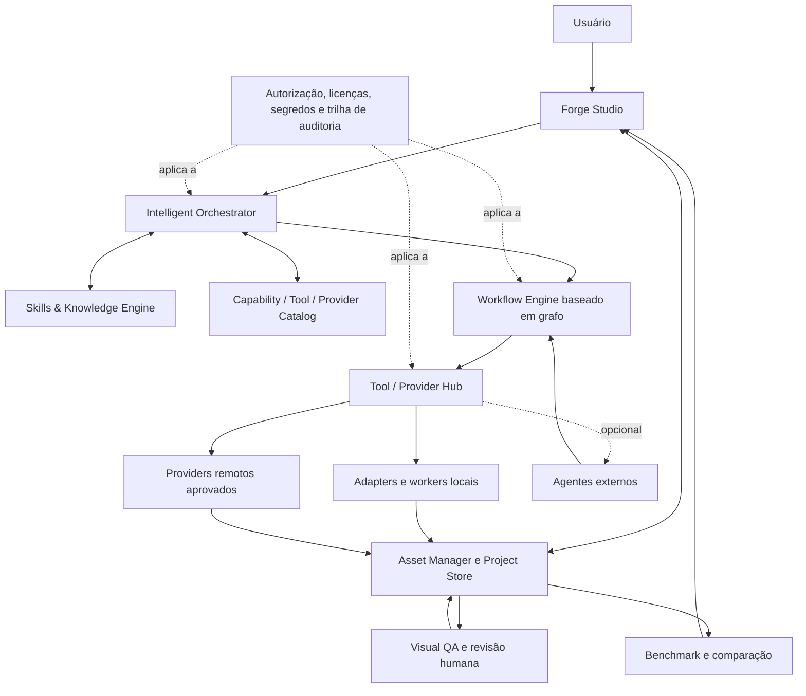

# Lia Forge — visão de produto e arquitetura-alvo

> **Estado:** visão confirmada pelo usuário; módulos e contratos descritos abaixo são arquitetura-alvo, não alegações de implementação. O estado verificável do checkout está em [`IMPLEMENTATION-AUDIT.md`](IMPLEMENTATION-AUDIT.md). Decisões técnicas ainda abertas estão em [`DECISIONS-AND-OPEN-QUESTIONS.md`](DECISIONS-AND-OPEN-QUESTIONS.md).

## Visão do produto

A Lia Forge é um **estúdio para criar, editar, converter, validar e organizar assets de jogos**. A pessoa descreve ou importa o asset, escolhe uma rota e um ponto de entrada compatível, decide quais ferramentas/providers podem ser usados, inicia explicitamente a execução e recebe arquivos reais, organizados e rastreáveis.

Não é apenas uma interface de ComfyUI/Blender, uma lista de tarefas ou uma ponte obrigatória para um agente. A Forge precisa ser utilizável sem agente, sem conta externa e sem conexão permanente à internet. Providers locais e cloud são opções; nenhum é obrigatório. O suporte efetivamente disponível depende de adapters concretos e testes, não do fato de um nome aparecer em catálogo ou documentação.

### Escopo de assets

A taxonomia deve ser extensível e não pode forçar tudo para um pipeline 3D:

- personagens e criaturas — concept, sprites, modelo 3D, rig, animação, retrato e variantes;
- itens, armas, ferramentas, props e colecionáveis;
- sprites, animações 2D, tilesets, ícones, elementos de UI e efeitos;
- ambientes, cenários, fundos estáticos, camadas, profundidade e parallax;
- modelos, materiais, texturas, rigs, clips, cenas e saídas procedurais;
- outras famílias de assets adicionáveis por pacote/contrato sem reescrever o núcleo.

A prioridade de produto já declarada é um **humanoide estilizado, corpo inteiro**, mas essa primeira fatia não deve limitar a arquitetura às categorias de personagem nem obrigar uma rota 3D.

### Rotas-alvo

A Forge deve suportar rotas independentes e combináveis, entre elas:

- Brief → 2D;
- Brief → 3D → Rig → Animação → Spritesheet;
- Manequim ou sequência de poses → 2D;
- Código/procedural → 2D ou 3D;
- Imagem → 3D;
- Asset existente → edição, conversão, otimização, retarget, render ou reexportação.

O usuário pode começar em qualquer estágio que aceite seus arquivos existentes e retomar depois sem regenerar trabalho compatível. Etapas anteriores ao ponto de entrada ficam **fora do escopo da nova execução**; não são falsamente marcadas como concluídas. A matriz de rotas e os gates estão em [`ASSET-PIPELINES.md`](ASSET-PIPELINES.md).

## Princípios e limites

1. **Ação explícita para executar.** Exibir plano e efeitos antes de iniciar; nenhum trabalho é feito só por abrir a tela ou inspecionar opções.
2. **Sem outputs ou progresso simulados.** Uma etapa só avança com arquivo real, validação declarada e evidência registrável. Progresso sem telemetria real do processo deve ser estado, não porcentagem inventada.
3. **Consentimento por efeito.** Instalação, atualização, download de modelo/asset, licença, envio de dados, uso de API, custo, upload e escrita destrutiva são decisões separadas e delimitadas.
4. **Local-first e sem agente obrigatório.** O núcleo de projeto, histórico, inspeção e operações locais deve funcionar offline; agentes e serviços cloud são opcionais.
5. **Neutralidade sem prometer compatibilidade.** Contratos comuns permitem adapters variados, mas cada par de adapter/runtime/OS/hardware requer evidência específica.
6. **Revisão humana para qualidade visual.** Checks estruturais ajudam a detectar erros; não aprovam arte, coerência de identidade, movimento, rig nem adequação ao jogo.
7. **Proveniência e direitos em cada transformação.** Código, weights, referências e outputs têm origens e licenças distintas; não se infere licença do output a partir da licença do repositório.
8. **Preservação.** Falha, cancelamento ou nova versão não apaga outputs válidos nem sobrescreve origem sem autorização.

## Arquitetura lógica-alvo

O desenho separa **plano de controle** (brief, capabilities, plano, aprovações e estado) de **plano de dados/execução** (arquivos, processos e chamadas de provider). A UI não deve chamar providers diretamente. Os adapters recebem contratos explícitos, gravam no workspace ou devolvem artefatos com origem conhecida, e nunca transformam um estado da interface em prova de que uma chamada ocorreu.

## Módulos e responsabilidades

| Módulo-alvo | Responsabilidade | Limite arquitetural | Estado do checkout |
|---|---|---|---|
| **Forge Studio** | Projetos, catálogo visual, criação/importação de tarefa, seleção de rota/ponto de entrada, consentimento, inspeção e revisão. | Apresentação e controle; sem chamadas diretas a serviços remotos e sem prévias ilustrativas apresentadas como outputs. | App Electron/React existe; capacidade e validação estão na auditoria. |
| **Asset Manager / Project Store** | IDs, versões, artefatos, lineage, referências, destinos, aprovações e proveniência. | Arquivos do usuário continuam acessíveis fora do app; migrações preservam originais. | JSON de assets e snapshots de runs, sem grafo completo de versões. |
| **Intelligent Orchestrator** | Interpretar objetivos/restrições, descobrir capabilities, sugerir DAG e explicitar lacunas/custos. | Propõe; não autoriza nem executa efeitos por conta própria. Deve ter modo sem LLM/agente. | Plano humanoide estático/contratual; não há planner geral. |
| **Workflow Engine** | Validar e executar DAG tipado, manter estado/checkpoints, pausar, cancelar, retomar e reconciliar efeitos. | Execução do grafo, não descoberta de ferramentas nem julgamento artístico. | Runner serial, contratos, autorização/revisão e validações parciais; sem scheduler DAG geral. |
| **Tool / Provider Hub** | Registro de adapters, discovery, compatibilidade, políticas, isolamento e invocation. | Adapter não é provider, skill ou workflow; cada um tem versão e licença próprias. | Adapters ComfyUI-conceito e Blender-render; sem hub genérico. |
| **Skills & Knowledge Engine** | Instruções versionadas, checklists, roteamento semântico e conhecimento de formatos/pipelines. | Conteúdo é dado não confiável; não concede permissão nem instala/executa código. | Não existe engine de skills em runtime. |
| **Visual QA** | Validação estrutural e visual assistida, render de evidência, revisão humana e critérios por tipo. | Resultado estrutural não equivale a aprovação visual. | Validadores de arquivo/atlas e instruções manuais; sem sistema geral de revisão visual. |
| **Benchmark / Comparison** | Comparar rotas e versões sob entradas/configurações equivalentes e reportar evidência. | Sem métricas inventadas; separar medições automáticas e julgamento humano. | Não implementado. |
| **Governance / Security** | Autorizações, credenciais, licenças, diretórios permitidos, rede, subprocessos, assinatura e audit log. | Default deny para efeitos externos; segredo não chega ao renderer/UI/skill. | Há proteções locais específicas; não há modelo de segurança transversal completo. |

## Fronteiras e dependências

- Um **workflow** é uma receita/instância versionada de nós e contratos; não é um agente.
- Um **adapter** é a tradução executável para uma ferramenta ou serviço; não garante que o provider esteja instalado, acessível ou licenciado.
- Um **provider** é a origem/modelo/serviço selecionado, local ou remoto; seu custo, versão, hardware e tratamento de dados precisam ser conhecidos ou apresentados como desconhecidos.
- Uma **skill** é orientação contextual; não executa subprocessos e não pode autorizar uma ação.
- Um **agente** é uma integração opcional. Se removido, ficam disponíveis a interface, os fluxos locais e os adapters aprovados.
- **QA** emite observações e evidências; a aprovação artística é uma decisão humana explícita.

## Qualidade arquitetural exigida

- Contratos versionados, migrations testadas e rejeição clara de campo desconhecido obrigatório.
- Execução idempotente quando possível; efeitos remotos incertos entram em reconciliação em vez de duplicar chamadas.
- Path traversal, symlinks fora do workspace, redirects HTTP, payloads sem limite e permissões excessivas são bloqueados.
- Política de rede explícita, telemetria desativada por padrão na Forge, segredos no host local e logs redigidos.
- Capability declara requisitos e limitações conhecidos; valor desconhecido não é transformado em compatibilidade presumida.
- Toda afirmação `VERIFIED` liga versão do software, ambiente, fixture/inputs, testes, outputs e responsável pela revisão.

## O que não está decidido aqui

Esta arquitetura não seleciona framework de plugin, banco de dados, provider, runtime de IA, GPU, modelo, serviço cloud, licença, agente, padrão de benchmark nem estratégia de instalação. Esses itens continuam abertos; os marcos podem ser desenvolvidos em paralelo conforme [`MASTER-ROADMAP.md`](MASTER-ROADMAP.md).