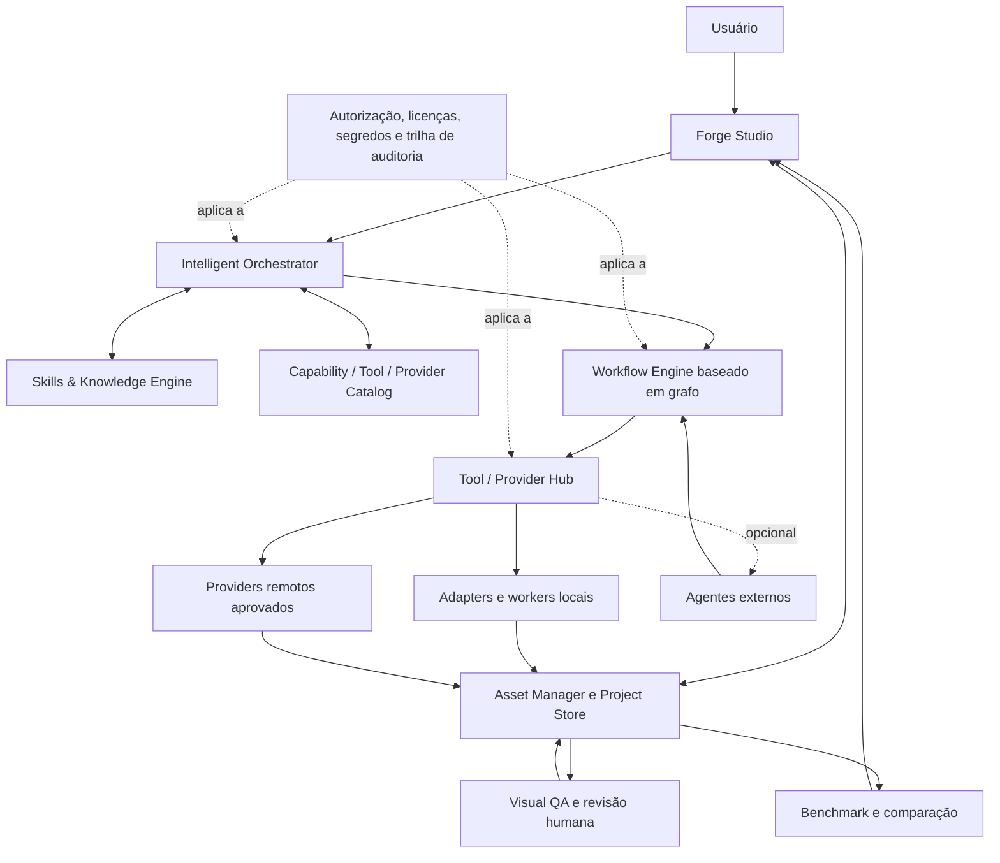

# Lia Forge — visão de produto e arquitetura-alvo

> **Estado:** visão confirmada pelo usuário; módulos e contratos descritos abaixo são arquitetura-alvo, não alegações de implementação. O estado verificável do checkout está em [`IMPLEMENTATION-AUDIT.md`](IMPLEMENTATION-AUDIT.md). Decisões técnicas ainda abertas estão em [`DECISIONS-AND-OPEN-QUESTIONS.md`](DECISIONS-AND-OPEN-QUESTIONS.md).

## Visão do produto

A Lia Forge é um **estúdio para criar, editar, converter, validar e organizar assets de jogos**. A pessoa descreve ou importa o asset, escolhe uma rota e um ponto de entrada compatível, decide quais ferramentas/providers podem ser usados, inicia explicitamente a execução e recebe arquivos reais, organizados e rastreáveis.

Não é apenas uma interface de ComfyUI/Blender, uma lista de tarefas ou uma ponte obrigatória para um agente. A Forge precisa ser utilizável sem agente, sem conta externa e sem conexão permanente à internet. Providers locais e cloud são opções; nenhum é obrigatório. O suporte efetivamente disponível depende de adapters concretos e testes, não do fato de um nome aparecer em catálogo ou documentação.

### Escopo de assets

A taxonomia deve ser extensível e não pode forçar tudo para um pipeline 3D:

- personagens e criaturas — concept, sprites, modelo 3D, rig, animação, retrato e variantes;
- itens, armas, ferramentas, props e colecionáveis;
- sprites, animações 2D, tilesets, ícones, elementos de UI e efeitos;
- ambientes, cenários, fundos estáticos, camadas, profundidade e parallax;
- modelos, materiais, texturas, rigs, clips, cenas e saídas procedurais;
- outras famílias de assets adicionáveis por pacote/contrato sem reescrever o núcleo.

A prioridade de produto já declarada é um **humanoide estilizado, corpo inteiro**, mas essa primeira fatia não deve limitar a arquitetura às categorias de personagem nem obrigar uma rota 3D.

### Rotas-alvo

A Forge deve suportar rotas independentes e combináveis, entre elas:

- Brief → 2D;
- Brief → 3D → Rig → Animação → Spritesheet;
- Manequim ou sequência de poses → 2D;
- Código/procedural → 2D ou 3D;
- Imagem → 3D;
- Asset existente → edição, conversão, otimização, retarget, render ou reexportação.

O usuário pode começar em qualquer estágio que aceite seus arquivos existentes e retomar depois sem regenerar trabalho compatível. Etapas anteriores ao ponto de entrada ficam **fora do escopo da nova execução**; não são falsamente marcadas como concluídas. A matriz de rotas e os gates estão em [`ASSET-PIPELINES.md`](ASSET-PIPELINES.md).

## Princípios e limites

1. **Ação explícita para executar.** Exibir plano e efeitos antes de iniciar; nenhum trabalho é feito só por abrir a tela ou inspecionar opções.
2. **Sem outputs ou progresso simulados.** Uma etapa só avança com arquivo real, validação declarada e evidência registrável. Progresso sem telemetria real do processo deve ser estado, não porcentagem inventada.
3. **Consentimento por efeito.** Instalação, atualização, download de modelo/asset, licença, envio de dados, uso de API, custo, upload e escrita destrutiva são decisões separadas e delimitadas.
4. **Local-first e sem agente obrigatório.** O núcleo de projeto, histórico, inspeção e operações locais deve funcionar offline; agentes e serviços cloud são opcionais.
5. **Neutralidade sem prometer compatibilidade.** Contratos comuns permitem adapters variados, mas cada par de adapter/runtime/OS/hardware requer evidência específica.
6. **Revisão humana para qualidade visual.** Checks estruturais ajudam a detectar erros; não aprovam arte, coerência de identidade, movimento, rig nem adequação ao jogo.
7. **Proveniência e direitos em cada transformação.** Código, weights, referências e outputs têm origens e licenças distintas; não se infere licença do output a partir da licença do repositório.
8. **Preservação.** Falha, cancelamento ou nova versão não apaga outputs válidos nem sobrescreve origem sem autorização.

## Arquitetura lógica-alvo

O desenho separa **plano de controle** (brief, capabilities, plano, aprovações e estado) de **plano de dados/execução** (arquivos, processos e chamadas de provider). A UI não deve chamar providers diretamente. Os adapters recebem contratos explícitos, gravam no workspace ou devolvem artefatos com origem conhecida, e nunca transformam um estado da interface em prova de que uma chamada ocorreu.

## Módulos e responsabilidades

| Módulo-alvo | Responsabilidade | Limite arquitetural | Estado do checkout |
|---|---|---|---|
| **Forge Studio** | Projetos, catálogo visual, criação/importação de tarefa, seleção de rota/ponto de entrada, consentimento, inspeção e revisão. | Apresentação e controle; sem chamadas diretas a serviços remotos e sem prévias ilustrativas apresentadas como outputs. | App Electron/React existe; capacidade e validação estão na auditoria. |
| **Asset Manager / Project Store** | IDs, versões, artefatos, lineage, referências, destinos, aprovações e proveniência. | Arquivos do usuário continuam acessíveis fora do app; migrações preservam originais. | JSON de assets e snapshots de runs, sem grafo completo de versões. |
| **Intelligent Orchestrator** | Interpretar objetivos/restrições, descobrir capabilities, sugerir DAG e explicitar lacunas/custos. | Propõe; não autoriza nem executa efeitos por conta própria. Deve ter modo sem LLM/agente. | Plano humanoide estático/contratual; não há planner geral. |
| **Workflow Engine** | Validar e executar DAG tipado, manter estado/checkpoints, pausar, cancelar, retomar e reconciliar efeitos. | Execução do grafo, não descoberta de ferramentas nem julgamento artístico. | Runner serial, contratos, autorização/revisão e validações parciais; sem scheduler DAG geral. |
| **Tool / Provider Hub** | Registro de adapters, discovery, compatibilidade, políticas, isolamento e invocation. | Adapter não é provider, skill ou workflow; cada um tem versão e licença próprias. | Adapters ComfyUI-conceito e Blender-render; sem hub genérico. |
| **Skills & Knowledge Engine** | Instruções versionadas, checklists, roteamento semântico e conhecimento de formatos/pipelines. | Conteúdo é dado não confiável; não concede permissão nem instala/executa código. | Não existe engine de skills em runtime. |
| **Visual QA** | Validação estrutural e visual assistida, render de evidência, revisão humana e critérios por tipo. | Resultado estrutural não equivale a aprovação visual. | Validadores de arquivo/atlas e instruções manuais; sem sistema geral de revisão visual. |
| **Benchmark / Comparison** | Comparar rotas e versões sob entradas/configurações equivalentes e reportar evidência. | Sem métricas inventadas; separar medições automáticas e julgamento humano. | Não implementado. |
| **Governance / Security** | Autorizações, credenciais, licenças, diretórios permitidos, rede, subprocessos, assinatura e audit log. | Default deny para efeitos externos; segredo não chega ao renderer/UI/skill. | Há proteções locais específicas; não há modelo de segurança transversal completo. |

## Fronteiras e dependências

- Um **workflow** é uma receita/instância versionada de nós e contratos; não é um agente.
- Um **adapter** é a tradução executável para uma ferramenta ou serviço; não garante que o provider esteja instalado, acessível ou licenciado.
- Um **provider** é a origem/modelo/serviço selecionado, local ou remoto; seu custo, versão, hardware e tratamento de dados precisam ser conhecidos ou apresentados como desconhecidos.
- Uma **skill** é orientação contextual; não executa subprocessos e não pode autorizar uma ação.
- Um **agente** é uma integração opcional. Se removido, ficam disponíveis a interface, os fluxos locais e os adapters aprovados.
- **QA** emite observações e evidências; a aprovação artística é uma decisão humana explícita.

## Qualidade arquitetural exigida

- Contratos versionados, migrations testadas e rejeição clara de campo desconhecido obrigatório.
- Execução idempotente quando possível; efeitos remotos incertos entram em reconciliação em vez de duplicar chamadas.
- Path traversal, symlinks fora do workspace, redirects HTTP, payloads sem limite e permissões excessivas são bloqueados.
- Política de rede explícita, telemetria desativada por padrão na Forge, segredos no host local e logs redigidos.
- Capability declara requisitos e limitações conhecidos; valor desconhecido não é transformado em compatibilidade presumida.
- Toda afirmação `VERIFIED` liga versão do software, ambiente, fixture/inputs, testes, outputs e responsável pela revisão.

## Consistência nos dois produtos: Lia Studio e Lia Forge

> **Estado:** `PROPOSED` — desenho de arquitetura-alvo para avaliação humana. Nada aqui altera código, contratos, banco de dados, serviço ou o escopo aprovado; a especificação de Domain Contracts continua `DRAFT_FOR_HUMAN_REVIEW — NOT AUTHORIZED FOR IMPLEMENTATION` e o ADR-001 continua `ACCEPTED — ARCHITECTURE ONLY`. As alternativas abaixo **não** escolhem banco, serviço nem módulo único.

A exigência arquitetural é que a identidade e a consistência existam nos **dois** produtos, com responsabilidades separadas, dados compatíveis e integração explícita — sem duas implementações isoladas que discordem entre si. O **Lia Studio** compreende a identidade global do jogo; a **Lia Forge** aplica essa identidade e mantém um sistema próprio de consistência de produção. Nenhum dos dois é redutível ao outro: o Studio não é um mero consumidor de arquivos prontos, e a Forge não é uma mera executora de pedidos.

### O que cada produto compreende

| Produto | Compreensão que precisa ter | O que não é responsabilidade dele |
|---|---|---|
| **Lia Studio** (jogo) | Direção artística; GDD, mundo e narrativa; personagens, locais e identidade de objetos/itens; regras de design; referências e decisões aprovadas; relações entre esses elementos; mudanças de direção e seus impactos; critérios de aceitação **no contexto do jogo**. Precisa ser capaz de detectar um asset **tecnicamente correto e visualmente incompatível** com o jogo. | Execução de pipeline, escolha de provider, validação estrutural de arquivo, rig, bake, atlas, otimização ou render. |
| **Lia Forge** (produção) | Aplicar a identidade recebida **e manter sistema próprio** de consistência de produção: perfil visual de projeto/Style Bible; referências e suas funções; identidade de personagens e objetos; relações entre assets e versões; consistência entre vistas, ângulos, poses e expressões; entre cabelo, roupas, acessórios e partes modulares; entre representações 2D, 2.5D e 3D; materiais, texturas, iluminação e estilo; continuidade entre workflows e providers; detecção de desvios e seu impacto; registro de alterações e justificativas de desvios aprovados. | Definir direção artística, narrativa, cânone do mundo ou critérios de aceitação do jogo. A Forge **não pode apenas receber texto e esquecer o contexto**: contexto recebido precisa virar registro versionado, com origem, e produzir evidência de volta. |

A fronteira prática é: **o Studio decide o que o jogo é; a Forge prova o que foi produzido e como se relaciona com o que foi pedido.** Um asset pode passar em todos os gates estruturais da Forge e ainda ser incompatível com o jogo — por isso o julgamento de adequação no contexto do jogo permanece no Studio, e a aprovação artística permanece decisão humana explícita (princípio 6 desta arquitetura).

### Os dez pontos de integração

1. **O que pertence ao projeto e é reconhecido pelos dois:** direção artística, identidade de personagens/locais/objetos, referências aprovadas com sua função, regras de design e decisões registradas. Na forma já proposta, isso é o perfil visual do projeto (`ProjectVisualProfile` / `ProjectVisualProfileVersion`, spec §3.8) mais relações (`AssetRelationship`, spec §3.9) — com traits de origem `manual`, `imported_reference` ou `ai_proposal`.
2. **O que é só de produção (Forge):** estado de etapas e runs, contratos de I/O por passo, validadores estruturais, formatos e destinos de export, seleção e estado real de adapters/providers, evidências de execução, gates de QA estrutural, retomada e idempotência, custos e consentimentos por efeito.
3. **O que é só do jogo (Studio):** GDD, mundo, narrativa, regras de design, critérios de aceitação no contexto do jogo, cânone e prioridades de conteúdo, e o julgamento de compatibilidade visual de um asset com o jogo.
4. **Como o Studio dá contexto sem excesso:** por **projeção datada e mínima**, não por dump do projeto — um perfil visual versionado (traits com estado `specified`/`unknown`/`not_applicable`), as referências aprovadas com hash e função, e apenas as relações relevantes para a categoria pedida. O mecanismo de caminho já existe e não precisa ser inventado: `SPRITEFORGE_PROJECT_ROOT` pode apontar diretamente para um projeto de jogo existente, e `LIA_HOME` define a raiz comum do ecossistema ([`lia-ecosystem-integration.md`](lia-ecosystem-integration.md)). Contexto sem hash, sem origem e sem versão não é contexto utilizável.
5. **Como a Forge devolve evidências, desvios, limitações e referências:** por registros que já têm forma proposta — `ValidationResult` e `ConsistencyAssessment` (spec §3.7, §3.11) para evidência e achados, `StyleDeviationDecision` (§3.12) para desvio aprovado com justificativa, `HumanReview` (§3.10) com `reviewBasis` e `limitations`, `Provenance` (§3.6) para origem e direitos, e `ChangeImpactReport`/`ImpactDecisionEvent` (§3.13, §3.14) para impacto. A devolução precisa dizer **o que foi medido, o que não foi, e o que ficou `unknown`** — nunca promover ausência de erro em aprovação artística.
6. **Como versionar perfil e referências:** perfil como aggregate com versões imutáveis e ponteiro `currentApprovedVersionRef` que só avança com `HumanReview = approve`; cada versão com `parentRefs`, `contentDigest` e `contentSchemaVersion` próprios; referências como artefatos com hash exato, cujo uso como baseline exige review aplicável (spec §3.8, §6). Isso já está desenhado; falta decidir o shape do conteúdo (spec §11, item 3).
7. **Como mudanças afetam assets existentes:** por `ChangeImpactReport` **informativo** a partir de um snapshot do grafo, expandindo apenas arestas explícitas com predicado e versão de catálogo conhecidos, e marcando `impactClass: "unknown"` com `limitations` onde o caminho é incerto (spec §7). A Forge não reescreve assets automaticamente: mudança de direção gera revisão, e revisão gera decisão humana.
8. **Como evitar versões conflitantes:** imutabilidade append-only (mudança é record novo com `supersedesRef`), um único aggregate de perfil ativo por projeto (dois ativos são erro de grafo), CAS no ponteiro de versão aprovada (spec §4.5) e proibição de edição de histórico. Conflito entre duas projeções (Studio e Forge) precisa de regra de precedência **explícita e registrada**, não de último-que-escreveu.
9. **Como a Forge funciona sem o Studio:** o perfil visual é **opcional e local**. Sem Studio, a Forge opera com perfil criado manualmente ou `unknown` declarado por trait, referências importadas com hash e direitos registrados, e todos os gates de produção funcionando — nada de identidade pode virar dependência de outro produto. `unknown` é estado válido e não pode ser preenchido por suposição (princípio 4, local-first; princípio 5, neutralidade sem prometer compatibilidade; e requisito confirmado 9).
10. **Como atender Lia Desktop e outros destinos sem projeto de jogo:** o perfil precisa ser **adaptável ao destino sem fragmentar o sistema de assets** — a mesma identidade de asset projetada para requisitos diferentes por destino (por exemplo, paleta e escala para pixel-art, contagem de triângulos e materiais para 3D, duração e fps para vídeo). Na forma já proposta, isso é extensão de `ArtifactVersion.extensions` com `ValidationResult.targetRef` apontando o destino (proposta §8.1, reconciliação R24) — o **shape dessas extensões permanece pendente** (spec §11, item 12).

### Alternativas para o contrato compartilhado (avaliação, não decisão)

Faz sentido um **contrato compartilhado e versionado de identidade/consistência, com projeções ou extensões por produto**? As três formas candidatas:

| Alternativa | Forma | Consequências positivas | Consequências negativas / riscos | O que exigiria decidir |
|---|---|---|---|---|
| **A — Núcleo compartilhado + projeções por produto** *(candidata a avaliar)* | Um contrato de identidade/consistência versionado (envelope, perfil, referências com função, relações, avaliação, desvio) com um núcleo comum e **projeções/extensões** por produto; cada produto escreve só o que é seu. | Uma única semântica para "identidade" e "desvio"; evidência da Forge legível pelo Studio sem tradução ad hoc; contexto do jogo reutilizável em outros produtos; compatível com o que a spec já desenha (`scope` + `extensions` em §3.8). | Exige governança de versão do núcleo e regra de precedência; risco de acoplamento de release entre produtos; **precedente externo de alerta:** no ArtCraft, o contrato puro `craft-ai-core` foi promovido a `craft-libs` e o workspace downstream manteve cópia local com adições pendentes, exigindo um documento de fronteira (`docs/CORE-SYNC.md`) — ou seja, contrato compartilhado sem sincronização disciplinada **produz duas implementações que divergem** (item 15 da pesquisa). | Quem é dono do núcleo; como se versiona; qual projeção prevalece em conflito; como um produto consome versão antiga; onde fica o registro (arquivo, banco ou serviço) — **decisão separada e posterior**. |
| **B — Dois contratos independentes + mapeamento explícito** | Studio e Forge mantêm contratos próprios e publicam um mapeador versionado entre eles. | Autonomia total de release; nenhum produto bloqueia o outro; mais fácil de começar. | Duplicação de semântica (dois conceitos de "referência", "desvio", "identidade"); mapeador vira ponto único de falha e de tradução lossy; probabilidade alta de divergência silenciosa — exatamente o que a exigência arquitetural quer evitar. | Semântica do mapeador; quem valida; como detectar divergência; o que acontece quando um lado muda. |
| **C — Contrato único do Studio, consumido read-only pela Forge** | Só o Studio escreve identidade; a Forge apenas lê. | Simplicidade máxima; uma fonte de verdade. | **Viola a exigência:** a Forge deixaria de manter sistema próprio de consistência de produção e ficaria inutilizável sem o Studio (contraria o ponto 9); evidências, desvios e justificativas de produção não teriam onde ser escritos. | Nada recomendado para avaliação, mantido aqui como contraste. |

Nenhuma alternativa está aprovada. A escolha entre elas é **decisão humana**, e a escolha de armazenamento (JSON no workspace, banco, serviço compartilhado, descoberta por `%APPDATA%\Lia\lia.json` e registro `HKCU\Software\Lia`) é **outra** decisão, posterior e independente — a forma do contrato não deve presumir o meio.

### Onde isso já existe nos documentos (sem inventar campos)

A forma necessária já está desenhada e **não precisa de campos novos** para esta discussão: `ProjectVisualProfile`/`ProjectVisualProfileVersion` com `scope` literal `{ "kind": "project" }` e `extensions` preservados para versões futuras de scope (spec §3.8); `TraitOrigin` com `manual`/`imported_reference`/`ai_proposal` (§3.8); `AssetRelationship` com predicados `lia.rel.uses_reference`, `derived_from`, `variant_of`, `uses_hair`, `uses_rig`, `uses_motion`, `animates`, `contains` (§7.1); `ConsistencyAssessment` (§3.11); `StyleDeviationDecision` (§3.12); `ChangeImpactReport`/`ImpactDecisionEvent` (§3.13, §3.14); e a proposta de FASE B §3 a §7 em [`DOMAIN-CONTRACTS-EVOLUTION-PROPOSAL.md`](DOMAIN-CONTRACTS-EVOLUTION-PROPOSAL.md).

**Dois limites reais já registrados precisam ser enfrentados por qualquer alternativa:**

- `AssetRelationship` porta **um único `projectRef`** e, portanto, **não representa relação entre endpoints de Projects diferentes**; se isso for necessário, é decisão pendente (spec §11, item 11). Identidade compartilhada entre dois produtos **é** um caso entre projetos distintos.
- `ProjectVisualProfile` tem **um único scope em v1** (`kind: "project"`). Projeções por produto ou por destino exigiriam extensão de scope — caminho previsto no campo `extensions`, mas **não desenhado** e não aprovado.

### O que precisa ser refletido no Lia Studio — e o documento inexistente

**Verificação de 2026-11-11 UTC:** o arquivo **`docs/LIA-FORGE-NA-PIPELINE.md` não existe**. Não está no workspace, não está na árvore publicada desta branch (104 arquivos, 43 `.md`), nenhuma referência a esse nome aparece em `docs/` nem nos `.md` da raiz deste repositório, e a busca no GitHub por esse nome retornou **0 repositórios e 0 resultados de código**. **O documento não foi inventado, criado nem substituído por um equivalente fictício nesta tarefa.** Se ele existe, está em outro repositório não acessível a partir deste checkout; se foi planejado, ainda não foi escrito. Os destinos reais desta documentação para o mesmo assunto são [`lia-ecosystem-integration.md`](lia-ecosystem-integration.md) (políticas do ecossistema Lia, caminhos de dados e limites em aberto; **tem revisão local de 2026-11-06 não publicada**) e esta seção.

O que o lado **Lia Studio** precisaria refletir, quando e se aquele documento for escrito ou localizado:

1. Que a Forge mantém **sistema próprio** de consistência de produção e não é apenas consumidora de um perfil enviado.
2. Que o contexto enviado pelo Studio precisa ser **versionado, com hash e origem** (perfil + referências aprovadas + relações relevantes), e não texto livre.
3. Que a Forge devolve **evidência, desvios, limitações e `unknown`** — e que ausência de erro estrutural **não** é aprovação artística nem compatibilidade com o jogo.
4. Que o julgamento de **compatibilidade visual no contexto do jogo** pertence ao Studio, com decisão humana registrada.
5. Que mudanças de direção artística geram **Change Impact informativo** e revisão, nunca reescrita automática de assets.
6. Que a Forge precisa funcionar **sem** o Studio (perfil opcional, `unknown` válido) e atender destinos sem projeto de jogo (Lia Desktop e outros) por projeção de perfil, sem fragmentar o sistema de assets.
7. Que **nenhum contrato compartilhado foi aprovado**: alternativa A/B/C, dono do núcleo, precedência em conflito e meio de armazenamento continuam como decisões humanas em aberto.

### Ambiguidade de nomes a resolver

Três "Studio" diferentes aparecem nesta documentação e não devem ser confundidos: **"Forge Studio"** é o módulo de apresentação da Lia Forge (tabela de módulos acima e `MASTER-ROADMAP.md` M1); **"Lia Studio"** é um produto do ecossistema Lia ([`BRAND-STANDARDS.md`](BRAND-STANDARDS.md)); **"ArtCraft Studio"** e **"HyperFrames Studio"** são produtos externos dos itens 15 e 16 da pesquisa. Recomenda-se que qualquer documento futuro use o nome completo do produto (`Lia Studio`, `Lia Forge`) e evite "Studio" isolado.

### Questões abertas desta seção (exigem decisão humana)

1. Qual alternativa de contrato compartilhado (A, B ou C) será avaliada, e quem é o dono do núcleo de identidade?
2. Qual a **precedência** quando a projeção do Studio e a da Forge discordam sobre o mesmo trait?
3. `AssetRelationship` passa a suportar endpoints de Projects diferentes (spec §11, item 11), ou a identidade compartilhada usa outro mecanismo?
4. `ProjectVisualProfile` ganha scope além de `kind: "project"` (por produto, por destino), ou cada produto mantém aggregate próprio ligado por relação?
5. Onde vive o registro compartilhado: arquivo no workspace, banco, serviço do ecossistema ou descoberta por `%APPDATA%\Lia\lia.json`/`HKCU\Software\Lia`? (Decisão posterior e independente da forma do contrato.)
6. Como o Studio detecta "asset tecnicamente correto e visualmente incompatível" — rubrica própria, `ConsistencyAssessment` recebido da Forge, ou ambos?
7. O documento `docs/LIA-FORGE-NA-PIPELINE.md` deve ser criado, localizado em outro repositório ou substituído por `lia-ecosystem-integration.md` como fonte?
8. Publica-se a revisão local 2026-11-06 de `lia-ecosystem-integration.md` e a revisão 2026-10-28 de `product-gap-analysis.md`, hoje divergentes entre workspace e árvore publicada?

## O que não está decidido aqui

Esta arquitetura não seleciona framework de plugin, banco de dados, provider, runtime de IA, GPU, modelo, serviço cloud, licença, agente, padrão de benchmark nem estratégia de instalação. Esses itens continuam abertos; os marcos podem ser desenvolvidos em paralelo conforme [`MASTER-ROADMAP.md`](MASTER-ROADMAP.md). Também não seleciona o modelo de contrato de identidade/consistência compartilhado entre Lia Studio e Lia Forge (alternativas A/B/C da seção anterior), seu dono, sua precedência em conflito nem o meio onde o registro vive.