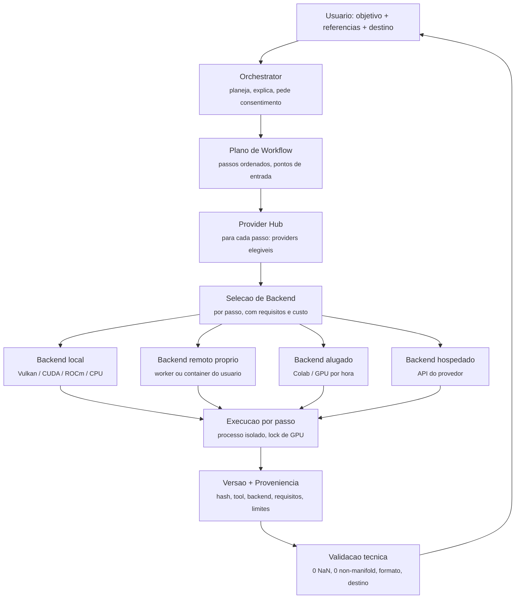

# T9 — Arquitetura de Execution Backend: Capability · Workflow · Provider/Adapter · Backend

> **Estado:** `PROPOSED`. **Não é contrato definitivo e não autoriza implementação.** Não altera a especificação de Domain Contracts, o ADR-001, nenhum código nem nenhuma configuração.
> **Data:** 2026-11-12 UTC. **Base empírica:** [`T9-HYBRID-EXECUTION-AND-ASSET-PRODUCTION-RESEARCH.md`](T9-HYBRID-EXECUTION-AND-ASSET-PRODUCTION-RESEARCH.md) e [`T9-ASSET-TOOLS-AND-EXECUTION-MATRIX.md`](T9-ASSET-TOOLS-AND-EXECUTION-MATRIX.md).
> **Regra de ouro:** *o backend não é o provider.* **TRELLIS.2 é uma tecnologia que executa uma etapa; Colab é um ambiente onde ela pode executar.** São dimensões diferentes e não podem ser fundidas num campo só.
> **Não duplicar:** esta camada vive **dentro** do [`TOOL-PROVIDER-HUB.md`](TOOL-PROVIDER-HUB.md) e do [`WORKFLOW-ENGINE.md`](WORKFLOW-ENGINE.md) existentes. Nenhuma entidade nova de domínio é proposta aqui além de **um** conceito (Execution Backend) e dos requisitos por passo que o tornam selecionável.

## 1. As quatro dimensões

| Dimensão | Pergunta que responde | Exemplo | Dono da decisão |
|---|---|---|---|
| **Capability** | *O que* o usuário quer produzir | `image3d.generate-mesh`, `mesh.make-watertight`, `mesh.retopologize`, `mesh.unwrap-uv`, `texture.bake-pbr`, `texture.generate-from-image`, `rig.fit-skeleton`, `rig.skin`, `motion.from-text`, `motion.from-video`, `motion.retarget`, `render.spritesheet`, `image.pixelate`, `asset.export-for-target` | Produto (catálogo de capacidades) |
| **Workflow** | *Como* as etapas se organizam e se conectam | `character-game-ready`: referência → gerar → watertight → retopo → UV → bake → textura → rig → animar → exportar → validar no destino | Produto + plano por execução |
| **Provider / Adapter** | *Qual* ferramenta, modelo ou serviço executa a etapa | TRELLIS.2-4B, Pixal3D, `pixal3d.cpp`, CuMesh, `manifold`, xatlas, UltraTex, FLUX.2-klein-4B, SkinTokens, Kimodo, GEM-X, Rodin Gen-2, Blender, Godot | Provider Hub (compatibilidade + direitos) |
| **Execution Backend** | *Onde* e em *qual ambiente* executa | `local-windows-cuda`, `local-windows-vulkan`, `local-linux-rocm`, `local-cpu`, `colab-t4-free`, `colab-a100`, `runpod-gpu`, `worker-remoto-proprio`, `api-hospedada` | Seleção explícita do usuário + elegibilidade técnica |

**Um provider pode rodar em vários backends** (`pixal3d.cpp` roda em CUDA, ROCm, Vulkan e CPU; ComfyUI roda local e em container remoto). **Um backend pode hospedar vários providers** (um pod RunPod com ComfyUI hospeda TRELLIS.2, Pixal3D e os nós de malha). **Um workflow pode usar backends diferentes por passo** — e é isso que permite atender uma RX 580 sem excluir produção avançada.

### 1.1 Diagrama de relações

### 1.2 O que cada camada **não** decide

- O **Orchestrator** não escolhe backend sozinho: propõe e explica; a escolha é explícita.
- O **Provider Hub** não decide direitos: aplica a política de admissão e bloqueia o que não está admitido.
- O **Workflow Engine** não sabe onde executa: sabe **o que** precisa ser executado e **com que requisitos**.
- O **Backend** não sabe o que é um asset: só executa um passo e devolve artefato + evidência.
- **Nenhum** deles aprova visual, licença ou gate do jogo (ver [`STUDIO-FORGE-CONSISTENCY-ARCHITECTURE.md`](STUDIO-FORGE-CONSISTENCY-ARCHITECTURE.md)).

## 2. Requisitos declarados por passo (o que torna a seleção possível)

Sem isto, "escolher backend" é chute. Cada passo de um plano declara, **antes** de executar:

| Campo | Conteúdo | Exemplo real observado |
|---|---|---|
| `capability` | Identificador da capacidade | `texture.bake-pbr` |
| `provider` | Implementação escolhida, com **pin** (repo/branch/commit ou versão de API) | `SifuInTheShell/Effigy` bake sobre `CuMesh` @ commit pinado |
| `os` | Sistemas suportados | `windows`, `linux` |
| `gpu.arch` | Arquiteturas com binário/wheel disponível | `sm_89`, `sm_120`, `gfx1201`, `vulkan-any`, `cpu` |
| `vram.required` / `vram.measured` | Necessário e **medido** (quando houver medição de terceiro) | TRELLIS.2 pico próprio **4,28 GB** (med. em RX 9070 XT) |
| `ram.required` | Memória de host | Effigy: motores 3D atingem **~20 GB**; recomendado 32 GB |
| `disk.required` | Pesos + intermediários | `trellis.cpp` **~16,5 GB**; Effigy **70–160 GB**; GGUF **789 MB–2,62 GB** |
| `network` | `none` / `download-weights` / `upload-input` / `api-call` | Rodin: `upload-input` + `api-call`; Effigy local: `none` após install |
| `time.estimated` | Estimativa declarada (com fonte) | prop completo ~3 min (med. RTX 5080 Laptop) |
| `cost.estimated` | Zero, desconhecido ou faixa — **sem inventar número** | local `0`; alugado `unknown` até consulta |
| `rights` | Categoria de admissão + restrições propagadas | `ADMIT_WITH_RESTRICTIONS`; `restricted` se derivado de componente com restrição territorial |
| `consent.required` | Efeitos que exigem autorização | `download_weights`, `upload_input`, `paid_execution`, `accept_license` |
| `fallback` | Provider/backend alternativo e o que se perde | `manifold` no lugar de `MeshLib`; `--cpu` no lugar de Vulkan (mais lento) |
| `evidence.expected` | O que será registrado | hashes, `meta.json` com tags de licença, métricas de validação |

### 2.1 Regras de seleção (propostas)

1. **Elegibilidade antes de preferência:** um passo só lista backends cujos requisitos declarados caibam no ambiente. Se nada cabe, o passo é **recusado com o motivo e a alternativa mais leve nomeada** — o padrão observado no Effigy: *"uma variante cujo pico medido nunca cabe é recusada com a mais leve nomeada; uma que não cabe ao lado de outros programas agora é recusada como 'GPU ocupada'"*.
2. **Orçamento, não esperança:** cada passo pode alocar **o que estiver livre no início − margem de contexto** (o Effigy usa −0,8 GB); **um passo pesado por vez** (lock global de GPU).
3. **Seleção explícita:** o usuário vê o backend escolhido por passo e pode trocar. Nada de "automático silencioso".
4. **Estimativa antes de executar:** tempo, VRAM/RAM/disco, custo e o que sai da máquina.
5. **Teto de gasto configurável** por tentativa, por execução e por projeto; atingir o teto **para** a execução e registra a parada.
6. **Consentimento por efeito:** `download_weights`, `upload_input`, `paid_execution`, `accept_license`, `install_tool` são autorizações separadas.
7. **Nenhum upload sem autorização** e nunca de arquivo privado por padrão.
8. **Falha parcial é registrada:** qual passo falhou, em que backend, com que erro, o que foi preservado.

## 3. Cenários híbridos (o mesmo workflow, backends diferentes)

### Cenário 1 — Alvo do ADR-001 (RX 580 8 GB, Ryzen 5 5500, **16 GB RAM**, Windows)

| Passo | Provider candidato | Backend | Por quê |
|---|---|---|---|
| `reference.prepare` (remoção de fundo, recorte, câmera) | BiRefNet (MIT), MoGe-2/3 (MIT) | **local-cpu** ou **local-vulkan** | Leve; sem GPU dedicada |
| `image3d.generate-mesh` | **`pixal3d.cpp` (MIT, Vulkan)** — probe E1 | **local-vulkan** | Único caminho sem CUDA/ROCm; **`unknown` para gfx803** |
| ↳ se o probe falhar | Rodin Gen-2 ou Colab A100 com pesos int8 | **api-hospedada** / **colab-a100** | Exige consentimento de upload + gasto |
| `mesh.make-watertight` / `mesh.retopologize` | CuMesh (MIT) ou `manifold` (Apache-2.0) + QuadriFlow do Blender | **local-cpu** / Blender subprocesso | CPU é suficiente; **evita MeshLib (não comercial)** |
| `mesh.unwrap-uv` | xatlas (MIT) | **local-cpu** | Maduro e leve |
| `texture.bake-pbr` | Re-bake do volume persistido (conceito Effigy) **ou** rasterizador pure-torch | **local-cpu/vulkan** | **Evita nvdiffrast (não comercial)** |
| `texture.generate-from-image` | FLUX.2-**klein-4B** (Apache-2.0) | **remoto** (~13 GB VRAM) | Não cabe em 8 GB; variante **4B**, nunca 9B |
| `rig.fit-skeleton` / `rig.skin` | Template Mixamo 52 juntas + *bone heat* do Blender | **local-cpu** | SkinTokens exige build CUDA |
| `motion.from-text` | **`kimodo.cpp` (Apache-2.0)** com checkpoint **SOMA** — probe E2 | **local-cpu/vulkan** | <2 GB, dois núcleos mínimo; **sem export GLB ainda** |
| `motion.retarget` | Blender Retarget (GPL, subprocesso) | **local** | — |
| `render.spritesheet` / `image.pixelate` | Código próprio da Forge + Blender Workbench | **local** | **Já existe como código** |
| `asset.export-for-target` | Perfis Godot/Unreal/Unity | **local** | — |
| `validate.on-target` | Godot headless | **local** | Import verificado headless por terceiro na 4.7 |

**Leitura honesta:** neste cenário **quatro passos são `unknown`** (geração via Vulkan, texturização remota, motion local, bake sem nvdiffrast) e **dois exigem decisão de custo/privacidade**. O piso garantido continua sendo o **caminho manual + render/validação da Forge** (R4 da T8).

### Cenário 2 — Máquina com NVIDIA ≥16 GB

Todos os passos locais; `local-cuda` como padrão; nenhuma decisão de custo. É o cenário em que a cadeia medida pelo Effigy se aplica (233,8 s para um prop completo, com picos por passo publicados).

### Cenário 3 — Sem GPU utilizável (CPU apenas)

`image3d.generate-mesh` por **api-hospedada** ou **colab**; todo o resto local em CPU (malha, UV, bake leve, rig por template, retarget, spritesheet, export). **Nenhuma dependência obrigatória de internet para os passos que podem ser locais.**

### Cenário 4 — Worker remoto próprio (a opção que preserva privacidade)

Um `trellis-server`/ComfyUI numa máquina da equipe, na rede local ou em VPS do usuário: `network = api-call` **sem** envio a fornecedor terceiro. É a resposta para "GPU melhor sem depender de serviço hospedado" e a única que mantém "nada sai do controle do usuário" com hardware avançado.

### Cenário 5 — Híbrido com retomada

Passos 1–3 locais → passo 4 remoto (falha) → **registro da falha parcial** → retomada do passo 4 em backend alternativo **sem refazer os passos 1–3**, porque cada passo lê uma pasta de versão e escreve a próxima. **Pré-requisito:** versões por passo nunca sobrescritas (padrão do Effigy: `library/<asset>/<NNN_step>/files + meta.json`).

## 4. Orchestrator, Provider Hub e Workflow Engine: o que muda em cada um

| Componente existente | O que a camada de backend acrescenta | O que **não** muda |
|---|---|---|
| [`INTELLIGENT-ORCHESTRATOR.md`](INTELLIGENT-ORCHESTRATOR.md) | O plano passa a propor **backend por passo** com requisitos, custo estimado e alternativas; e pode ser **por template, sem LLM** (opção mais barata e auditável, observada no Effigy) | Entradas explícitas, passos de planejamento, modo offline, ausência de ação externa sem consentimento |
| [`TOOL-PROVIDER-HUB.md`](TOOL-PROVIDER-HUB.md) | Cada entrada de provider ganha: **pin**, requisitos por passo (`os`, `gpu.arch`, `vram`, `ram`, `disk`, `network`), **categoria de admissão**, restrições propagadas e `fallback` | Gate de direitos fail-closed, consentimento por efeito, nenhum provider obrigatório |
| [`WORKFLOW-ENGINE.md`](WORKFLOW-ENGINE.md) | Três mecanismos observados: **lock global de GPU** (um passo pesado por vez), **orçamento de VRAM com recusa nomeada**, e **trabalhador residente** para famílias pesadas (evita recarregar modelo por passo; `--serve` com JSON lines em stdin/stdout) | Separação definição/plano/run, DAG e pontos de entrada, idempotência, retry, retomada, contrato de autorização |
| [`ASSET-MANAGEMENT.md`](ASSET-MANAGEMENT.md) | Proveniência por passo passa a incluir **backend, ambiente, versões e requisitos declarados**, além de tool/provider | Versões imutáveis, lineage, relações, hashes |
| [`DOMAIN-CONTRACTS-IMPLEMENTATION-SPEC.md`](DOMAIN-CONTRACTS-IMPLEMENTATION-SPEC.md) | **Nada.** A spec não é alterada. Se a camada for aprovada, a mudança é descrita como **proposta separada** em [`DOMAIN-CONTRACTS-EVOLUTION-PROPOSAL.md`](DOMAIN-CONTRACTS-EVOLUTION-PROPOSAL.md) | `DRAFT_FOR_HUMAN_REVIEW — NOT AUTHORIZED FOR IMPLEMENTATION` |

## 5. Onde vivem os notebooks Colab e os templates de GPU alugada

**Três opções avaliadas:**

| Opção | Consequências |
|---|---|
| **Módulo do produto** ("Forge Colab") | Acopla o produto a um fornecedor, exige conta, quebra offline-first e cria superfície de manutenção permanente (notebooks quebram com versão de Colab/CUDA) |
| **Template oficial do Forge** (imagem/notebook publicado e mantido por nós) | Melhor experiência, mas o Forge passa a **distribuir** um ambiente com componentes de terceiros — o que obriga a cumprir GPL/atribuições e a manter pins, além de responder por falhas de um ambiente que não controla |
| **Adapter externo** *(recomendada)* | O Forge conhece **um contrato de backend remoto** (endpoint, saúde, envio, recebimento, custo, limpeza) e o usuário aponta para **um ambiente que ele escolheu** (template de terceiro, notebook próprio, worker próprio). Nada é distribuído; nada é obrigatório; offline-first preservado |

**Recomendação (não aprovada):** **adapter externo**, com duas condições: (i) o contrato de backend remoto deve exigir **pin de versão do ambiente**, **hash dos artefatos recebidos** e **política de limpeza**; (ii) se um dia houver template oficial, ele deve seguir o padrão observado no template RunPod da PixelArtistry — **imagem pública sem nada do usuário dentro**, dados em volume persistente separado, nós de terceiros pinados por commit e buscados das fontes originais.

## 6. Segurança e privacidade por backend

| Backend | Risco dominante | Controle proposto |
|---|---|---|
| `local-*` | Download de pesos de origem não verificada; `curl \| bash` | Hash por artefato; leitura prévia de script; nunca como passo automático |
| `worker-remoto-proprio` | Exposição de portas (o template observado expõe 8188, 8080 e **SSH 22**) | Autenticação, bind restrito, portas declaradas no plano, registro de quem acessou |
| `colab-*` / `runpod-*` | Upload de referência; persistência em volume; conta de terceiro | Consentimento por arquivo; retenção configurável; limpeza controlada; **nada privado por padrão** |
| `api-hospedada` | Termos não lidos; retenção do provedor; chave de API | Categoria `BLOCKED_PENDING_LICENSE_REVIEW` até ler os termos; credencial fora de projeto/log/manifesto |
| Todos | **Restrição que viaja pela linhagem** | Propagação de `restricted` até o fim da cadeia + recusa de exportação sem confirmação explícita |

## 7. O que esta proposta não faz

1. Não cria contrato, campo, enum, predicado ou record; não altera a spec nem o ADR-001.
2. Não escolhe provider, backend ou ferramenta; não admite componente (as categorias da matriz são **propostas**).
3. Não declara compatibilidade com nenhum hardware: **RX 580 permanece `unknown`** em todos os caminhos.
4. Não estima preço: custo é `0`, `unknown` ou "faixa declarada por terceiro".
5. Não autoriza download, instalação, execução, criação de conta, aceite de licença, upload ou gasto.
6. Não cria arquitetura paralela: é uma dimensão a mais **dentro** do hub e do engine existentes.
